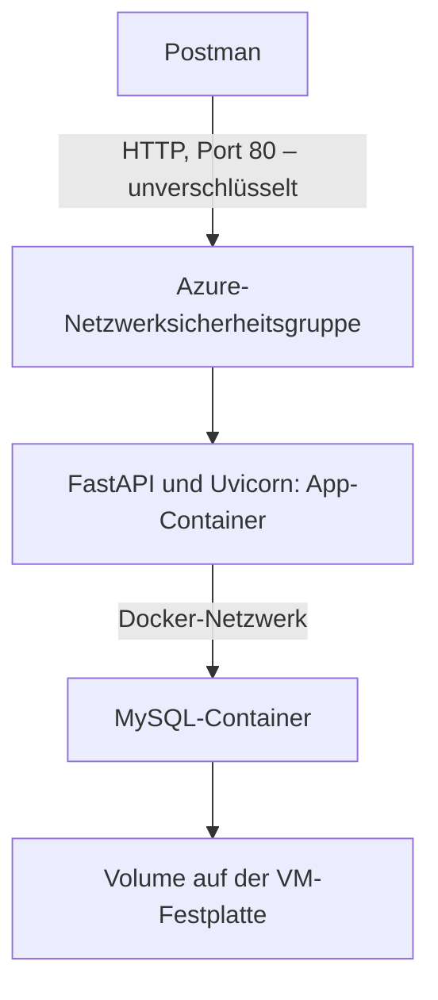
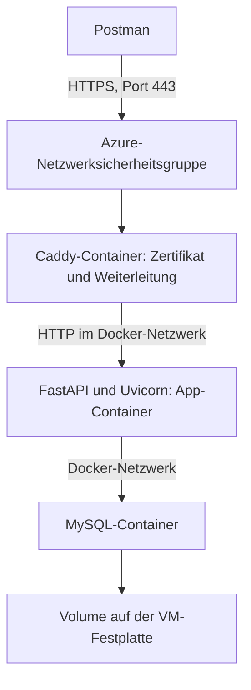
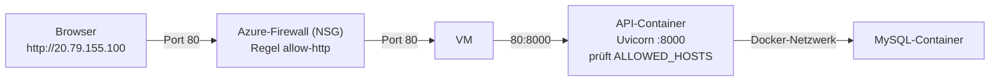

# Deployment lokal und Cloud – Dozentenskript für Tag 13

## Orientierung

- **Wir veröffentlichen die bestehende Anwendung aus Tag 12.**
- Anmeldung, Zuständigkeiten und der Async-Bericht bleiben erhalten.
- FastAPI und MySQL laufen in getrennten Containern.
- Eine eigene **Azure-VM** mit Docker betreibt dieselben Container in der Cloud.
- Zuerst veröffentlichen wir **ohne SSL** über HTTP; danach übernimmt ein **Caddy-Container** HTTPS.

| Etappe | Sichtbares Ergebnis |
| --- | --- |
| Git und GitHub | Ein nachvollziehbarer Projektstand liegt im eigenen Repository. |
| Docker-Exkursion | Die App läuft lokal im Container und verwendet einen MySQL-Container. |
| Azure-VM | Eine Linux-VM mit Docker ist per SSH erreichbar. |
| Etappe A: HTTP | Die App antwortet unter `http://ÖFFENTLICHE-IP`. |
| Etappe B: Caddy | Dieselbe App antwortet unter `https://NAME.REGION.cloudapp.azure.com`. |
| Änderung veröffentlichen | Eine neue Versionsnummer erscheint; gespeicherte Kurse bleiben erhalten. |
| Bonus CI/CD | GitHub Actions prüft den Stand und aktualisiert danach die VM per SSH. |

- **Pflichtziel: lokal starten → verpacken → auf der VM starten → HTTPS ergänzen → aktualisieren.**
- Docker-Konfiguration und Einrichtungsprogramm werden angeleitet übernommen.
- Ein Worker genügt für die Demonstration. Sync- und Async-Routen funktionieren gemeinsam.

### Zeit und Vorbereitung

| Bei einem Unterrichtstag | Richtwert ohne Pausen |
| --- | ---: |
| Auftrag, Voraussetzungen und Git | 60 Minuten |
| Docker verstehen und App vorbereiten | 75 Minuten |
| Zwei Container lokal verbinden und prüfen | 75 Minuten |
| Azure-VM, Docker und Etappe A (HTTP) | 90 Minuten |
| Etappe B: Caddy, HTTPS und Postman | 60 Minuten |
| Update und Fehlersuche | 45 Minuten |
| Transfer und Besprechung | 30 Minuten |

- Bei zwei Tagen: Tag A bis einschließlich Abschnitt 4; Tag B ab Abschnitt 5.
- **Azure-Zugang (z. B. Azure for Students), Docker Desktop und den Projektstand vorher prüfen.**
- Vorab klären, ob Teilnehmende eine VM anlegen dürfen (Kontingent, Region, Richtlinien des Abonnements).
- Grundlage ist das bereitgestellte [Cookbook-Kapitel 12][cookbook]. Quellen und Abweichungen stehen im [Anhang](#anhang-quellen-und-abgrenzung).

## 0. Unser Ausgangspunkt

- Den vollständigen Vormittagsstand von [Tag 12][tag12] weiterverwenden.
- Benötigt: `tag7` bis `tag12`, `alembic`, `alembic.ini` und die bisherigen Requirements-Dateien.
- Die Migrationen reichen bis `0005`. Nachmittagslösungen sind nicht erforderlich.
- Der Hinweisdienst auf Port 8001 bleibt ein lokaler Versuch. Er wird heute nicht veröffentlicht.

```powershell
# Im bisherigen Unterrichtsprojekt arbeiten; Pfad bei Bedarf anpassen.
Set-Location "$env:USERPROFILE\hogwarts-sql"
.\.venv\Scripts\Activate.ps1
git --version
docker version
python --version
ssh -V
python -m pip check
python -m alembic current
```

- Erwartet: Docker-Client und Docker-Server sind erreichbar; Revision `0005`.
- `ssh -V` prüft den OpenSSH-Client von Windows; wir brauchen ihn für die VM.
- Dozentenvorbereitung: Migrationen einmal auf einer leeren MySQL-Datenbank prüfen.
- **Eine neue Datenbank auf der VM enthält anfangs weder unsere Tabellen noch unsere Konten.**
- Den bisherigen Uvicorn-Server vor Abschnitt 4 beenden, damit Port 8000 frei ist.

### Vier Orte auseinanderhalten

| Ort | Was liegt dort? |
| --- | --- |
| Arbeitsordner | Bearbeitete Python-Dateien und lokale Konfiguration. |
| GitHub | Hochgeladene Commits; keine laufende App und keine MySQL-Daten. |
| App-Container | Python, Pakete und eine Kopie unseres Anwendungscodes. |
| MySQL-Volume | Dauerhaft gespeicherte Datenbankdateien – lokal und auf der VM getrennt. |

- Denkfrage: Überträgt `git push` auch unsere Kurse und Benutzerkonten?
- **Nein. Quellcode und Datenbankinhalt haben unterschiedliche Speicherorte.**

## 1. Git: Änderungen nachvollziehbar sichern

- **Git speichert Projektstände; GitHub stellt das entfernte Repository bereit.**
- Ein Commit enthält ausgewählte Dateiänderungen und eine Beschreibung.
- `push` überträgt vorhandene Commits zu GitHub. Die VM holt sie später mit `git pull`.

### 1.1 Lokale Dateien ausschließen

- Datei: `.gitignore` im Projektordner; vorhandene Regeln ergänzen.
- Beispieldateien enthalten Platzhalter. Echte Konfiguration bleibt lokal.

```gitignore
.venv/
__pycache__/
*.pyc
.pytest_cache/
.env
.env.*
!.env.example
!.env.test.example
!.env.deploy.example
*.pem
*.log
```

```powershell
git status --short
git ls-files ".env" ".env.*"
```

- `.gitignore` schützt keine bereits verfolgte Datei rückwirkend.
- Falls eine echte `.env` verfolgt wird: gezielt aus dem Index nehmen, etwa `git rm --cached -- .env`.
- Die lokale Datei bleibt bestehen. Bereits veröffentlichte Zugangsdaten ersetzen.
- **Vor jedem Commit die ausgewählten Änderungen prüfen.**

### 1.2 Commit und GitHub verbinden

- Falls bereits ein Git-Repository existiert, dessen Historie weiterverwenden.
- Nur ohne Repository einmal `git init -b main` ausführen.
- Falls nötig: `git config user.name "DEIN NAME"` und `git config user.email "DEINE COMMIT-E-MAIL"` ausführen.

```powershell
git add .
git diff --cached --stat
git diff --cached
git commit -m "Stand von Tag 12 fuer Deployment vorbereiten"
git log --oneline -3
git remote -v
```

- Auf GitHub ein eigenes leeres Repository `hogwarts-api` erstellen; zunächst ohne README.
- Falls `origin` schon auf das eigene Repository zeigt, die nächste `remote add`-Zeile überspringen.
- Ein fremdes Ziel vorher umstellen: `git remote set-url origin EIGENE-REPOSITORY-URL`.

```powershell
# DEIN-NAME durch den eigenen GitHub-Namen ersetzen.
git remote add origin https://github.com/DEIN-NAME/hogwarts-api.git
# main ist unser Veröffentlichungsbranch; vorhandenen Branchnamen prüfen.
git branch --show-current
git push -u origin main
```

| Befehl | Bedeutung |
| --- | --- |
| `git status` | Zeigt geänderte und ausgewählte Dateien. |
| `git add` | Wählt Änderungen für den nächsten Commit aus. |
| `git diff --cached` | Zeigt genau diese ausgewählten Änderungen. |
| `git commit` | Speichert den Stand lokal in Git. |
| `git push` | Überträgt Commits zum entfernten Repository. |

- Ergebnis: Die Dateien des gewählten Commits sind auf GitHub sichtbar.
- Übergang: Jetzt verpacken wir diesen Code mit seiner Laufzeitumgebung.

## 2. Mini-Exkursion: Docker verstehen

- **Ein Image ist die Vorlage; ein Container ist eine gestartete Instanz daraus.**
- Unser App-Image enthält Python, Pakete und Code.
- MySQL verwendet ein eigenes Image und läuft in einem eigenen Container.

| Begriff | In unserem Projekt |
| --- | --- |
| Dockerfile | Anleitung zum Bauen des App-Images. |
| Image | Verpackter Stand der Anwendung. |
| Container | Laufende Umgebung mit eigenem Prozess und Netzwerk. |
| Port | Anschluss eines Dienstes, etwa 8000 für die API. |
| Volume | Speicher, der einen Containerwechsel überlebt. |
| Docker Compose | Beschreibt und startet mehrere Dienste zusammen – lokal und auf der VM. |

- Container teilen einen Kernel; Docker Desktop stellt auf Windows die Linux-Umgebung bereit.
- Auf der Azure-VM läuft Docker direkt auf Ubuntu Linux.
- Denkfrage: Wo bleiben die Kurse beim Containerwechsel? Im MySQL-Volume.

### Unser Aufbau

Etappe A – ohne SSL:



Etappe B – mit Caddy:



- **Ein Reverse Proxy nimmt Anfragen entgegen und leitet sie an die App weiter.**
- Caddy holt das Zertifikat automatisch bei Let's Encrypt und erneuert es selbst.
- Die TLS-Verschlüsselung endet bei Caddy; die Weiterleitung zur App bleibt innerhalb der VM.
- Wir verwenden den kostenlosen Azure-DNS-Namen. Eine eigene Domain ist eine spätere Erweiterung.

## 3. Unsere App für den Container vorbereiten

### 3.1 Erlaubte Hosts konfigurierbar machen

- Datei: `tag10/main.py`; nur den bisherigen `app.add_middleware(...)`-Block für `TrustedHostMiddleware` ersetzen.
- `os` und `TrustedHostMiddleware` werden dort bereits importiert.
- Tag 11 und Tag 12 bauen diese App weiter; dadurch gilt die Änderung auch dort.

```python
    # Innerhalb von create_app; anstelle der bisherigen festen Hostliste.
    # API8: Nur die bewusst freigegebenen Hostnamen annehmen.
    # Die Variable enthält Hostnamen ohne https:// und ohne Port, kommagetrennt.
    # strip() entfernt Leerzeichen; leere Einträge (z. B. "a,,b") fallen weg.
    allowed_hosts = [
        host.strip()
        for host in os.environ.get(
            "ALLOWED_HOSTS", "localhost,127.0.0.1"
        ).split(",")
        if host.strip()
    ]
    app.add_middleware(
        TrustedHostMiddleware, allowed_hosts=allowed_hosts
    )
```

- Aus `"localhost, 127.0.0.1,20.79.155.100"` wird die Liste `["localhost", "127.0.0.1", "20.79.155.100"]`.
- Ohne `strip()` stünde dort `" 127.0.0.1"` mit Leerzeichen – dieser Host würde nie passen.
- **Die öffentliche IP bzw. der DNS-Name der VM muss erlaubt sein, sonst antwortet die Middleware mit 400.**
- Die Vorgabe bleibt lokal nutzbar. Kein `*` als bequemer Ersatz für die Hostliste.
- Hostprüfung und Benutzerberechtigung bleiben verschiedene Prüfungen.

### 3.2 Tag 13 ergänzt nur die Betriebsansicht

```powershell
New-Item -ItemType Directory -Force -Path .\tag13
New-Item -ItemType File -Force -Path .\tag13\__init__.py
```

<!-- file: tag13/main.py -->
- Datei: `tag13/main.py`.

```python
import os

from tag12.main import create_app as create_previous_app


def create_app(show_docs=False):
    # Der bekannte Aufbau bleibt: Auth, CRUD, Sync- und Async-Bericht.
    app = create_previous_app(show_docs=show_docs)
    app.version = "0.9.0"

    @app.get("/version")
    def read_version():
        # Zeigt, welcher Code tatsächlich im laufenden Dienst ankommt.
        return {"version": app.version}

    return app


app = create_app(show_docs=os.environ.get("API_DOCS", "0") == "1")
```

- **`/health` aus Tag 10 prüft die App-Erreichbarkeit, nicht die Datenbank.** Anmeldung und Bericht zusätzlich prüfen.

<!-- file: tag13/start.py -->
- Datei: `tag13/start.py`.

```python
import os

import uvicorn


if __name__ == "__main__":
    uvicorn.run(
        "tag13.main:app",
        host="0.0.0.0",  # Im Container auch externe Weiterleitungen annehmen.
        port=int(os.environ.get("PORT", "8000")),  # Port im Container.
        workers=1,       # Ein Prozess; kann trotzdem viele Requests bedienen.
        proxy_headers=True,  # Vertrauenswürdige Proxy-Informationen auswerten.
    )
```

| Einstellung | Warum? |
| --- | --- |
| `0.0.0.0` | Der Dienst lauscht auf allen IPv4-Schnittstellen des Containers. Es ist keine Browseradresse. |
| `PORT` | Port im Container. Welcher VM-Port dorthin führt, legt Compose fest. |
| Kein `reload` | Der veröffentlichte Code wird durch ein neues Image ersetzt. |
| Ein Worker | Kleine, verständliche Demo; jeder weitere Worker hätte eigene Pools und Speicher. |
| `proxy_headers` | Hinter Caddy erfährt die App so das ursprüngliche Protokoll `https`. |


### 3.3 Das Dockerfile

<!-- file: Dockerfile -->
- Datei: `Dockerfile` im Projektordner; großer Anfangsbuchstabe, keine Endung.
- Wir verwenden Python 3.12 im Linux-Container; diesen Stand vor dem Unterricht mit den vorhandenen Requirements prüfen.

```dockerfile
FROM python:3.12-slim

# Kein .pyc-Schreiben; Ausgaben sofort an die Container-Logs weitergeben.
ENV PYTHONDONTWRITEBYTECODE=1
ENV PYTHONUNBUFFERED=1
WORKDIR /app

# Zuerst Pakete installieren: Reine Codeänderungen können diese Schicht nutzen.
# Auch die mit -r referenzierten Requirements-Dateien müssen vorhanden sein.
COPY requirements*.txt ./
RUN python -m pip install --no-cache-dir -r requirements-tag12.txt

# .dockerignore bestimmt, welche lokalen Dateien dabei ausgeschlossen sind.
COPY . .

# Ein einfacher Benutzer ohne Root-Rechte für den laufenden App-Prozess.
USER 10001:10001
EXPOSE 8000
CMD ["python", "-m", "tag13.start"]
```

- `RUN` führt etwas beim Imagebau aus; `CMD` legt den Standardstart des Containers fest.
- **Beim Imagebau wird keine Datenbank verbunden und keine Migration ausgeführt.**
- `EXPOSE` dokumentiert einen Port. Es veröffentlicht ihn nicht auf dem Rechner.
- Die bisherigen Requirements bleiben einschließlich Testpaketen erhalten; Produktionsabhängigkeiten später trennen.

<!-- file: .dockerignore -->
- Datei: `.dockerignore` im Projektordner; unabhängig von `.gitignore`.

```dockerignore
.git
.venv
**/__pycache__
**/*.pyc
.pytest_cache
.env
.env.*
*.pem
*.log
tests
docs
fastAPI_cookbook
```

- **Git-Ausschlüsse und Docker-Ausschlüsse lösen unterschiedliche Aufgaben.**
- `.dockerignore` hält echte Zugangsdaten und das Windows-`venv` aus dem Build-Kontext heraus.
- Datenbankzugangsdaten werden dem gestarteten Container als Variablen übergeben.

## 4. Lokal: FastAPI und MySQL getrennt starten

### 4.1 Warum ändert sich der Datenbankhost?

| Aufrufer | Datenbankadresse |
| --- | --- |
| Python auf Windows, bisher | `127.0.0.1:3307`, sofern so im bisherigen Compose veröffentlicht. |
| App-Container im neuen Compose | `db:3306`, über den Dienstnamen im gemeinsamen Netzwerk. |
| App-Container auf der Azure-VM | Ebenfalls `db:3306` – dieselbe Compose-Datei. |

- **`localhost` im App-Container bezeichnet diesen App-Container.**
- MySQL läuft daneben unter `db`. Die neue Demo erhält ein eigenes Volume.
- **Auf der VM verwenden wir dieselbe Compose-Datei.** Eine kleine Ergänzungsdatei ändert nur den öffentlichen Zugang.

<!-- file: .env.deploy.example -->
- Datei: `.env.deploy.example`; als `.env.deploy` kopieren und die Platzhalter ersetzen.
- Drei unterschiedliche lange Passwörter wählen; keine echten persönlichen Passwörter verwenden.
- Die beiden unteren Zeilen werden erst auf der VM gebraucht; lokal dürfen sie Platzhalter bleiben.

```dotenv
MYSQL_PASSWORD=REPLACE_WITH_APP_DB_PASSWORD
MYSQL_ROOT_PASSWORD=REPLACE_WITH_ROOT_DB_PASSWORD
DEMO_PASSWORD=REPLACE_WITH_LONG_DEMO_PASSWORD

# Nur auf der Azure-VM: Etappe A (HTTP) und Etappe B (Caddy).
# Kommagetrennt, ohne http:// und ohne Port, z. B. localhost,127.0.0.1,20.79.155.100
ALLOWED_HOSTS=localhost,127.0.0.1,REPLACE_WITH_PUBLIC_IP
API_DOMAIN=REPLACE_WITH_DNS_NAME
```

```powershell
Copy-Item .\.env.deploy.example .\.env.deploy
# .env.deploy jetzt im Editor öffnen und die drei Passwörter ersetzen.
```

<!-- file: compose.deploy.yaml -->
- Datei: `compose.deploy.yaml`; bestehende Compose-Dateien für Unterricht und Tests behalten.
- YAML-Einrückungen beibehalten. Die Betriebsbeschreibung wird angeleitet übernommen.

```yaml
services:
  db:
    image: mysql:8.4
    environment:
      MYSQL_DATABASE: hogwarts
      MYSQL_USER: hogwarts_app
      MYSQL_PASSWORD: ${MYSQL_PASSWORD:?Set MYSQL_PASSWORD}
      MYSQL_ROOT_PASSWORD: ${MYSQL_ROOT_PASSWORD:?Set MYSQL_ROOT_PASSWORD}
    volumes:
      - hogwarts_deploy_data:/var/lib/mysql
    # Werkzeug: Erst weitergehen, wenn der App-Benutzer SQL ausführen kann.
    # $$ reicht das Dollarzeichen an die Shell IM Container weiter.
    healthcheck:
      test: ["CMD-SHELL", "MYSQL_PWD=$$MYSQL_PASSWORD mysql --protocol=TCP -h127.0.0.1 -u$$MYSQL_USER -D$$MYSQL_DATABASE -e 'SELECT 1'"]
      interval: 5s
      timeout: 5s
      retries: 30
      start_period: 20s

  api:
    build: .
    image: hogwarts-api:tag13
    environment:
      MYSQL_HOST: db
      MYSQL_PORT: "3306"
      MYSQL_DATABASE: hogwarts
      MYSQL_USER: hogwarts_app
      MYSQL_PASSWORD: ${MYSQL_PASSWORD:?Set MYSQL_PASSWORD}
      DEMO_PASSWORD: ${DEMO_PASSWORD:-}
      ALLOWED_HOSTS: localhost,127.0.0.1
      API_DOCS: "0"
      PORT: "8000"
    ports:
      - "127.0.0.1:8000:8000"
    depends_on:
      db:
        condition: service_healthy

volumes:
  hogwarts_deploy_data:
```

- MySQL hat hier keinen veröffentlichten Host-Port. Die API erreicht ihn intern.
- `8000:8000` bedeutet Rechner-Port zu Container-Port; `127.0.0.1` beschränkt den lokalen Zugang.
- `.env.deploy` liefert die Compose-Platzhalter. `environment` reicht ausgewählte Werte in den Container.
- `tag7/db.py` liest weiterhin `MYSQL_HOST`, `MYSQL_PORT` und die übrigen bekannten Variablen.
- `load_dotenv` überschreibt gesetzte Umgebungsvariablen standardmäßig nicht. Eine `.env` im Image ist unnötig.

### 4.2 Image bauen, Tabellen erzeugen, App starten

```powershell
# @deploy setzt die Elemente dieses Arrays als einzelne Befehlsargumente ein.
$deploy = @("--env-file", ".env.deploy", "-f", "compose.deploy.yaml")
docker compose @deploy build api
docker compose @deploy up -d --wait db

# run erzeugt einen kurzlebigen App-Container für genau diesen Befehl.
# Er bekommt dasselbe Netzwerk und dieselben Variablen wie der API-Dienst.
docker compose @deploy run --rm api python -m alembic upgrade head
docker compose @deploy run --rm api python -m alembic current
docker compose @deploy run --rm api python -m alembic check
docker compose @deploy up -d api
docker compose @deploy ps
docker compose @deploy logs --tail 30 api
```

- **Leere Datenbank: `upgrade head`, nicht `stamp`.**
- `upgrade` führt die vorhandenen Migrationen bis `0005` aus.
- `current` zeigt den angewendeten Stand. `check` sucht Abweichungen zwischen Modellen und Schema.
- Die Baseline erzeugt hier Tabellen. Beim alten Schema hatte `stamp` lediglich den Stand markiert.

### 4.3 Bereitgestelltes Werkzeug: einen Berichtstag einrichten

- Datei: `tag13/prepare_demo.py`; den folgenden Block vorab bereitstellen.
- **Das Werkzeug ist kein neues Lernziel.** Wir besprechen Eingaben und erzeugte Daten.
- Es erzeugt drei Konten, zwei Zuständigkeiten und vier Buchungen am 1. September 1993.
- Vector erhält drei eigene Treffer; eine fremde Buchung gehört zu Hagrid.

<details>
<summary>Bereitgestellter Code: tag13/prepare_demo.py</summary>

<!-- file: tag13/prepare_demo.py -->
```python
import os
from datetime import date

from sqlalchemy import select

from tag7.db import SessionLocal
from tag7.models import Booking, Course, Student
from tag9.models import User
from tag9.passwords import hash_password
from tag10.models import CourseManager


def main():
    # Nur für die frische Unterrichtsumgebung; keine vorhandenen Konten ändern.
    with SessionLocal.begin() as db:
        if db.scalar(select(User.id).where(User.username == "vector")):
            print("Demo bereits vorhanden; keine Daten geändert.")
            return

        password = os.environ.get("DEMO_PASSWORD", "")
        if not 16 <= len(password) <= 128 or password.startswith("REPLACE_"):
            raise SystemExit("DEMO_PASSWORD durch ein langes Demo-Passwort ersetzen.")

        users = []
        for name, role in (("vector", "staff"), ("hagrid", "staff"),
                           ("babbling", "reader")):
            user = User(username=name, role=role,
                        password_hash=hash_password(password))
            db.add(user)
            users.append(user)

        own = Course(title="Arithmantik")
        other = Course(title="Pflege magischer Geschöpfe")
        db.add_all([own, other])
        db.flush()  # IDs werden für die folgenden Zuordnungen gebraucht.
        db.add_all([
            CourseManager(course_id=own.id, user_id=users[0].id),
            CourseManager(course_id=other.id, user_id=users[1].id),
        ])

        for first, last, course in (
            ("Hermione", "Granger", own),
            ("Harry", "Potter", own),
            ("Ron", "Weasley", own),
            ("Neville", "Longbottom", other),
        ):
            student = Student(first_name=first, last_name=last,
                              house="Gryffindor", school_year=3)
            db.add(student)
            db.flush()
            db.add(Booking(student_id=student.id, course_id=course.id,
                           booking_date=date(1993, 9, 1)))
    # Kontext verlassen: Alle Beispieldaten werden gemeinsam committed.
    print("Demo eingerichtet: vector, hagrid, babbling; Berichtstag 1993-09-01.")


if __name__ == "__main__":
    main()
```

</details>

```powershell
docker compose @deploy run --rm api python -m tag13.prepare_demo
```

- Ein erneuter Aufruf lässt die Demo unverändert; Teilbestände werden nicht repariert.
- Das gemeinsame Passwort vereinfacht ausschließlich die Demo; für echte Konten individuelle Passwörter verwenden.
- Öffentlich lange Passwörter verwenden; die kurze Übungsgrenze aus Tag 9 war keine Betriebsempfehlung.

### 4.4 Lokal mit Postman prüfen

- Die [Tag-12-Collection][postman12] duplizieren und die Kopie **Tag 13 – Deployment** nennen.
- `base_url` auf `http://127.0.0.1:8000` setzen.
- `vector_password` und `reader_password` lokal mit `DEMO_PASSWORD` belegen; `reader_username=babbling`.
- `report_date=1993-09-01` setzen; gespeicherte Tokens und Berichtsreferenzen vor dem ersten Lauf leeren.

| Ausführen | Erwartung |
| --- | --- |
| Ordner 00 – Anmeldung | Healthcheck und beide Logins erfolgreich. |
| Neuer Request `GET {{base_url}}/version` | `{"version":"0.9.0"}`. |
| Ordner 02 – Berichte vergleichen | Sync und Async liefern gleiche erlaubte Seiten; insgesamt drei eigene Buchungen. |
| Ordner 03 – Rechte und Eingaben | Die vorgesehenen 401-, 403- und 422-Antworten. |
| Ordner 04 – Abmelden | Beide Tokens werden widerrufen. |

- Ordner **Demo** und **01** abwählen: Sie gehören zum getrennten Hinweisdienst auf Port 8001.
- **Der bekannte API-Vertrag funktioniert jetzt mit zwei lokalen Containern.**

## 5. Azure: eine Linux-VM mit Docker vorbereiten

- **Eine VM ist ein gemieteter Linux-Rechner. Wir verwalten ihn selbst – auch Updates und Firewall.**
- Auf der VM laufen genau die Container, die wir lokal getestet haben.
- Der Unterschied zu einer Plattform wie Railway: Mehr Kontrolle, aber auch mehr Verantwortung.

### 5.1 VM im Azure-Portal anlegen

1. Im [Azure-Portal](https://portal.azure.com) **Virtuelle Computer → Erstellen → Virtueller Azure-Computer** wählen.
2. Ressourcengruppe neu: `rg-hogwarts`. VM-Name: `vm-hogwarts`. Region: z. B. `Germany West Central`.
3. Image: **Ubuntu Server 24.04 LTS**. Größe: z. B. `Standard_B2s` (2 vCPU, 4 GiB RAM).
4. Authentifizierung: **Öffentlicher SSH-Schlüssel**, Benutzername `azureuser`, Quelle **Neues Schlüsselpaar generieren**, Schlüsselpaarname `vm-hogwarts_key`.
5. Eingehende Ports: zunächst nur **SSH (22)**. HTTP und HTTPS öffnen wir bewusst später.
6. **Überprüfen + erstellen** → **Privaten Schlüssel herunterladen und Ressource erstellen**. Der Browser speichert `vm-hogwarts_key.pem`.
7. Nach der Bereitstellung die **öffentliche IP-Adresse** notieren.

- **MySQL und das Bauen des Images brauchen Arbeitsspeicher.** Sehr kleine Größen mit 1 GiB RAM scheitern leicht.
- Empfehlung: In der Netzwerksicherheitsgruppe die SSH-Regel auf **Meine IP-Adresse** als Quelle einschränken.
- Für MySQL wird **kein** Port geöffnet. Die Datenbank bleibt im Docker-Netzwerk der VM.
- **Die `.pem`-Datei ist der private Schlüssel.** Azure bietet den Download nur einmal an. Den öffentlichen Teil hat Azure bereits auf der VM hinterlegt.

<details>
<summary>Alternative: dieselbe VM mit der Azure CLI anlegen</summary>

```powershell
# Ohne Portal: Schlüsselpaar lokal erzeugen; legt vm-hogwarts_key.pem und vm-hogwarts_key.pem.pub an.
ssh-keygen -t ed25519 -f "$HOME\.ssh\vm-hogwarts_key.pem" -C "hogwarts-azure"
az login
az group create --name rg-hogwarts --location germanywestcentral
# hogwarts-DEINNAME muss in der Region eindeutig sein; nur Kleinbuchstaben, Ziffern, Bindestrich.
az vm create `
  --resource-group rg-hogwarts `
  --name vm-hogwarts `
  --image Ubuntu2404 `
  --size Standard_B2s `
  --admin-username azureuser `
  --ssh-key-values "$HOME\.ssh\vm-hogwarts_key.pem.pub" `
  --public-ip-sku Standard `
  --public-ip-address-dns-name hogwarts-DEINNAME
az vm show --resource-group rg-hogwarts --name vm-hogwarts --show-details --query "{ip:publicIps, fqdn:fqdns}"
```

- `az vm create` öffnet bei Linux standardmäßig nur Port 22.
- Der DNS-Name aus `--public-ip-address-dns-name` wird erst in Etappe B gebraucht.

</details>

### 5.2 Privaten Schlüssel ablegen und schützen

```powershell
# Einmalig: Schlüssel aus dem Download-Ordner nach .ssh verschieben.
New-Item -ItemType Directory -Force "$HOME\.ssh" | Out-Null
Move-Item "$HOME\Downloads\vm-hogwarts_key.pem" "$HOME\.ssh\vm-hogwarts_key.pem"

# Nur der eigene Benutzer darf die Datei lesen.
icacls "$HOME\.ssh\vm-hogwarts_key.pem" /inheritance:r
icacls "$HOME\.ssh\vm-hogwarts_key.pem" /grant:r "$($env:USERNAME):R"
icacls "$HOME\.ssh\vm-hogwarts_key.pem"
```

- `/inheritance:r` entfernt alle vom Ordner geerbten Rechte.
- `/grant:r "<Benutzer>:R"` gibt nur dem eigenen Benutzer Leserechte.
- **Ohne diesen Schritt** verweigert OpenSSH den Schlüssel mit `UNPROTECTED PRIVATE KEY FILE`.
- Die `.pem`-Datei gehört **nie** ins Projekt-Repository.

### 5.3 Per SSH verbinden und Docker installieren

```powershell
# ÖFFENTLICHE-IP durch die notierte Adresse ersetzen.
ssh -i "$HOME\.ssh\vm-hogwarts_key.pem" azureuser@ÖFFENTLICHE-IP
```

- Beim ersten Verbinden fragt SSH nach dem Host-Fingerprint; mit `yes` bestätigen.
- **Ab hier laufen die Befehle in der Linux-Shell der VM, nicht in PowerShell.**
- Wir installieren Docker Engine und das Compose-Plugin aus dem offiziellen Docker-Repository.

```bash
# Systempakete aktualisieren; git wird zum Klonen gebraucht.
sudo apt-get update
sudo apt-get upgrade -y
sudo apt-get install -y ca-certificates curl git

# Offizielles Docker-Repository mit Signaturschlüssel einbinden.
sudo install -m 0755 -d /etc/apt/keyrings
sudo curl -fsSL https://download.docker.com/linux/ubuntu/gpg -o /etc/apt/keyrings/docker.asc
sudo chmod a+r /etc/apt/keyrings/docker.asc
echo "deb [arch=$(dpkg --print-architecture) signed-by=/etc/apt/keyrings/docker.asc] https://download.docker.com/linux/ubuntu $(. /etc/os-release && echo "$VERSION_CODENAME") stable" \
  | sudo tee /etc/apt/sources.list.d/docker.list > /dev/null

sudo apt-get update
sudo apt-get install -y docker-ce docker-ce-cli containerd.io docker-buildx-plugin docker-compose-plugin

# docker ohne sudo verwenden; wirkt erst nach erneuter Anmeldung.
sudo usermod -aG docker "$USER"
exit
```

```powershell
ssh -i "$HOME\.ssh\vm-hogwarts_key.pem" azureuser@ÖFFENTLICHE-IP
```

```bash
docker version
docker compose version
docker run --rm hello-world
```

- Erwartet: Client **und** Server werden angezeigt; `hello-world` gibt eine Begrüßung aus.
- **Die Gruppe `docker` entspricht praktisch Root-Rechten.** Nur vertrauenswürdige Konten aufnehmen.
- Der Docker-Dienst startet nach einem VM-Neustart automatisch.

### 5.4 Projekt auf die VM holen und Zugangsdaten anlegen

```bash
# Zielordner hogwarts-api: Die folgenden Abschnitte arbeiten mit ~/hogwarts-api.
git clone https://github.com/pietow/cimdata_python_mysql_live.git hogwarts-api
cd hogwarts-api
git log --oneline -1
```

- Öffentliches Repository: Klonen ohne Anmeldung.
- Privates Repository: einen schreibgeschützten **Deploy Key** für dieses Repository verwenden; kein persönliches Passwort auf der VM speichern.
- **Die VM holt den Code von GitHub. Das lokal gebaute Image wird nicht übertragen.**

```bash
cp .env.deploy.example .env.deploy
chmod 600 .env.deploy
nano .env.deploy
```

- **Neue Passwörter nur für die VM wählen.** Nicht die lokalen Werte wiederverwenden.
- `ALLOWED_HOSTS`: `localhost,127.0.0.1,` gefolgt von der öffentlichen IP der VM.
- `API_DOMAIN` bleibt bis Etappe B ein Platzhalter.

So sieht `.env.deploy` auf der VM danach aus (Beispiel-IP `20.79.155.100`):

```dotenv
MYSQL_PASSWORD=eigenes-langes-app-passwort
MYSQL_ROOT_PASSWORD=eigenes-langes-root-passwort
DEMO_PASSWORD=eigenes-langes-demo-passwort

# Nur auf der Azure-VM: Etappe A (HTTP) und Etappe B (Caddy).
# Kommagetrennt, ohne http:// und ohne Port, z. B. localhost,127.0.0.1,20.79.155.100
ALLOWED_HOSTS=localhost,127.0.0.1,20.79.155.100
API_DOMAIN=REPLACE_WITH_DNS_NAME
```

- **Nur den Hostnamen eintragen.** Falsch: `http://20.79.155.100` oder `20.79.155.100:80`.
- `localhost` und `127.0.0.1` bleiben drin: `curl http://127.0.0.1/health` auf der VM selbst soll weiter funktionieren.
- In `nano`: Speichern mit `Strg+O`, Enter; Beenden mit `Strg+X`.
- `chmod 600` erlaubt nur dem eigenen Benutzer das Lesen der Datei.

## 6. Etappe A: veröffentlichen ohne SSL

- **Ziel: Die App ist aus dem Internet über `http://ÖFFENTLICHE-IP` erreichbar.**
- Uvicorn lauscht weiter auf Port 8000 im Container; die VM leitet Port 80 dorthin.
- Diese Etappe zeigt den Aufbau ohne weitere Bausteine. Sie ist **kein Dauerzustand**.

### 6.1 Ergänzungsdatei für den HTTP-Zugang

<!-- file: compose.http.yaml -->
- Datei: `compose.http.yaml` im Projektordner; lokal anlegen, committen und pushen.
- Sie ergänzt `compose.deploy.yaml`; die Grunddatei bleibt unverändert.

```yaml
# Etappe A: API direkt über Port 80 – ohne Verschlüsselung, nur zur Demonstration.
services:
  db:
    restart: unless-stopped

  api:
    restart: unless-stopped
    environment:
      ALLOWED_HOSTS: ${ALLOWED_HOSTS:?Set ALLOWED_HOSTS}
    # !override ersetzt die lokale Portliste vollständig, statt sie zu ergänzen.
    ports: !override
      - "80:8000"
```

| Eintrag | Bedeutung |
| --- | --- |
| Mehrere `-f`-Dateien | Compose führt sie der Reihe nach zusammen; spätere Werte gewinnen. |
| `restart: unless-stopped` | Container starten nach Absturz oder VM-Neustart wieder. |
| `ALLOWED_HOSTS` | Kommt aus `.env.deploy`; enthält die öffentliche IP. |
| `"80:8000"` | VM-Port 80 auf allen Schnittstellen → Container-Port 8000. |

**Die Datei ändert drei Dinge – nicht nur den Port.**

**Wie das Zusammenführen funktioniert**

- `compose.deploy.yaml` beschreibt die vollständigen Dienste: Image, Datenbank, Volume, Healthcheck.
- `compose.http.yaml` enthält nur die **Unterschiede** für Etappe A. Allein ist sie nicht lauffähig.
- Mit `-f compose.deploy.yaml -f compose.http.yaml` legt Compose die zweite Datei über die erste.
- Einzelwerte wie `restart` werden ergänzt oder überschrieben. Einträge unter `environment` werden einzeln ersetzt; die übrigen Variablen bleiben.
- Prüfen, was am Ende wirklich gilt: `docker compose "${http[@]}" config` zeigt das zusammengeführte Ergebnis.

**1. `restart: unless-stopped`**

- Lokal starten wir Container von Hand; ein Neustart-Verhalten brauchen wir dort nicht.
- Auf der VM soll die API nach einem Absturz oder einem Neustart der VM von selbst wieder laufen.
- `unless-stopped`: Docker startet den Container immer neu – außer wir haben ihn selbst mit `docker compose stop` angehalten.
- Beide Dienste erhalten die Regel. Ohne laufende Datenbank wäre die API nutzlos.

**2. `ALLOWED_HOSTS` aus `.env.deploy`**

- In `compose.deploy.yaml` steht fest `ALLOWED_HOSTS: localhost,127.0.0.1`. Das reicht für Tests auf dem eigenen Rechner.
- Der Browser schickt bei `http://20.79.155.100/health` den Header `Host: 20.79.155.100`.
- Die `TrustedHostMiddleware` aus Abschnitt 3.1 vergleicht diesen Header mit der Liste. Fehlt die IP, antwortet sie mit **`400 Invalid host header`** – noch bevor eine Route läuft.
- `${ALLOWED_HOSTS:?Set ALLOWED_HOSTS}` liest den Wert aus `.env.deploy` (Beispiel in Abschnitt 5.4).
- `:?` bricht den Start mit der Meldung `Set ALLOWED_HOSTS` ab, wenn die Variable fehlt oder leer ist. So fällt ein Tippfehler sofort auf, nicht erst im Browser.

**3. Port 80 statt 127.0.0.1:8000**

- In `compose.deploy.yaml` steht `"127.0.0.1:8000:8000"`. Die API ist dann **nur auf der VM selbst** erreichbar.
- `"80:8000"` bedeutet: Port 80 der VM auf **allen** Netzwerkschnittstellen → Port 8000 im Container.
- Port 80 ist der Standardport für HTTP. Darum genügt im Browser `http://20.79.155.100` ohne `:8000`.
- **Ohne `!override` würde Compose beide Listen zusammenführen.** Der Container hätte dann beide Mappings.
- `!override` ersetzt die Portliste vollständig. Es bleibt genau eine Regel: `80:8000`.
- Damit Anfragen von außen ankommen, muss Port 80 zusätzlich in der Azure-Firewall offen sein (Abschnitt 6.3).



```powershell
# Lokal im Projektordner.
git add compose.http.yaml .env.deploy.example
git commit -m "HTTP-Zugang fuer Azure-VM ergaenzen"
git push
```

### 6.2 Auf der VM starten, migrieren, Demo einrichten

```bash
# Auf der VM im Ordner hogwarts-api.
git pull
# Bash-Array: entspricht @deploy aus PowerShell.
http=(--env-file .env.deploy -f compose.deploy.yaml -f compose.http.yaml)

docker compose "${http[@]}" config --quiet
docker compose "${http[@]}" build api
docker compose "${http[@]}" up -d --wait db
docker compose "${http[@]}" run --rm api python -m alembic upgrade head
docker compose "${http[@]}" run --rm api python -m alembic current
docker compose "${http[@]}" run --rm api python -m tag13.prepare_demo
docker compose "${http[@]}" up -d api
docker compose "${http[@]}" ps
curl -s http://127.0.0.1/health
```

- **Dieselben Schritte wie lokal – nur auf einem anderen Rechner.**
- `config --quiet` meldet fehlende Variablen und YAML-Fehler, bevor etwas startet.
- `run` veröffentlicht keine Ports; der kurzlebige Container blockiert Port 80 nicht.
- Der erste Build dauert länger: Die VM lädt Python-Image und Pakete selbst.

### 6.3 Port 80 freigeben und von außen prüfen

1. Im Portal die VM öffnen → **Netzwerk** → **Regel für eingehenden Port hinzufügen**.
2. Zielportbereich `80`, Protokoll `TCP`, Aktion **Zulassen**, Name `allow-http`.
3. Speichern; die Regel greift nach wenigen Sekunden.

```powershell
# Alternative mit der Azure CLI.
az vm open-port --resource-group rg-hogwarts --name vm-hogwarts --port 80 --priority 1010
```

- Im Browser `http://ÖFFENTLICHE-IP/health` und `/version` öffnen.
- In der Tag-13-Collection eine Postman-Umgebung **Azure** anlegen: `base_url=http://ÖFFENTLICHE-IP`.
- Passwortwerte auf das Demo-Passwort der VM setzen; Tokens und Berichtsreferenzen leeren.
- Ordner 00 ausführen und `/version` prüfen.
- **Lokale Tokens und lokale IDs gehören nicht zur Datenbank auf der VM.**

### 6.4 Warum Etappe A nicht so bleibt

- **Ohne TLS gehen Passwort und Bearer-Token im Klartext durchs Netz.**
- Jeder Rechner auf dem Weg könnte mitlesen und das Token weiterverwenden.
- Darum in Etappe A nur Demo-Konten verwenden und danach direkt zu Etappe B wechseln.
- Denkfrage: Hilft hier Passwort-Hashing? **Nein. Hashing schützt die gespeicherten Passwörter, nicht die Übertragung.**

## 7. Etappe B: HTTPS mit einem Caddy-Container

- **Caddy ist ein Webserver, der als Reverse Proxy automatisch HTTPS einrichtet.**
- Er beantragt beim Start ein Zertifikat bei Let's Encrypt und erneuert es selbst.
- Ab jetzt ist nur noch Caddy öffentlich erreichbar. Die API hat keinen veröffentlichten Port mehr.

### 7.1 DNS-Namen und Port 443 einrichten

- **Let's Encrypt stellt Zertifikate für Domainnamen aus.** Wir nutzen den kostenlosen Azure-DNS-Namen.

1. Im Portal die **öffentliche IP-Adresse** der VM öffnen → **Konfiguration**.
2. **DNS-Namensbezeichnung** setzen, etwa `hogwarts-deinname`; speichern.
3. Der vollständige Name lautet dann etwa `hogwarts-deinname.germanywestcentral.cloudapp.azure.com`.
4. Unter **Netzwerk** eine weitere Eingangsregel für Port `443` (TCP) anlegen, Name `allow-https`.
5. **Port 80 offen lassen.** Let's Encrypt prüft darüber die Domain, und Caddy leitet HTTP auf HTTPS um.

```powershell
# Prüfen, ob der Name auf die VM zeigt.
Resolve-DnsName hogwarts-deinname.germanywestcentral.cloudapp.azure.com
# Alternative zu Schritt 4 mit der Azure CLI.
az vm open-port --resource-group rg-hogwarts --name vm-hogwarts --port 443 --priority 1020
```

- Auf der VM in `.env.deploy` `API_DOMAIN` auf diesen vollständigen Namen setzen.
- Bei der Statischen-IP-Option (Standard-SKU) bleibt die Adresse auch nach einem Neustart gleich.

### 7.2 Die Caddy-Konfiguration

<!-- file: Caddyfile -->
- Datei: `Caddyfile` im Projektordner; großer Anfangsbuchstabe, keine Endung.

```caddyfile
# {$API_DOMAIN} liest die Umgebungsvariable des Caddy-Containers.
{$API_DOMAIN} {
	# Alle Anfragen an den App-Container im Docker-Netzwerk weiterreichen.
	reverse_proxy api:8000
}
```

- **Drei Zeilen genügen: Domain, Ziel – und HTTPS ist eingeschaltet.**
- Caddy setzt `X-Forwarded-For` und `X-Forwarded-Proto` für die App.
- Der ursprüngliche `Host`-Header wird weitergereicht; `ALLOWED_HOSTS` muss die Domain enthalten.
- Caddyfiles werden üblicherweise mit Tabulatoren eingerückt.

### 7.3 Ergänzungsdatei für Caddy

<!-- file: compose.caddy.yaml -->
- Datei: `compose.caddy.yaml`; ersetzt in Etappe B die Datei `compose.http.yaml` beim Start.

```yaml
# Etappe B: Nur Caddy ist öffentlich; die API bleibt im Docker-Netzwerk.
services:
  db:
    restart: unless-stopped

  api:
    restart: unless-stopped
    environment:
      ALLOWED_HOSTS: localhost,127.0.0.1,${API_DOMAIN:?Set API_DOMAIN}
      # Weiterleitungsinformationen von Caddy vertrauen; die API ist von außen nicht erreichbar.
      FORWARDED_ALLOW_IPS: "*"
    # !reset entfernt jede Portveröffentlichung der API.
    ports: !reset []

  caddy:
    image: caddy:2.10
    restart: unless-stopped
    environment:
      API_DOMAIN: ${API_DOMAIN:?Set API_DOMAIN}
    ports:
      - "80:80"
      - "443:443"
    volumes:
      - ./Caddyfile:/etc/caddy/Caddyfile:ro
      - caddy_data:/data
      - caddy_config:/config
    depends_on:
      - api

volumes:
  caddy_data:
  caddy_config:
```

| Eintrag | Bedeutung |
| --- | --- |
| `ports: !reset []` | Die API hat keinen VM-Port mehr; nur Caddy erreicht sie unter `api:8000`. |
| `FORWARDED_ALLOW_IPS` | Uvicorn wertet `X-Forwarded-Proto` von Caddy aus und erkennt `https`. |
| `caddy_data` | Speichert Zertifikat und Schlüssel; überlebt Containerwechsel. |
| `./Caddyfile:…:ro` | Die Konfiguration aus dem Repository, nur lesend eingebunden. |

- **`FORWARDED_ALLOW_IPS="*"` ist nur sicher, weil die API keinen öffentlichen Port hat.**
- Das ist keine Hostfreigabe. Der Platzhalter `*` gehört ausdrücklich nicht in `ALLOWED_HOSTS`.
- `caddy_data` nicht löschen: Sonst beantragt Caddy neue Zertifikate; Let's Encrypt begrenzt wiederholte Anträge.
- Vor dem Unterricht den aktuellen Patch-Stand des Caddy-Images prüfen und festschreiben.

```powershell
# Lokal im Projektordner.
git add Caddyfile compose.caddy.yaml
git commit -m "Caddy als HTTPS-Reverse-Proxy ergaenzen"
git push
```

### 7.4 Auf der VM umschalten

```bash
cd ~/hogwarts-api
git pull
http=(--env-file .env.deploy -f compose.deploy.yaml -f compose.http.yaml)
caddy=(--env-file .env.deploy -f compose.deploy.yaml -f compose.caddy.yaml)

docker compose "${caddy[@]}" config --quiet
# Etappe A beenden; ohne -v bleibt das MySQL-Volume erhalten.
docker compose "${http[@]}" down
docker compose "${caddy[@]}" up -d
docker compose "${caddy[@]}" ps
docker compose "${caddy[@]}" logs --tail 50 caddy
```

- In den Caddy-Logs auf `certificate obtained successfully` achten; das dauert meist wenige Sekunden.
- **Dieselbe Datenbank, dasselbe Volume:** Die Demo-Konten aus Etappe A sind weiterhin vorhanden.
- Keine Migration nötig: Der Code hat sich nicht geändert.

### 7.5 Mit Postman über HTTPS nachweisen

- In der Postman-Umgebung **Azure** `base_url=https://hogwarts-deinname.germanywestcentral.cloudapp.azure.com` setzen.
- Tokens und Berichtsreferenzen leeren und neu anmelden.
- Zusätzlich `http://…` aufrufen: Caddy antwortet mit einer Umleitung auf `https://`.

1. Ordner 00 ausführen; anschließend `/version` prüfen.
2. Ordner 02 ausführen: gleiche Sync-/Async-Ergebnisse und eine zweite Seite.
3. Ordner 03 ausführen: Leserrolle und ungültige Eingaben bleiben eingeschränkt.
4. Vor dem Logout einen eigenen Kurs mit dem Vector-Token anlegen; die zurückgegebene ID notieren.

```http
POST {{base_url}}/courses
Authorization: Bearer {{vector_token}}
Content-Type: application/json

{"title": "Alte Runen – Cloud-Nachweis"}
```

- In Postman: Methode `POST`, Body → raw → JSON; Bearer-Token aus `vector_token`.
- Erwartet: `201`; anschließend `GET {{base_url}}/courses/NOTIERTE_ID` mit demselben Token prüfen.
- Die Route legt weiterhin die bekannte Zuständigkeit an. Deployment ersetzt keine Rechteprüfung.
- **Nachweis: HTTPS, Anmeldung, Lesen und Schreiben funktionieren außerhalb des lokalen Rechners.**

### Was HTTPS hier leistet

- HTTPS schützt die Übertragung zwischen Postman und Caddy auf der VM.
- Das Zertifikat stellt Let's Encrypt aus; Caddy beantragt und erneuert es automatisch.
- Von Caddy zur App läuft HTTP – aber nur im Docker-Netzwerk derselben VM.
- HTTPS ersetzt weder Passwort-Hashing noch Rollen oder Datensatzrechte.
- Keine lokalen `mkcert`-Zertifikate und keine eigene Nginx-Konfiguration für diesen Deploymentweg nötig.
- Eine HTTPS-Middleware kann einen TLS-Handshake auf einem reinen TLS-Port nicht nachträglich reparieren; das entsprechende Buchbeispiel übernehmen wir nicht.
- Nach dem Wechsel die Demo-Passwörter aus Etappe A als bekannt betrachten; für echte Konten wären sie jetzt zu ersetzen.

## 8. Eine Änderung veröffentlichen und Daten behalten

- In `tag13/main.py` nur `app.version` von `0.9.0` auf `0.9.1` ändern.
- Frage vorab: An welchen Stellen ist die Änderung nach Speichern, Commit und Push schon vorhanden?

```powershell
git diff
git add .\tag13\main.py
git commit -m "Version 0.9.1 fuer Cloud-Update markieren"
git push
```

1. `/version` in der Cloud erneut aufrufen: Dort steht noch `0.9.0`. **Die VM holt Änderungen nicht von selbst.**
2. Auf der VM den neuen Stand holen, das Image neu bauen, migrieren und die API ersetzen:

```bash
cd ~/hogwarts-api
git pull
caddy=(--env-file .env.deploy -f compose.deploy.yaml -f compose.caddy.yaml)
docker compose "${caddy[@]}" build api
docker compose "${caddy[@]}" run --rm api python -m alembic upgrade head
docker compose "${caddy[@]}" up -d
docker compose "${caddy[@]}" ps
```

3. `/version` muss jetzt `0.9.1` liefern; `git log --oneline -1` auf der VM zeigt den passenden Commit.
4. Den zuvor angelegten Kurs über die notierte ID erneut lesen.
5. Ordner 04 ausführen und die Tokens abmelden.

- **Neuer App-Container, weiterhin dieselbe Datenbank und dasselbe Volume.**
- `up -d` ersetzt nur Container, deren Image oder Konfiguration sich geändert hat; MySQL und Caddy laufen weiter.
- Ein Neustart (`restart`) startet vorhandenen Code neu; erst Build und `up` stellen neuen Code bereit.
- Ein App-Rollback setzt Datenbankmigrationen nicht automatisch zurück.
- Tabellenänderungen deshalb prüfen und mit alten/neuen App-Versionen verträglich planen.

### Sauber beenden und Kosten vermeiden

```powershell
# Lokal: Container stoppen; das benannte Datenbank-Volume bleibt bestehen.
docker compose @deploy down
```

```powershell
# Azure: VM freigeben – keine Rechenkosten mehr, Festplatte und IP bleiben.
az vm deallocate --resource-group rg-hogwarts --name vm-hogwarts
# Später wieder starten; dank restart: unless-stopped laufen die Container von selbst an.
az vm start --resource-group rg-hogwarts --name vm-hogwarts
# Nach dem Kurs: alles in der Ressourcengruppe endgültig löschen – auch die Datenbank.
az group delete --name rg-hogwarts
```

- **Nur „Beenden“ im Betriebssystem reicht nicht.** Erst „Beenden (Zuordnung aufheben)“ bzw. `deallocate` stoppt die Rechenkosten.
- Festplatte und statische öffentliche IP kosten auch im freigegebenen Zustand eine kleine Gebühr.
- Ein Volume auf der VM-Festplatte ist dauerhafter Speicher, aber kein Backup.

## 9. Fehlersuche und Transfer

### Von außen nach innen prüfen

| Beobachtung | Zuerst prüfen |
| --- | --- |
| `ssh` hängt oder bricht ab | NSG-Regel für Port 22, Quell-IP-Einschränkung, richtige öffentliche IP. |
| `permission denied … docker.sock` | Nach `usermod -aG docker` ab- und neu angemeldet? |
| Imagebau scheitert | Dockerfile, Requirements-Dateien, Installationsfehler; VM-Arbeitsspeicher. |
| App startet nicht | `docker compose … logs api`: Importpfad, gesetzte DB-Variablen. |
| Browser: Zeitüberschreitung | NSG-Regel für Port 80/443, `docker compose … ps`, Portzuordnung. |
| `400 Invalid host header` | Tatsächliche IP bzw. Domain in `ALLOWED_HOSTS`; Container danach neu erzeugt? |
| Caddy erhält kein Zertifikat | DNS-Name zeigt auf die VM? Port 80 **und** 443 offen? `API_DOMAIN` gesetzt? |
| `502 Bad Gateway` von Caddy | API-Container läuft? Ziel im Caddyfile genau `api:8000`? |
| Migration scheitert | MySQL bereit? Host `db`? Passwort? Richtige Datenbank? |
| `401` beim Bericht | Frischer Cloud-Login, gültiges Token, Header. |
| `403` oder leerer Bericht | Rolle, Kurszuordnung und vorhandener Berichtstag. |
| Nach Push bleibt alte Version | Auf der VM `git pull`, `build` und `up -d` ausgeführt? |

- **Statuscode, konkrete Anfrage und passende Logs zusammen betrachten.**
- Keine Passwörter, Tokens, `.env.deploy`-Inhalte oder privaten SSH-Schlüssel in Screenshots und geteilte Exporte aufnehmen.

### Kurze Transferaufträge

| Auftrag | Nachweis | Besprechung für Dozenten |
| --- | --- | --- |
| Eine neue Versionsnummer veröffentlichen. | Neuer Commit, neues Image, passende `/version`-Antwort. | Die laufende Version muss zum Commit auf der VM passen. |
| Einen anderen erlaubten Kurstitel anlegen und nach dem Update lesen. | Gleiche ID und gleicher Titel vor/nach dem App-Update. | Codewechsel und Datenspeicherung sind getrennt. |
| Erklären, weshalb `MYSQL_HOST=127.0.0.1` im App-Container falsch ist. | Aufbau mit drei Containern aufzeichnen. | Die Loopback-Adresse zeigt auf den jeweiligen Container. |
| Erklären, warum die API in Etappe B keinen Port mehr veröffentlicht. | `docker compose … ps` zeigt nur Caddy mit 80/443. | Sonst ließe sich Caddy und damit HTTPS umgehen. |
| Ein Schüler erhält 403. Liegt es an Docker? | Rolle und Zuständigkeit anhand eines Requests prüfen. | Ein erreichbarer Dienst kann fachlich korrekt ablehnen. |

- Abschließende Frage: Welche Daten gehören zu Git, zum Image, zu `.env.deploy` und zum Volume?
- Pflicht abgeschlossen, wenn der Cloud-Kurs nach einem App-Update über HTTPS weiter abrufbar ist.

## 10. Bonus: GitHub Actions und automatisches Deployment

- **CI prüft Änderungen automatisch; CD veröffentlicht einen geprüften Stand.**
- GitHub Actions übernimmt beides: erst Tests, danach die Befehle aus Abschnitt 8 per SSH auf der VM.
- Wir verwenden eine einzige Cloud-Umgebung; eine getrennte Staging-VM entfällt aus Kostengründen.
- Staging wäre eine zusätzliche Prüf-Umgebung vor Produktion, nicht bloß ein anderer Name derselben laufenden Umgebung.

### 10.1 Bereitgestellter CI-Workflow

- Datei: `.github/workflows/ci.yml`; als fertiges Werkzeug übernehmen.
- Voraussetzung: vorhandenes `compose.test.yaml`, `tag8.init_test_db` und Tag-12-Tests liegen im Repository.
- Der GitHub-Linux-Runner startet eine **eigene echte MySQL-Testdatenbank**. Keine Cloud-Zugangsdaten und keine Mocks.

<details>
<summary>Bereitgestellter Code: .github/workflows/ci.yml</summary>

<!-- file: .github/workflows/ci.yml -->
```yaml
name: Hogwarts CI

on:
  push:
    branches: [main]
  pull_request:

jobs:
  tests:
    runs-on: ubuntu-latest
    permissions:
      contents: read
    env:
      # Nur für den Import der bisherigen App; DB-Tests nutzen eigene Fixtures.
      MYSQL_PASSWORD: unused-import-value
    steps:
      - uses: actions/checkout@v7
      - uses: actions/setup-python@v7
        with:
          python-version: "3.12"
      - name: Pakete installieren
        run: python -m pip install -r requirements-tag12.txt
      - name: Wegwerf-Testzugang vorbereiten
        run: |
          python - <<'PY'
          from pathlib import Path
          Path(".env.test").write_text(
              "TEST_MYSQL_ROOT_PASSWORD=ci-root-only\n"
              "TEST_MYSQL_PASSWORD=ci-test-only\n"
              "TEST_MYSQL_PORT=3308\n"
          )
          PY
      - name: Echte Testdatenbank starten
        run: docker compose --env-file .env.test -f compose.test.yaml up -d --wait test_db
      - name: Testschema migrieren
        run: python -m tag8.init_test_db
      - name: Bekannte Tests ausfuehren
        run: python -m pytest tests/tag12 -q
      - name: App-Image bauen
        run: docker build -t hogwarts-api:ci .
      - name: Testcontainer aufraeumen
        if: always()
        run: docker compose --env-file .env.test -f compose.test.yaml down --volumes
```

</details>

- Diese Passwörter gelten ausschließlich für den kurzlebigen CI-Testcontainer.
- `--volumes` ist hier absichtlich: Die CI-Testdaten werden verworfen.
- Der Workflow prüft die bekannten Tag-12-Funktionen und den Imagebau; er verändert die VM noch nicht.
- Der Postman-Cloudcheck bleibt erforderlich: DNS, Zertifikat, Variablen und Erreichbarkeit sind damit noch nicht geprüft.

### 10.2 Nach erfolgreicher CI die VM aktualisieren

1. Lokal ein **eigenes** Schlüsselpaar nur für GitHub erzeugen: `ssh-keygen -t ed25519 -f "$HOME\.ssh\hogwarts_deploy"`; Passphrase leer lassen, da GitHub ohne Eingabe arbeitet.
2. Den Inhalt von `hogwarts_deploy.pub` auf der VM an `~/.ssh/authorized_keys` anhängen.
3. Lokal `ssh-keyscan -t ed25519 ÖFFENTLICHE-IP` ausführen; die ausgegebene Zeile ist der Wert für `VM_KNOWN_HOSTS`. Zur Kontrolle auf der VM `ssh-keygen -lf /etc/ssh/ssh_host_ed25519_key.pub` mit dem Fingerprint vergleichen.
4. Im GitHub-Repository unter **Settings → Secrets and variables → Actions** anlegen: `VM_HOST`, `VM_USER` (`azureuser`), `VM_SSH_KEY` (Inhalt von `hogwarts_deploy`), `VM_KNOWN_HOSTS`.
5. Den folgenden Job in `.github/workflows/ci.yml` unter `jobs:` ergänzen, committen und pushen.

<details>
<summary>Bereitgestellter Code: Deploy-Job für .github/workflows/ci.yml</summary>

```yaml
  deploy:
    # Nur nach erfolgreichen Tests und nur für Pushes auf main.
    needs: tests
    if: github.event_name == 'push' && github.ref == 'refs/heads/main'
    runs-on: ubuntu-latest
    permissions:
      contents: read
    concurrency: production
    steps:
      - name: SSH-Zugang vorbereiten
        run: |
          install -m 700 -d ~/.ssh
          printf '%s\n' "${{ secrets.VM_SSH_KEY }}" > ~/.ssh/id_ed25519
          chmod 600 ~/.ssh/id_ed25519
          printf '%s\n' "${{ secrets.VM_KNOWN_HOSTS }}" > ~/.ssh/known_hosts
      - name: VM aktualisieren
        run: |
          ssh "${{ secrets.VM_USER }}@${{ secrets.VM_HOST }}" bash -s <<'SH'
          set -euo pipefail
          cd ~/hogwarts-api
          git pull --ff-only
          caddy=(--env-file .env.deploy -f compose.deploy.yaml -f compose.caddy.yaml)
          docker compose "${caddy[@]}" build api
          docker compose "${caddy[@]}" run --rm api python -m alembic upgrade head
          docker compose "${caddy[@]}" up -d
          SH
```

</details>

6. Eine neue Versionsnummer pushen und den Ablauf unter GitHub → Actions bis zur `/version`-Antwort beobachten.
7. In einem weiteren Commit absichtlich einen bekannten Test fehlschlagen lassen; zeigen, dass `deploy` übersprungen wird. Danach reparieren.

- `needs: tests` ist die Sperre: **Ohne grüne Tests wird nichts veröffentlicht.**
- `concurrency` verhindert zwei gleichzeitige Deployments auf dieselbe VM.
- GitHub-Runner haben wechselnde IP-Adressen; SSH muss dafür aus dem Internet erreichbar sein – nur per Schlüssel, nie per Passwort.
- Migrationen laufen auf der VM; die Tests greifen niemals auf die Produktionsdatenbank zu.
- In einer echten Produktion kämen unter anderem Backup-/Wiederherstellungskonzept, Betriebssystem-Updates und Überwachung hinzu.

## Anhang: Quellen und Abgrenzung

| Cookbook-Abschnitt | Verwendung für Tag 13 |
| --- | --- |
| Running the server with the FastAPI CLI | Startprinzip übernehmen; beim bekannten Uvicorn bleiben. |
| Enabling HTTPS on FastAPI applications | Zweck von HTTPS erklären; Zertifikat über Caddy und Let's Encrypt. |
| Running FastAPI applications in Docker containers | Dockerfile, Build und Container auf unsere App übertragen. |
| Running the server across multiple workers | Nur einordnen; keine zusätzliche Gunicorn-Übung. |
| Deploying your FastAPI application on the cloud | Azure-VM mit Docker Compose statt Plattformdienst; kein Procfile. |
| Shipping FastAPI applications with Hatch | Auslassen; keine Paketveröffentlichung für dieses Lernziel nötig. |

- Eigene Ergänzungen: Git-Einstieg, MySQL-Volume, Hostkonfiguration, Migrationen, Beispieldaten, VM-Einrichtung, Caddy und Postman-Nachweise.
- Stand der Beschreibung: **Oktober 2026**. Portal-Bezeichnungen, Image-Versionen und VM-Größen vor dem Unterricht prüfen.
- [Dockerfile-Referenz][dockerfile], [Compose][compose], [Zusammenführen von Compose-Dateien][compose-merge], [FastAPI in Containern][fastapi-docker].
- [Linux-VM im Azure-Portal][azure-vm-portal], [Linux-VM mit der Azure CLI][azure-vm-cli], [DNS-Name für die VM][azure-fqdn], [Netzwerksicherheitsgruppen][azure-nsg].
- [Docker Engine auf Ubuntu][docker-ubuntu], [Docker ohne sudo][docker-postinstall] und [offizielles MySQL-Image][mysql-image].
- [Caddy als Reverse Proxy][caddy-proxy], [automatisches HTTPS][caddy-https] und [Caddy-Image][caddy-image].
- [FastAPI hinter einem Proxy][proxy] erklärt die Weiterleitungsinformationen.
- Bonuswerkzeuge: [Checkout][checkout], [Setup Python][setup-python] und [GitHub-Secrets][gh-secrets].

[tag12]: 12-Async_in_APIs.md
[postman12]: ../postman/12-Tag12-Hogwarts.postman_collection.json
[cookbook]: ../../fastAPI_cookbook/16-chapter-12-deploying-and-managing-fastapi-applications.md
[dockerfile]: https://docs.docker.com/reference/dockerfile/
[compose]: https://docs.docker.com/compose/
[compose-merge]: https://docs.docker.com/reference/compose-file/merge/
[fastapi-docker]: https://fastapi.tiangolo.com/deployment/docker/
[azure-vm-portal]: https://learn.microsoft.com/azure/virtual-machines/linux/quick-create-portal
[azure-vm-cli]: https://learn.microsoft.com/azure/virtual-machines/linux/quick-create-cli
[azure-fqdn]: https://learn.microsoft.com/azure/virtual-machines/create-fqdn
[azure-nsg]: https://learn.microsoft.com/azure/virtual-network/network-security-groups-overview
[docker-ubuntu]: https://docs.docker.com/engine/install/ubuntu/
[docker-postinstall]: https://docs.docker.com/engine/install/linux-postinstall/
[mysql-image]: https://github.com/docker-library/docs/blob/master/mysql/README.md
[caddy-proxy]: https://caddyserver.com/docs/quick-starts/reverse-proxy
[caddy-https]: https://caddyserver.com/docs/automatic-https
[caddy-image]: https://hub.docker.com/_/caddy
[proxy]: https://fastapi.tiangolo.com/advanced/behind-a-proxy/
[checkout]: https://github.com/actions/checkout
[setup-python]: https://github.com/actions/setup-python
[gh-secrets]: https://docs.github.com/actions/security-for-github-actions/security-guides/using-secrets-in-github-actions
