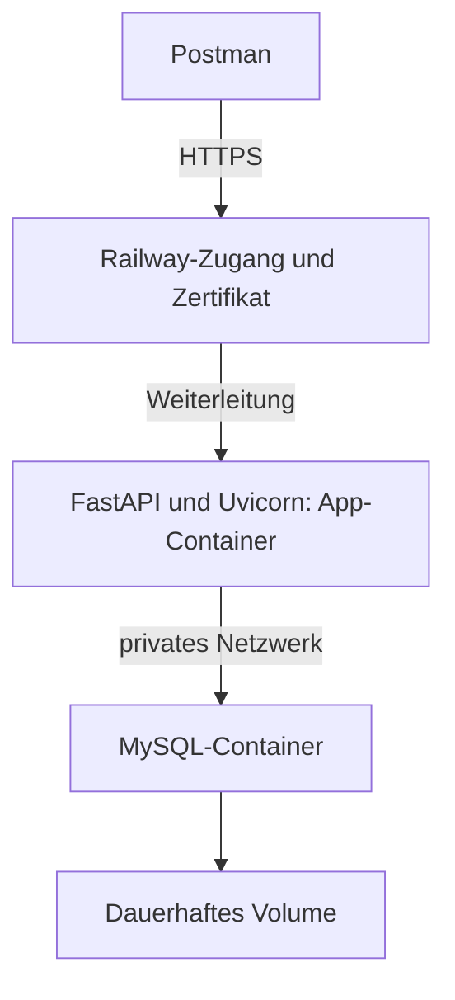

# Deployment lokal und Cloud – Dozentenskript für Tag 13

## Orientierung

- **Wir veröffentlichen die bestehende Anwendung aus Tag 12.**
- Anmeldung, Zuständigkeiten und der Async-Bericht bleiben erhalten.
- FastAPI und MySQL laufen in getrennten Containern.
- Railway stellt den öffentlichen HTTPS-Zugang bereit.

| Etappe | Sichtbares Ergebnis |
| --- | --- |
| Git und GitHub | Ein nachvollziehbarer Projektstand liegt im eigenen Repository. |
| Docker-Exkursion | Die App läuft lokal im Container und verwendet einen MySQL-Container. |
| Railway | Dieselbe Anwendung ist über eine HTTPS-Adresse erreichbar. |
| Änderung veröffentlichen | Eine neue Versionsnummer erscheint; gespeicherte Kurse bleiben erhalten. |
| Bonus CI/CD | GitHub Actions prüft den Stand; Railway veröffentlicht nach erfolgreichen Prüfungen. |

- **Pflichtziel: lokal starten → verpacken → veröffentlichen → prüfen → aktualisieren.**
- Docker-Konfiguration und Einrichtungsprogramm werden angeleitet übernommen.
- Ein Worker genügt für die Demonstration. Sync- und Async-Routen funktionieren gemeinsam.

### Zeit und Vorbereitung

| Bei einem Unterrichtstag | Richtwert ohne Pausen |
| --- | ---: |
| Auftrag, Voraussetzungen und Git | 60 Minuten |
| Docker verstehen und App vorbereiten | 75 Minuten |
| Zwei Container lokal verbinden und prüfen | 75 Minuten |
| Railway, Datenbank und Migration | 90 Minuten |
| Postman, Update und Fehlersuche | 75 Minuten |
| Transfer und Besprechung | 30 Minuten |

- Bei zwei Tagen: Tag A bis einschließlich Abschnitt 4; Tag B ab Abschnitt 5.
- **Accounts, Docker Desktop und den Projektstand vorher prüfen.**
- Grundlage ist das bereitgestellte [Cookbook-Kapitel 12][cookbook]. Quellen und Abweichungen stehen im [Anhang](#anhang-quellen-und-abgrenzung).

## 0. Unser Ausgangspunkt

- Den vollständigen Vormittagsstand von [Tag 12][tag12] weiterverwenden.
- Benötigt: `tag7` bis `tag12`, `alembic`, `alembic.ini` und die bisherigen Requirements-Dateien.
- Die Migrationen reichen bis `0005`. Nachmittagslösungen sind nicht erforderlich.
- Der Hinweisdienst auf Port 8001 bleibt ein lokaler Versuch. Er wird heute nicht veröffentlicht.

```powershell
# Im bisherigen Unterrichtsprojekt arbeiten; Pfad bei Bedarf anpassen.
Set-Location "$env:USERPROFILE\hogwarts-sql"
.\.venv\Scripts\Activate.ps1
git --version
docker version
python --version
python -m pip check
python -m alembic current
```

- Erwartet: Docker-Client und Docker-Server sind erreichbar; Revision `0005`.
- Dozentenvorbereitung: Migrationen einmal auf einer leeren MySQL-Datenbank prüfen.
- **Eine Cloud-Datenbank enthält anfangs weder unsere Tabellen noch unsere Konten.**
- Den bisherigen Uvicorn-Server vor Abschnitt 4 beenden, damit Port 8000 frei ist.

### Vier Orte auseinanderhalten

| Ort | Was liegt dort? |
| --- | --- |
| Arbeitsordner | Bearbeitete Python-Dateien und lokale Konfiguration. |
| GitHub | Hochgeladene Commits; keine laufende App und keine MySQL-Daten. |
| App-Container | Python, Pakete und eine Kopie unseres Anwendungscodes. |
| MySQL-Volume | Dauerhaft gespeicherte Datenbankdateien. |

- Denkfrage: Überträgt `git push` auch unsere Kurse und Benutzerkonten?
- **Nein. Quellcode und Datenbankinhalt haben unterschiedliche Speicherorte.**

## 1. Git: Änderungen nachvollziehbar sichern

- **Git speichert Projektstände; GitHub stellt das entfernte Repository bereit.**
- Ein Commit enthält ausgewählte Dateiänderungen und eine Beschreibung.
- `push` überträgt vorhandene Commits zu GitHub.

### 1.1 Lokale Dateien ausschließen

- Datei: `.gitignore` im Projektordner; vorhandene Regeln ergänzen.
- Beispieldateien enthalten Platzhalter. Echte Konfiguration bleibt lokal.

```gitignore
.venv/
__pycache__/
*.pyc
.pytest_cache/
.env
.env.*
!.env.example
!.env.test.example
!.env.deploy.example
*.pem
*.log
```

```powershell
git status --short
git ls-files ".env" ".env.*"
```

- `.gitignore` schützt keine bereits verfolgte Datei rückwirkend.
- Falls eine echte `.env` verfolgt wird: gezielt aus dem Index nehmen, etwa `git rm --cached -- .env`.
- Die lokale Datei bleibt bestehen. Bereits veröffentlichte Zugangsdaten ersetzen.
- **Vor jedem Commit die ausgewählten Änderungen prüfen.**

### 1.2 Commit und GitHub verbinden

- Falls bereits ein Git-Repository existiert, dessen Historie weiterverwenden.
- Nur ohne Repository einmal `git init -b main` ausführen.
- Falls nötig: `git config user.name "DEIN NAME"` und `git config user.email "DEINE COMMIT-E-MAIL"` ausführen.

```powershell
git add .
git diff --cached --stat
git diff --cached
git commit -m "Stand von Tag 12 fuer Deployment vorbereiten"
git log --oneline -3
git remote -v
```

- Auf GitHub ein eigenes leeres Repository `hogwarts-api` erstellen; zunächst ohne README.
- Falls `origin` schon auf das eigene Repository zeigt, die nächste `remote add`-Zeile überspringen.
- Ein fremdes Ziel vorher umstellen: `git remote set-url origin EIGENE-REPOSITORY-URL`.

```powershell
# DEIN-NAME durch den eigenen GitHub-Namen ersetzen.
git remote add origin https://github.com/DEIN-NAME/hogwarts-api.git
# main ist unser Veröffentlichungsbranch; vorhandenen Branchnamen prüfen.
git branch --show-current
git push -u origin main
```

| Befehl | Bedeutung |
| --- | --- |
| `git status` | Zeigt geänderte und ausgewählte Dateien. |
| `git add` | Wählt Änderungen für den nächsten Commit aus. |
| `git diff --cached` | Zeigt genau diese ausgewählten Änderungen. |
| `git commit` | Speichert den Stand lokal in Git. |
| `git push` | Überträgt Commits zum entfernten Repository. |

- Ergebnis: Die Dateien des gewählten Commits sind auf GitHub sichtbar.
- Übergang: Jetzt verpacken wir diesen Code mit seiner Laufzeitumgebung.

## 2. Mini-Exkursion: Docker verstehen

- **Ein Image ist die Vorlage; ein Container ist eine gestartete Instanz daraus.**
- Unser App-Image enthält Python, Pakete und Code.
- MySQL verwendet ein eigenes Image und läuft in einem eigenen Container.

| Begriff | In unserem Projekt |
| --- | --- |
| Dockerfile | Anleitung zum Bauen des App-Images. |
| Image | Verpackter Stand der Anwendung. |
| Container | Laufende Umgebung mit eigenem Prozess und Netzwerk. |
| Port | Anschluss eines Dienstes, etwa 8000 für die API. |
| Volume | Speicher, der einen Containerwechsel überlebt. |
| Docker Compose | Beschreibt und startet mehrere lokale Dienste zusammen. |

- Container teilen einen Kernel; Docker Desktop stellt auf Windows die Linux-Umgebung bereit.
- Denkfrage: Wo bleiben die Kurse beim Containerwechsel? Im MySQL-Volume.

### Unser Aufbau



- **Railway übernimmt den öffentlichen HTTPS-Zugang. Eigenes Nginx ist hier nicht nötig.**
- Ein Reverse Proxy nimmt Anfragen entgegen und leitet sie an die App weiter.
- Die TLS-Verschlüsselung endet am Railway-Zugang; der nächste Abschnitt ist die interne Weiterleitung.
- Wir verwenden die Railway-Domain. Eine eigene Domain ist eine spätere Erweiterung.

## 3. Unsere App für den Container vorbereiten

### 3.1 Erlaubte Hosts konfigurierbar machen

- Datei: `tag10/main.py`; nur den bisherigen `app.add_middleware(...)`-Block für `TrustedHostMiddleware` ersetzen.
- `os` und `TrustedHostMiddleware` werden dort bereits importiert.
- Tag 11 und Tag 12 bauen diese App weiter; dadurch gilt die Änderung auch dort.

```python
    # Innerhalb von create_app; anstelle der bisherigen festen Hostliste.
    # API8: Nur die bewusst freigegebenen Hostnamen annehmen.
    # Die Variable enthält Hostnamen ohne https:// und ohne Leerzeichen.
    allowed_hosts = os.environ.get(
        "ALLOWED_HOSTS", "localhost,127.0.0.1"
    ).split(",")
    app.add_middleware(
        TrustedHostMiddleware, allowed_hosts=allowed_hosts
    )
```

- **Der Cloud-Hostname muss erlaubt sein, sonst antwortet die Middleware mit 400.**
- Die Vorgabe bleibt lokal nutzbar. Kein `*` als bequemer Ersatz für die Hostliste.
- Hostprüfung und Benutzerberechtigung bleiben verschiedene Prüfungen.

### 3.2 Tag 13 ergänzt nur die Betriebsansicht

```powershell
New-Item -ItemType Directory -Force -Path .\tag13
New-Item -ItemType File -Force -Path .\tag13\__init__.py
```

<!-- file: tag13/main.py -->
- Datei: `tag13/main.py`.

```python
import os

from tag12.main import create_app as create_previous_app


def create_app(show_docs=False):
    # Der bekannte Aufbau bleibt: Auth, CRUD, Sync- und Async-Bericht.
    app = create_previous_app(show_docs=show_docs)
    app.version = "0.9.0"

    @app.get("/version")
    def read_version():
        # Zeigt, welcher Code tatsächlich im laufenden Dienst ankommt.
        return {"version": app.version}

    return app


app = create_app(show_docs=os.environ.get("API_DOCS", "0") == "1")
```

- **`/health` aus Tag 10 prüft die App-Erreichbarkeit, nicht die Datenbank.** Anmeldung und Bericht zusätzlich prüfen.

<!-- file: tag13/start.py -->
- Datei: `tag13/start.py`.

```python
import os

import uvicorn


if __name__ == "__main__":
    uvicorn.run(
        "tag13.main:app",
        host="0.0.0.0",  # Im Container auch externe Weiterleitungen annehmen.
        port=int(os.environ.get("PORT", "8000")),  # Railway gibt PORT vor.
        workers=1,       # Ein Prozess; kann trotzdem viele Requests bedienen.
        proxy_headers=True,  # Vertrauenswürdige Proxy-Informationen auswerten.
    )
```

| Einstellung | Warum? |
| --- | --- |
| `0.0.0.0` | Der Dienst lauscht auf allen IPv4-Schnittstellen des Containers. Es ist keine Browseradresse. |
| `PORT` | Der Server lauscht auf dem von Railway erwarteten Port. |
| Kein `reload` | Der veröffentlichte Code wird durch ein neues Deployment ersetzt. |
| Ein Worker | Kleine, verständliche Demo; jeder weitere Worker hätte eigene Pools und Speicher. |


### 3.3 Das Dockerfile

<!-- file: Dockerfile -->
- Datei: `Dockerfile` im Projektordner; großer Anfangsbuchstabe, keine Endung.
- Wir verwenden Python 3.12 im Linux-Container; diesen Stand vor dem Unterricht mit den vorhandenen Requirements prüfen.

```dockerfile
FROM python:3.12-slim

# Kein .pyc-Schreiben; Ausgaben sofort an die Container-Logs weitergeben.
ENV PYTHONDONTWRITEBYTECODE=1
ENV PYTHONUNBUFFERED=1
WORKDIR /app

# Zuerst Pakete installieren: Reine Codeänderungen können diese Schicht nutzen.
# Auch die mit -r referenzierten Requirements-Dateien müssen vorhanden sein.
COPY requirements*.txt ./
RUN python -m pip install --no-cache-dir -r requirements-tag12.txt

# .dockerignore bestimmt, welche lokalen Dateien dabei ausgeschlossen sind.
COPY . .

# Ein einfacher Benutzer ohne Root-Rechte für den laufenden App-Prozess.
USER 10001:10001
EXPOSE 8000
CMD ["python", "-m", "tag13.start"]
```

- `RUN` führt etwas beim Imagebau aus; `CMD` legt den Standardstart des Containers fest.
- **Beim Imagebau wird keine Datenbank verbunden und keine Migration ausgeführt.**
- `EXPOSE` dokumentiert einen Port. Es veröffentlicht ihn nicht auf dem Rechner.
- Die bisherigen Requirements bleiben einschließlich Testpaketen erhalten; Produktionsabhängigkeiten später trennen.

<!-- file: .dockerignore -->
- Datei: `.dockerignore` im Projektordner; unabhängig von `.gitignore`.

```dockerignore
.git
.venv
**/__pycache__
**/*.pyc
.pytest_cache
.env
.env.*
*.pem
*.log
tests
docs
fastAPI_cookbook
```

- **Git-Ausschlüsse und Docker-Ausschlüsse lösen unterschiedliche Aufgaben.**
- `.dockerignore` hält echte Zugangsdaten und das Windows-`venv` aus dem Build-Kontext heraus.
- Datenbankzugangsdaten werden dem gestarteten Container als Variablen übergeben.

## 4. Lokal: FastAPI und MySQL getrennt starten

### 4.1 Warum ändert sich der Datenbankhost?

| Aufrufer | Datenbankadresse |
| --- | --- |
| Python auf Windows, bisher | `127.0.0.1:3307`, sofern so im bisherigen Compose veröffentlicht. |
| App-Container im neuen Compose | `db:3306`, über den Dienstnamen im gemeinsamen Netzwerk. |
| App auf Railway | Privater Host und Port des dortigen MySQL-Dienstes. |

- **`localhost` im App-Container bezeichnet diesen App-Container.**
- MySQL läuft daneben unter `db`. Die neue Demo erhält ein eigenes Volume.
- **Railway führt diese Compose-Datei nicht direkt aus.** Dort legen wir dieselben zwei Dienste einzeln an.

<!-- file: .env.deploy.example -->
- Datei: `.env.deploy.example`; als `.env.deploy` kopieren und alle drei Platzhalter ersetzen.
- Drei unterschiedliche lange Passwörter wählen; keine echten persönlichen Passwörter verwenden.

```dotenv
MYSQL_PASSWORD=REPLACE_WITH_APP_DB_PASSWORD
MYSQL_ROOT_PASSWORD=REPLACE_WITH_ROOT_DB_PASSWORD
DEMO_PASSWORD=REPLACE_WITH_LONG_DEMO_PASSWORD
```

```powershell
Copy-Item .\.env.deploy.example .\.env.deploy
# .env.deploy jetzt im Editor öffnen und die Werte ersetzen.
```

<!-- file: compose.deploy.yaml -->
- Datei: `compose.deploy.yaml`; bestehende Compose-Dateien für Unterricht und Tests behalten.
- YAML-Einrückungen beibehalten. Die Betriebsbeschreibung wird angeleitet übernommen.

```yaml
services:
  db:
    image: mysql:8.4
    environment:
      MYSQL_DATABASE: hogwarts
      MYSQL_USER: hogwarts_app
      MYSQL_PASSWORD: ${MYSQL_PASSWORD:?Set MYSQL_PASSWORD}
      MYSQL_ROOT_PASSWORD: ${MYSQL_ROOT_PASSWORD:?Set MYSQL_ROOT_PASSWORD}
    volumes:
      - hogwarts_deploy_data:/var/lib/mysql
    # Werkzeug: Erst weitergehen, wenn der App-Benutzer SQL ausführen kann.
    # $$ reicht das Dollarzeichen an die Shell IM Container weiter.
    healthcheck:
      test: ["CMD-SHELL", "MYSQL_PWD=$$MYSQL_PASSWORD mysql --protocol=TCP -h127.0.0.1 -u$$MYSQL_USER -D$$MYSQL_DATABASE -e 'SELECT 1'"]
      interval: 5s
      timeout: 5s
      retries: 30
      start_period: 20s

  api:
    build: .
    image: hogwarts-api:tag13
    environment:
      MYSQL_HOST: db
      MYSQL_PORT: "3306"
      MYSQL_DATABASE: hogwarts
      MYSQL_USER: hogwarts_app
      MYSQL_PASSWORD: ${MYSQL_PASSWORD:?Set MYSQL_PASSWORD}
      DEMO_PASSWORD: ${DEMO_PASSWORD:-}
      ALLOWED_HOSTS: localhost,127.0.0.1
      API_DOCS: "0"
      PORT: "8000"
    ports:
      - "127.0.0.1:8000:8000"
    depends_on:
      db:
        condition: service_healthy

volumes:
  hogwarts_deploy_data:
```

- MySQL hat hier keinen veröffentlichten Host-Port. Die API erreicht ihn intern.
- `8000:8000` bedeutet Rechner-Port zu Container-Port; `127.0.0.1` beschränkt den lokalen Zugang.
- `.env.deploy` liefert die Compose-Platzhalter. `environment` reicht ausgewählte Werte in den Container.
- `tag7/db.py` liest weiterhin `MYSQL_HOST`, `MYSQL_PORT` und die übrigen bekannten Variablen.
- `load_dotenv` überschreibt gesetzte Umgebungsvariablen standardmäßig nicht. Eine `.env` im Image ist unnötig.

### 4.2 Image bauen, Tabellen erzeugen, App starten

```powershell
# @deploy setzt die Elemente dieses Arrays als einzelne Befehlsargumente ein.
$deploy = @("--env-file", ".env.deploy", "-f", "compose.deploy.yaml")
docker compose @deploy build api
docker compose @deploy up -d --wait db

# run erzeugt einen kurzlebigen App-Container für genau diesen Befehl.
# Er bekommt dasselbe Netzwerk und dieselben Variablen wie der API-Dienst.
docker compose @deploy run --rm api python -m alembic upgrade head
docker compose @deploy run --rm api python -m alembic current
docker compose @deploy run --rm api python -m alembic check
docker compose @deploy up -d api
docker compose @deploy ps
docker compose @deploy logs --tail 30 api
```

- **Leere Datenbank: `upgrade head`, nicht `stamp`.**
- `upgrade` führt die vorhandenen Migrationen bis `0005` aus.
- `current` zeigt den angewendeten Stand. `check` sucht Abweichungen zwischen Modellen und Schema.
- Die Baseline erzeugt hier Tabellen. Beim alten Schema hatte `stamp` lediglich den Stand markiert.

### 4.3 Bereitgestelltes Werkzeug: einen Berichtstag einrichten

- Datei: `tag13/prepare_demo.py`; den folgenden Block vorab bereitstellen.
- **Das Werkzeug ist kein neues Lernziel.** Wir besprechen Eingaben und erzeugte Daten.
- Es erzeugt drei Konten, zwei Zuständigkeiten und vier Buchungen am 1. September 1993.
- Vector erhält drei eigene Treffer; eine fremde Buchung gehört zu Hagrid.

<details>
<summary>Bereitgestellter Code: tag13/prepare_demo.py</summary>

<!-- file: tag13/prepare_demo.py -->
```python
import os
from datetime import date

from sqlalchemy import select

from tag7.db import SessionLocal
from tag7.models import Booking, Course, Student
from tag9.models import User
from tag9.passwords import hash_password
from tag10.models import CourseManager


def main():
    # Nur für die frische Unterrichtsumgebung; keine vorhandenen Konten ändern.
    with SessionLocal.begin() as db:
        if db.scalar(select(User.id).where(User.username == "vector")):
            print("Demo bereits vorhanden; keine Daten geändert.")
            return

        password = os.environ.get("DEMO_PASSWORD", "")
        if not 16 <= len(password) <= 128 or password.startswith("REPLACE_"):
            raise SystemExit("DEMO_PASSWORD durch ein langes Demo-Passwort ersetzen.")

        users = []
        for name, role in (("vector", "staff"), ("hagrid", "staff"),
                           ("babbling", "reader")):
            user = User(username=name, role=role,
                        password_hash=hash_password(password))
            db.add(user)
            users.append(user)

        own = Course(title="Arithmantik")
        other = Course(title="Pflege magischer Geschöpfe")
        db.add_all([own, other])
        db.flush()  # IDs werden für die folgenden Zuordnungen gebraucht.
        db.add_all([
            CourseManager(course_id=own.id, user_id=users[0].id),
            CourseManager(course_id=other.id, user_id=users[1].id),
        ])

        for first, last, course in (
            ("Hermione", "Granger", own),
            ("Harry", "Potter", own),
            ("Ron", "Weasley", own),
            ("Neville", "Longbottom", other),
        ):
            student = Student(first_name=first, last_name=last,
                              house="Gryffindor", school_year=3)
            db.add(student)
            db.flush()
            db.add(Booking(student_id=student.id, course_id=course.id,
                           booking_date=date(1993, 9, 1)))
    # Kontext verlassen: Alle Beispieldaten werden gemeinsam committed.
    print("Demo eingerichtet: vector, hagrid, babbling; Berichtstag 1993-09-01.")


if __name__ == "__main__":
    main()
```

</details>

```powershell
docker compose @deploy run --rm api python -m tag13.prepare_demo
```

- Ein erneuter Aufruf lässt die Demo unverändert; Teilbestände werden nicht repariert.
- Das gemeinsame Passwort vereinfacht ausschließlich die Demo; für echte Konten individuelle Passwörter verwenden.
- Öffentlich lange Passwörter verwenden; die kurze Übungsgrenze aus Tag 9 war keine Betriebsempfehlung.

### 4.4 Lokal mit Postman prüfen

- Die [Tag-12-Collection][postman12] duplizieren und die Kopie **Tag 13 – Deployment** nennen.
- `base_url` auf `http://127.0.0.1:8000` setzen.
- `vector_password` und `reader_password` lokal mit `DEMO_PASSWORD` belegen; `reader_username=babbling`.
- `report_date=1993-09-01` setzen; gespeicherte Tokens und Berichtsreferenzen vor dem ersten Lauf leeren.

| Ausführen | Erwartung |
| --- | --- |
| Ordner 00 – Anmeldung | Healthcheck und beide Logins erfolgreich. |
| Neuer Request `GET {{base_url}}/version` | `{"version":"0.9.0"}`. |
| Ordner 02 – Berichte vergleichen | Sync und Async liefern gleiche erlaubte Seiten; insgesamt drei eigene Buchungen. |
| Ordner 03 – Rechte und Eingaben | Die vorgesehenen 401-, 403- und 422-Antworten. |
| Ordner 04 – Abmelden | Beide Tokens werden widerrufen. |

- Ordner **Demo** und **01** abwählen: Sie gehören zum getrennten Hinweisdienst auf Port 8001.
- **Der bekannte API-Vertrag funktioniert jetzt mit zwei lokalen Containern.**

## 5. Railway: zwei Dienste in der Cloud

### 5.1 Projekt und Datenbank anlegen

1. Bei Railway anmelden und ein leeres Projekt erstellen.
2. Einen Dienst aus einem **Docker Image** erstellen: `mysql:8.4`; Dienstname genau `MySQL`.
3. Vor der Einrichtung die vier Variablen aus der folgenden Tabelle und ein Volume mit Mount-Pfad `/var/lib/mysql` setzen.
4. Änderungen anwenden und in den Logs warten, bis MySQL Verbindungen annimmt.
5. Beide Dienste in derselben Railway-Umgebung betreiben; `production` genügt für unseren Unterricht.

| Variable am MySQL-Dienst | Wert |
| --- | --- |
| `MYSQL_DATABASE` | `hogwarts` |
| `MYSQL_USER` | `hogwarts_app` |
| `MYSQL_PASSWORD` | Neues langes Cloud-Datenbankpasswort. |
| `MYSQL_ROOT_PASSWORD` | Anderes langes Passwort für die Datenbankadministration. |

- **Nur die API wird öffentlich. MySQL bleibt im privaten Netzwerk.**
- Für die Datenbank weder eine öffentliche Domain noch einen TCP-Proxy einrichten.
- Wir verwenden lokal und in der Cloud das offizielle Image mit demselben Tag; die Datenbestände sind getrennt.
- Diese vier MySQL-Variablen richten eine leere Datenbank ein. Bei gefülltem Volume ändern sie vorhandene Passwörter nicht nachträglich.
- Vorab Kontoguthaben und Accountfreigabe prüfen; der Trial ist keine Zusage für dauerhaften Gratisbetrieb.

### 5.2 Den vollständigen Stand nach GitHub übertragen

```powershell
git add .
git diff --cached --stat
git diff --cached
git commit -m "App containerisieren und lokalen Deploymentweg ergaenzen"
git push
```

1. Im Railway-Projekt einen App-Dienst aus dem eigenen GitHub-Repository hinzufügen; Name `api`.
2. Repository-Wurzel als Root Directory wählen: Dort liegt unser `Dockerfile`.
3. Branch `main` verwenden. Einen eventuell sofort startenden Erstversuch bis zur Konfiguration nicht bewerten.
4. **GitHub-Autodeploy für den Pflichtteil deaktivieren.** Weitere Veröffentlichungen lösen wir bewusst manuell aus.
5. In den Build-Logs prüfen, dass Railway den `Dockerfile` verwendet.

- Railway baut aus dem GitHub-Stand ein neues Image. Das lokal gebaute Image wird dabei nicht automatisch hochgeladen.
- Der Dienst wird erst nach Variablen, Migration und erfolgreichem Start geprüft.

### 5.3 Variablen zuordnen

- Diese Werte am **App-Dienst `api`** setzen; nicht bloß am MySQL-Dienst.
- Die Referenzen über den Variableneditor auswählen; Dienstnamen sind relevant.

| Variable unserer App | Wert bei Dienstname `MySQL` |
| --- | --- |
| `MYSQL_HOST` | `${{MySQL.RAILWAY_PRIVATE_DOMAIN}}` – privater Diensthostname. |
| `MYSQL_PORT` | `3306` |
| `MYSQL_USER` | `${{MySQL.MYSQL_USER}}` |
| `MYSQL_PASSWORD` | `${{MySQL.MYSQL_PASSWORD}}` |
| `MYSQL_DATABASE` | `${{MySQL.MYSQL_DATABASE}}` |
| `API_DOCS` | `0` |
| `DEMO_PASSWORD` | Ein neues langes Passwort nur für die Cloud-Demo. |
| `FORWARDED_ALLOW_IPS` | `*` – nur für den hier kontrollierten Zugang über Railways Proxy. |

- **Eine Referenz übernimmt einen Wert vom anderen Dienst.** Das Root-Passwort wird der App nicht übergeben.
- Diese Tabelle gehört zum hier selbst angelegten Image-Dienst; ein Railway-Datenbanktemplate kann andere Variablennamen verwenden.
- Tag 12 leitet die Async-URL aus `tag7.db.url` ab; beide Treiber erhalten dieselben DB-Werte.
- Keine Zugangsdaten in `Dockerfile`, `alembic.ini` oder GitHub eintragen.
- `FORWARDED_ALLOW_IPS` lässt Uvicorn Weiterleitungsinformationen vertrauen, etwa dem ursprünglichen HTTPS-Protokoll.
- Das ist keine Hostfreigabe. Der Platzhalter `*` gehört ausdrücklich nicht in `ALLOWED_HOSTS`.

### 5.4 Domain, Hosts und Migration konfigurieren

1. Beim App-Dienst unter Networking eine Railway-Domain erzeugen.
2. Den tatsächlichen Hostnamen kopieren, etwa `hogwarts-api-xyz.up.railway.app`.
3. `ALLOWED_HOSTS` auf `localhost,127.0.0.1,healthcheck.railway.app,DEIN-TATSAECHLICHER-HOSTNAME` setzen.
4. Als Healthcheck-Pfad `/health` eintragen. Das Startkommando aus dem Dockerfile beibehalten.
5. Beim ersten Deployment den folgenden **Pre-deploy Command** eintragen; beispielsweise 120 Sekunden Timeout einstellen.

```sh
sh -c "python -m alembic upgrade head && python -m tag13.prepare_demo"
```

- Diesen Befehl in Railway eintragen; er ist kein lokaler PowerShell-Aufruf.
- `&&` startet das Einrichtungsprogramm nur nach erfolgreicher Migration.
- **Pre-deploy läuft mit DB-Variablen und privatem Netzwerk vor dem Start der neuen App-Version.**
- Scheitert ein Schritt, wird dieses Deployment nicht aktiviert. Keine interaktive Eingabe einbauen.
- Der kurzlebige Pre-deploy-Container zählt nicht als dritter dauerhaft laufender Dienst.
- `healthcheck.railway.app` ist der Hostname für Railways Startprüfung; unsere Middleware muss ihn annehmen.

### 5.5 Ersten Stand veröffentlichen

1. Die Konfigurationsänderungen anwenden und das Deployment starten.
2. Build-, Pre-deploy- und Start-Logs nacheinander prüfen.
3. Die erzeugte Adresse mit `https://` öffnen und `/health` sowie `/version` abrufen.
4. Nach erfolgreicher Einrichtung den Pre-deploy-Befehl auf den folgenden Dauerzustand ändern.
5. `DEMO_PASSWORD` aus den App-Variablen entfernen und die Konfigurationsänderungen anwenden.

```sh
python -m alembic upgrade head
```

- **Das spätere Entfernen von `DEMO_PASSWORD` löscht keine Benutzer. Ihre Passwort-Hashes liegen in MySQL.**
- Der Seed wird jetzt nicht mehr ausgeführt. Migrationen bleiben Teil jedes Deployments.
- `/health` ersetzt weder den Funktionscheck noch ein dauerhaftes Monitoring.
- Die Railway-Startprüfung wird nach dem Deployment nicht automatisch zu einer laufenden Überwachung.

## 6. Cloud mit Postman nachweisen

- In der duplizierten **Tag-13-Collection** nur `base_url` zur tatsächlichen HTTPS-Adresse ändern.
- Die beiden Passwortwerte auf das neue Cloud-Demo-Passwort setzen.
- Tokens und Berichtsreferenzen aus dem lokalen Lauf leeren und in der Cloud neu anmelden.
- **Lokale Tokens und lokale IDs gehören nicht automatisch zur Cloud-Datenbank.**

1. Ordner 00 ausführen; anschließend `/version` prüfen.
2. Ordner 02 ausführen: gleiche Sync-/Async-Ergebnisse und eine zweite Seite.
3. Ordner 03 ausführen: Leserrolle und ungültige Eingaben bleiben eingeschränkt.
4. Vor dem Logout einen eigenen Kurs mit dem Vector-Token anlegen; die zurückgegebene ID notieren.

```http
POST {{base_url}}/courses
Authorization: Bearer {{vector_token}}
Content-Type: application/json

{"title": "Alte Runen – Cloud-Nachweis"}
```

- In Postman: Methode `POST`, Body → raw → JSON; Bearer-Token aus `vector_token`.
- Erwartet: `201`; anschließend `GET {{base_url}}/courses/NOTIERTE_ID` mit demselben Token prüfen.
- Die Route legt weiterhin die bekannte Zuständigkeit an. Deployment ersetzt keine Rechteprüfung.
- **Nachweis: HTTPS, Anmeldung, Lesen und Schreiben funktionieren außerhalb des lokalen Rechners.**

### Was HTTPS hier leistet

- HTTPS schützt die Übertragung zwischen Postman und dem öffentlichen Railway-Zugang.
- Das Zertifikat wird durch Railway bereitgestellt und erneuert.
- HTTPS ersetzt weder Passwort-Hashing noch Rollen oder Datensatzrechte.
- Keine lokalen `mkcert`-Zertifikate und keine eigene Nginx-Konfiguration für diesen Deploymentweg nötig.
- Eine HTTPS-Middleware kann einen TLS-Handshake auf einem reinen TLS-Port nicht nachträglich reparieren; das entsprechende Buchbeispiel übernehmen wir nicht.

## 7. Eine Änderung veröffentlichen und Daten behalten

- In `tag13/main.py` nur `app.version` von `0.9.0` auf `0.9.1` ändern.
- Frage vorab: An welchen Stellen ist die Änderung nach Speichern, Commit und Push schon vorhanden?

```powershell
git diff
git add .\tag13\main.py
git commit -m "Version 0.9.1 fuer Cloud-Update markieren"
git push
```

1. `/version` in der Cloud erneut aufrufen: Bei deaktiviertem Autodeploy steht dort noch `0.9.0`.
2. In Railway bewusst den **neuesten Commit von `main` deployen**; nicht nur das alte Deployment neu starten.
3. Commit-Zuordnung und Logs prüfen; danach muss `/version` `0.9.1` liefern.
4. Den zuvor angelegten Kurs über die notierte ID erneut lesen.
5. Ordner 04 ausführen und die Tokens abmelden.

- **Neuer App-Container, weiterhin dieselbe Datenbank und dasselbe Volume.**
- Ein Neustart startet vorhandenen Code neu; ein Deployment kann neuen Code bereitstellen.
- Ein App-Rollback setzt Datenbankmigrationen nicht automatisch zurück.
- Tabellenänderungen deshalb prüfen und mit alten/neuen App-Versionen verträglich planen.

### Lokal sauber beenden

```powershell
docker compose @deploy down
# Das benannte Datenbank-Volume bleibt bestehen.
# Kein --volumes bzw. -v ergänzen, wenn die Daten erhalten bleiben sollen.
```

- Auch Cloud-Dienste können nach dem Unterricht weiter Kosten verursachen. Einen bewussten Endzeitpunkt festlegen.
- Ein Volume ist dauerhafter Speicher, aber kein Backup.

## 8. Fehlersuche und Transfer

### Von außen nach innen prüfen

| Beobachtung | Zuerst prüfen |
| --- | --- |
| Imagebau scheitert | Dockerfile, Requirements-Dateien, Installationsfehler in Build-Logs. |
| App startet nicht | Importpfad, gesetzte DB-Variablen und Start-Logs. |
| Railway erreicht die App nicht | Bindung `0.0.0.0`, `PORT` und Domain-Zielport. |
| `400 Invalid host header` | Tatsächlicher Domainname und Healthcheck-Host in `ALLOWED_HOSTS`. |
| Migration scheitert | MySQL bereit? Privater Host? Passwort? Richtige Datenbank? |
| `401` beim Bericht | Frischer Cloud-Login, gültiges Token, Header. |
| `403` oder leerer Bericht | Rolle, Kurszuordnung und vorhandener Berichtstag. |
| Nach Push bleibt alte Version | Autodeploy ist im Pflichtteil aus; neuesten Commit manuell veröffentlichen. |

- **Statuscode, konkrete Anfrage und passende Logs zusammen betrachten.**
- Keine Passwörter, Tokens oder vollständigen DB-URLs in Screenshots und geteilte Exporte aufnehmen.

### Kurze Transferaufträge

| Auftrag | Nachweis | Besprechung für Dozenten |
| --- | --- | --- |
| Eine neue Versionsnummer veröffentlichen. | Neuer Commit, neues Deployment, passende `/version`-Antwort. | Die laufende Version muss zum deployten Commit passen. |
| Einen anderen erlaubten Kurstitel anlegen und nach dem Update lesen. | Gleiche ID und gleicher Titel vor/nach dem App-Update. | Codewechsel und Datenspeicherung sind getrennt. |
| Erklären, weshalb `MYSQL_HOST=127.0.0.1` im App-Container falsch ist. | Aufbau mit zwei Containern aufzeichnen. | Die Loopback-Adresse zeigt auf den jeweiligen Container. |
| Ein Schüler erhält 403. Liegt es an Docker? | Rolle und Zuständigkeit anhand eines Requests prüfen. | Ein erreichbarer Dienst kann fachlich korrekt ablehnen. |

- Abschließende Frage: Welche Daten gehören zu Git, zum Image, zu Variablen und zum Volume?
- Pflicht abgeschlossen, wenn der Cloud-Kurs nach einem App-Update weiter abrufbar ist.

## 9. Bonus: GitHub Actions und automatisches Deployment

- **CI prüft Änderungen automatisch; CD veröffentlicht einen geprüften Stand.**
- GitHub Actions übernimmt CI. Railway übernimmt anschließend das Deployment.
- Wir verwenden eine einzige Cloud-Umgebung `production`; eine getrennte Staging-Umgebung entfällt aus Kostengründen.
- Staging wäre eine zusätzliche Prüf-Umgebung vor Produktion, nicht bloß ein anderer Name derselben laufenden Umgebung.

### 9.1 Bereitgestellter CI-Workflow

- Datei: `.github/workflows/ci.yml`; als fertiges Werkzeug übernehmen.
- Voraussetzung: vorhandenes `compose.test.yaml`, `tag8.init_test_db` und Tag-12-Tests liegen im Repository.
- Der GitHub-Linux-Runner startet eine **eigene echte MySQL-Testdatenbank**. Keine Cloud-Zugangsdaten und keine Mocks.

<details>
<summary>Bereitgestellter Code: .github/workflows/ci.yml</summary>

<!-- file: .github/workflows/ci.yml -->
```yaml
name: Hogwarts CI

on:
  push:
    branches: [main]
  pull_request:

jobs:
  tests:
    runs-on: ubuntu-latest
    permissions:
      contents: read
    env:
      # Nur für den Import der bisherigen App; DB-Tests nutzen eigene Fixtures.
      MYSQL_PASSWORD: unused-import-value
    steps:
      - uses: actions/checkout@v7
      - uses: actions/setup-python@v7
        with:
          python-version: "3.12"
      - name: Pakete installieren
        run: python -m pip install -r requirements-tag12.txt
      - name: Wegwerf-Testzugang vorbereiten
        run: |
          python - <<'PY'
          from pathlib import Path
          Path(".env.test").write_text(
              "TEST_MYSQL_ROOT_PASSWORD=ci-root-only\n"
              "TEST_MYSQL_PASSWORD=ci-test-only\n"
              "TEST_MYSQL_PORT=3308\n"
          )
          PY
      - name: Echte Testdatenbank starten
        run: docker compose --env-file .env.test -f compose.test.yaml up -d --wait test_db
      - name: Testschema migrieren
        run: python -m tag8.init_test_db
      - name: Bekannte Tests ausfuehren
        run: python -m pytest tests/tag12 -q
      - name: App-Image bauen
        run: docker build -t hogwarts-api:ci .
      - name: Testcontainer aufraeumen
        if: always()
        run: docker compose --env-file .env.test -f compose.test.yaml down --volumes
```

</details>

- Diese Passwörter gelten ausschließlich für den kurzlebigen CI-Testcontainer.
- `--volumes` ist hier absichtlich: Die CI-Testdaten werden verworfen.
- Der Workflow prüft die bekannten Tag-12-Funktionen und den Imagebau; er startet keine öffentliche Cloud-App.
- Der Postman-Cloudcheck bleibt erforderlich: Domain, Railway-Variablen und tatsächliche Erreichbarkeit sind damit noch nicht geprüft.

### 9.2 Railway erst nach erfolgreicher CI deployen lassen

1. Workflow committen und pushen; den erfolgreichen Lauf unter GitHub → Actions öffnen.
2. Für den App-Dienst GitHub-Autodeploy auf `main` aktivieren.
3. **Wait for CI aktivieren**, damit Railway auf die GitHub-Prüfungen wartet.
4. Eine neue Versionsnummer pushen und den Ablauf bis zur `/version`-Antwort beobachten.
5. In einem weiteren Commit absichtlich einen bekannten Test fehlschlagen lassen; zeigen, dass dieser Stand nicht veröffentlicht wird. Danach reparieren.

- Keine eigene Deploy-API und kein Railway-Token in Actions nötig für diesen Weg.
- Migrationen bleiben im Pre-deploy Command; CI greift niemals auf die Produktionsdatenbank zu.
- In einer echten Produktion kämen unter anderem Backup-/Wiederherstellungskonzept und Betriebsüberwachung hinzu.

## Anhang: Quellen und Abgrenzung

| Cookbook-Abschnitt | Verwendung für Tag 13 |
| --- | --- |
| Running the server with the FastAPI CLI | Startprinzip übernehmen; beim bekannten Uvicorn bleiben. |
| Enabling HTTPS on FastAPI applications | Zweck von HTTPS erklären; Zertifikat durch Railway. |
| Running FastAPI applications in Docker containers | Dockerfile, Build und Container auf unsere App übertragen. |
| Running the server across multiple workers | Nur einordnen; keine zusätzliche Gunicorn-Übung. |
| Deploying your FastAPI application on the cloud | Railway/GitHub übernehmen; Dockerfile statt zusätzlichem Procfile. |
| Shipping FastAPI applications with Hatch | Auslassen; keine Paketveröffentlichung für dieses Lernziel nötig. |

- Eigene Ergänzungen: Git-Einstieg, MySQL-Volume, Hostkonfiguration, Migrationen, Beispieldaten und Postman-Nachweise.
- Providerdetails mit offizieller Dokumentation abgeglichen: **25. Oktober 2026**. UI-Bezeichnungen können sich ändern.
- [Dockerfile-Referenz][dockerfile], [Compose][compose], [FastAPI in Containern][fastapi-docker].
- [Railway Dockerfiles][railway-docker], [MySQL][railway-mysql], [Pre-deploy][railway-predeploy].
- [Eigener Datenbankdienst][railway-db-service], [privates Netzwerk][railway-private] und [offizielles MySQL-Image][mysql-image].
- [Railway HTTPS][railway-https], [Healthchecks][railway-health], [GitHub-Autodeploy und Wait for CI][railway-ci].
- [FastAPI hinter einem Proxy][proxy] erklärt die Weiterleitungsinformationen.
- Bonuswerkzeuge: [Checkout][checkout] und [Setup Python][setup-python].

[tag12]: 12-Async_in_APIs.md
[postman12]: ../postman/12-Tag12-Hogwarts.postman_collection.json
[cookbook]: ../../fastAPI_cookbook/16-chapter-12-deploying-and-managing-fastapi-applications.md
[dockerfile]: https://docs.docker.com/reference/dockerfile/
[compose]: https://docs.docker.com/compose/
[fastapi-docker]: https://fastapi.tiangolo.com/deployment/docker/
[railway-docker]: https://docs.railway.com/builds/dockerfiles
[railway-mysql]: https://docs.railway.com/databases/mysql
[railway-db-service]: https://docs.railway.com/databases/build-a-database-service
[railway-private]: https://docs.railway.com/networking/private-networking
[mysql-image]: https://github.com/docker-library/docs/blob/master/mysql/README.md
[railway-predeploy]: https://docs.railway.com/deployments/pre-deploy-command
[railway-https]: https://docs.railway.com/networking/public-networking
[railway-health]: https://docs.railway.com/deployments/healthchecks
[railway-ci]: https://docs.railway.com/deployments/github-autodeploys
[proxy]: https://fastapi.tiangolo.com/advanced/behind-a-proxy/
[checkout]: https://github.com/actions/checkout
[setup-python]: https://github.com/actions/setup-python
