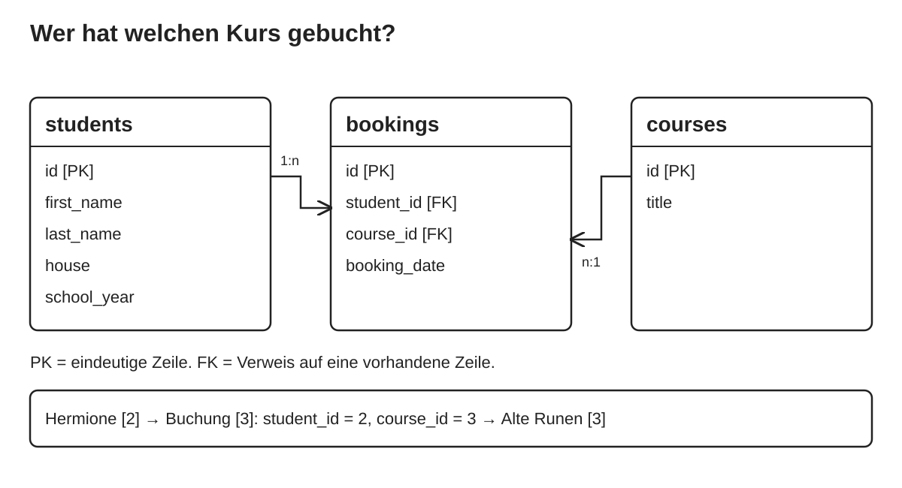

# MySQL-Grundlagen mit Hogwarts – Teilnehmerskript

Tag 1 des Kurses „Programmierung mit Python für komplexe Datenbanken“.

- Die Abschnitte folgen der Reihenfolge des Unterrichts.
- Jeder Codeblock nennt seine Datei und den Ladebefehl.

## Ziel des Tages

- Daten dauerhaft in MySQL speichern.
- Tabellen, Zeilen, Spalten und Schlüssel unterscheiden.
- Daten anlegen, lesen, sortieren, filtern, ändern und löschen.
- Gültige Werte und Verweise mit Datenbankregeln absichern.
- Eine Buchung anhand von Schüler-ID und Kurs-ID erklären.

Heute entsteht die Datenbasis unseres Hogwarts-Kursbuchungssystems.
Ab Tag 2 greifen wir mit Python darauf zu.

## SQL auf einen Blick

| Du möchtest … | Anweisung | Abschnitt |
|---|---|---|
| eine Tabelle anlegen | `CREATE TABLE … (…)` | 3 |
| die Struktur ansehen | `DESCRIBE tabelle;` | 3 |
| Zeilen speichern | `INSERT INTO … (…) VALUES (…)` | 3 |
| Zeilen lesen | `SELECT spalten FROM tabelle` | 3 |
| sortieren | `ORDER BY spalte ASC` oder `DESC` | 4 |
| Zeilen filtern | `WHERE bedingung` | 4 |
| Überschriften umbenennen | `spalte AS name` | 4 |
| Bedingungen verbinden | `AND`, `OR`, Klammern | 5 |
| einen Bereich prüfen | `BETWEEN a AND b` | 5 |
| ein Textmuster suchen | `LIKE '%text%'` | 5 |
| fehlende Werte finden | `IS NULL`, `IS NOT NULL` | 5 |
| Werte ändern | `UPDATE … SET … WHERE …` | 6 |
| Zeilen entfernen | `DELETE FROM … WHERE …` | 6 |
| eine Regel nachtragen | `ALTER TABLE … ADD CONSTRAINT …` | 7 |
| auf eine Tabelle verweisen | `FOREIGN KEY … REFERENCES …` | 9 |
| Doppelte im Ergebnis entfernen | `SELECT DISTINCT …` | 10 |
| eine Werteliste prüfen | `IN (a, b)` | 10 |


## 0. Warum eine Datenbank?

- Die Verwaltung möchte Schüler und Kurswünsche speichern,
  wiederfinden und korrigieren.
- Daten im Arbeitsspeicher von Python verschwinden beim Programmende.
- Dateien wie JSON oder CSV speichern dauerhaft.
- Eine Datenbank bietet zusätzlich Suche, Datenregeln und Zugriff für
  mehrere Programme.

## 1. Eine Schülerliste als Tabelle

| id | first_name | last_name | house | school_year |
|---|---|---|---|---|
| 1 | Harry | Potter | Gryffindor | 3 |
| 2 | Hermione | Granger | Gryffindor | 3 |

- Eine **Zeile** ist ein Datensatz, hier ein Schüler.
- Eine **Spalte** ist ein Merkmal mit festem **Datentyp**.
- Namen sind nicht eindeutig. Die **ID** ist es.
- Diese Schlüsselspalte heißt **Primärschlüssel**.

| Begriff | Bedeutung bei uns |
|---|---|
| `hogwarts` | Unsere Datenbank |
| MySQL | Das System, das die Datenbank verwaltet |
| SQL | Die Sprache für unsere Anweisungen |
| `dumbledore` | Unser Datenbankbenutzer |
| `root` | Administrator des Servers, brauchen wir nicht |

> **💡 Merke**
> SQL ist deklarativ: Du beschreibst, welche Daten du willst. Wie der
> Server sie ermittelt, entscheidet er selbst. Du schreibst keine
> Schleife.

> **⚠️ Pitfall: Die ID ist keine Zeilennummer**
> Sie gehört fest zum Datensatz und sagt nichts über die Position in
> einer sortierten Anzeige.

## 2. MySQL erreichen


- Der **Client** sendet SQL. Der **Server** führt es aus.
- Das **Volume** bewahrt die Daten, auch wenn der Container neu
  erstellt wird.
- Die Einrichtung steht in [Anhang A](#anhang-a--einrichtung).

In PowerShell im Projektordner starten und den Client öffnen:

```powershell
docker compose up -d --wait --wait-timeout 180
docker compose exec db mysql `
  --default-character-set=utf8mb4 -u dumbledore -p hogwarts
```

Das Passwort wird bei der Eingabe nicht angezeigt. Danach erscheint
`mysql>`.

| Eingabestelle | Erkennbar an | Hier gibst du ein |
|---|---|---|
| PowerShell | `PS C:\…>` | `docker`-Befehle |
| MySQL-Client | `mysql>` | SQL und `SOURCE` |

> **⚠️ Pitfall: Falsche Eingabestelle oder Prompt `->`**
> SQL funktioniert nicht in PowerShell, `docker` nicht bei `mysql>`.
> Zeigt der Client `->`, fehlt das Semikolon. Gib `;` ein oder verwirf
> die Eingabe mit `\c`.

### SQL-Dateien schreiben und laden

1. Datei in VS Code unter `sql\live\` schreiben.
2. Mit Strg+S als UTF-8 speichern.
3. Im Client mit `SOURCE` laden.
4. Ausgabe mit der Erwartung vergleichen.

| Wo | Pfad desselben Ordners |
|---|---|
| Windows und VS Code | `.\sql\live\…` |
| Im Container bei SOURCE | `/work/sql/live/…` |

| Inhalt der Datei | Erneut laden? |
|---|---|
| CREATE, ALTER, INSERT | Nein, nur einmal |
| SELECT | Ja, beliebig oft |
| UPDATE, DELETE | Nur nach Prüfung |
| Dateien mit `error` im Namen | Einzeln, sie sollen scheitern |

> **⚠️ Pitfall: SOURCE**
> - Kein Windows-Pfad: Der Client kennt nur `/work/sql/...`.
> - Ohne Strg+S läuft die alte Fassung der Datei.
> - Erneut laden heißt erneut ausführen. Bei CREATE folgt
>   `Table already exists`, bei INSERT `Duplicate entry`.
> - Ein Fehler macht nichts rückgängig. Frühere Anweisungen der Datei
>   können schon gespeichert sein. Prüfe den Stand mit SELECT.

Verbindung prüfen – Datei `sql\live\02_01_connection_check.sql`:

```sql
SELECT DATABASE();
SHOW TABLES;
```

Laden: `SOURCE /work/sql/live/02_01_connection_check.sql;`

<details><summary>Erwartung</summary>hogwarts, noch keine Tabellen.</details>

## 3. Einen Schüler speichern und wiederfinden

### 3.1 Tabelle anlegen

Datei `sql\live\03_01_students_create.sql`:

```sql
USE hogwarts;

CREATE TABLE students (
    id INT AUTO_INCREMENT PRIMARY KEY,
    first_name VARCHAR(50) NOT NULL,
    last_name VARCHAR(50) NOT NULL,
    house VARCHAR(20) NULL,
    school_year TINYINT NOT NULL
) ENGINE=InnoDB;

DESCRIBE students;
```

Laden: `SOURCE /work/sql/live/03_01_students_create.sql;`

<details><summary>Erwartung</summary>DESCRIBE zeigt fünf Spalten. Die Tabelle ist noch leer.</details>

| Bestandteil | Bedeutung |
|---|---|
| `INT`, `TINYINT` | Ganze Zahlen; TINYINT hat den kleineren Bereich |
| `VARCHAR(50)` | Text mit höchstens 50 Zeichen |
| `NOT NULL` / `NULL` | Wert ist Pflicht / Wert darf fehlen |
| `PRIMARY KEY` | Eindeutig und nie NULL |
| `AUTO_INCREMENT` | MySQL vergibt neue IDs selbst |

### 3.2 Harry speichern und anzeigen

Datei `sql\live\03_02_harry_insert.sql`:

```sql
INSERT INTO students (id, first_name, last_name, house, school_year)
VALUES (1, 'Harry', 'Potter', 'Gryffindor', 3);

SELECT * FROM students;

SELECT first_name, last_name
FROM students
WHERE id = 1;
```

Laden: `SOURCE /work/sql/live/03_02_harry_insert.sql;`

<details><summary>Erwartung</summary>Harry als erste gespeicherte Person.</details>

- SELECT nennt die Spalten (`*` = alle), FROM die Tabelle, WHERE die
  gesuchten Zeilen.

> **⚠️ Pitfall: Werte bei INSERT**
> Die Werte müssen zur Reihenfolge der Spaltenliste passen. Text steht
> in einfachen Anführungszeichen, Zahlen und NULL stehen ohne.

### 3.3 Die weiteren Schüler

Datei `sql\live\03_03_students_seed.sql`:

```sql
INSERT INTO students (id, first_name, last_name, house, school_year)
VALUES (2, 'Hermione', 'Granger', 'Gryffindor', 3);

SELECT * FROM students ORDER BY id;

INSERT INTO students (id, first_name, last_name, house, school_year)
VALUES
    (3, 'Ron', 'Weasley', 'Gryffindor', 3),
    (4, 'Draco', 'Malfoy', 'Slytherin', 3),
    (5, 'Luna', 'Lovegood', 'Ravenclaw', 2),
    (6, 'Cedric', 'Diggory', 'Hufflepuff', 5),
    (7, 'Ginny', 'Weasley', 'Gryffindor', 2),
    (8, 'Alex', 'Morgan', NULL, 1);

SELECT * FROM students ORDER BY id;
```

Laden: `SOURCE /work/sql/live/03_03_students_seed.sql;`

<details><summary>Erwartung</summary>Acht Schüler mit den IDs 1–8.</details>

> **⚠️ Pitfall: NULL, 'NULL' und leerer Text**
> `NULL` bedeutet „unbekannt“, wie bei Alex' Haus. `'NULL'` ist ein
> Text aus vier Buchstaben. `''` ist ein vorhandener, leerer Text.

## 4. Auswählen und sortieren

Datei `sql\live\04_01_columns.sql`:

```sql
USE hogwarts;

SELECT first_name, last_name
FROM students;

SELECT id, first_name, last_name
FROM students
ORDER BY last_name, first_name;
```

Laden: `SOURCE /work/sql/live/04_01_columns.sql;`

<details><summary>Erwartung</summary>Sortierte Liste: Cedric zuerst, Ginny vor Ron.</details>

Datei `sql\live\04_02_sort_filter.sql`:

```sql
SELECT id, first_name, school_year
FROM students
ORDER BY school_year DESC, id ASC;

SELECT id, first_name, house
FROM students
WHERE house = 'Gryffindor'
ORDER BY id;
```

Laden: `SOURCE /work/sql/live/04_02_sort_filter.sql;`

<details><summary>Erwartung</summary>Erste Abfrage: IDs 6, 1, 2, 3, 4, 5, 7, 8. Zweite Abfrage: IDs 1, 2, 3, 7.</details>

- SELECT wählt Spalten, WHERE filtert Zeilen.
- ORDER BY ändert nur die Anzeige. DESC = absteigend, ASC =
  aufsteigend.
- Die zweite Sortierspalte entscheidet bei Gleichstand.

> **⚠️ Pitfall: Reihenfolge und Vergleich**
> Ohne ORDER BY ist die Reihenfolge nicht zugesichert. Verglichen wird
> mit `=`, nicht mit `==` wie in Python. Ungleich ist `<>`.

Optional – Datei `sql\live\04_03_aliases.sql`:

```sql
SELECT first_name AS vorname, last_name AS nachname
FROM students
ORDER BY last_name, first_name;
```

Laden: `SOURCE /work/sql/live/04_03_aliases.sql;`

AS benennt nur die Ergebnisspalten um, nicht die gespeicherten.

## 5. Filtern

### 5.1 AND und OR

Datei `sql\live\05_01_and_or.sql`:

```sql
USE hogwarts;

SELECT id, first_name, school_year
FROM students
WHERE house = 'Gryffindor' AND school_year = 3
ORDER BY id;

SELECT id, first_name, last_name
FROM students
WHERE last_name = 'Granger' OR last_name = 'Weasley'
ORDER BY id;

SELECT id, first_name, house, school_year
FROM students
WHERE school_year = 2
  AND (house = 'Gryffindor' OR house = 'Ravenclaw')
ORDER BY id;
```

Laden: `SOURCE /work/sql/live/05_01_and_or.sql;`

<details><summary>Erwartung</summary>IDs 1, 2, 3; danach 2, 3, 7; zuletzt 5, 7.</details>

> **⚠️ Pitfall: AND und OR ohne Klammern**
> AND bindet stärker als OR. `a AND b OR c` bedeutet `(a AND b) OR c`.
> Setze Klammern, sobald du beide mischst.

### 5.2 Bereiche und Textmuster

Datei `sql\live\05_02_between_like.sql`:

```sql
SELECT id, first_name, school_year
FROM students
WHERE school_year BETWEEN 1 AND 2
ORDER BY id;

SELECT id, first_name, last_name
FROM students
WHERE last_name LIKE '%Love%'
ORDER BY id;
```

Laden: `SOURCE /work/sql/live/05_02_between_like.sql;`

<details><summary>Erwartung</summary>IDs 5, 7, 8; danach Luna mit ID 5.</details>

- BETWEEN schließt beide Grenzen ein.
- Bei LIKE steht `%` für beliebig viele Zeichen, `_` für genau eines.

### 5.3 Fehlende Angaben

Datei `sql\live\05_03_null.sql`:

```sql
SELECT id, first_name, house
FROM students
WHERE house IS NULL
ORDER BY id;

SELECT id, first_name, house
FROM students
WHERE house <> 'Gryffindor'
ORDER BY id;

SELECT id, first_name, house
FROM students
WHERE house <> 'Gryffindor' OR house IS NULL
ORDER BY id;
```

Laden: `SOURCE /work/sql/live/05_03_null.sql;`

<details><summary>Erwartung</summary>IDs 8; dann 4, 5, 6; dann 4, 5, 6, 8.</details>


- Ein Vergleich mit NULL ergibt UNKNOWN, weder wahr noch falsch.
- WHERE übernimmt nur Zeilen, deren Bedingung wahr ist.

> **⚠️ Pitfall: Vergleiche mit NULL**
> `house = NULL` findet nichts. Verwende `IS NULL`. Auch
> `house <> 'Gryffindor'` lässt Alex weg. Soll er dabei sein, ergänze
> `OR house IS NULL`.

## 6. Ändern und löschen

> **💡 Merke**
> Erst lesen, dann ändern, danach erneut lesen.

Datei `sql\live\06_01_jamie_changes.sql`:

```sql
USE hogwarts;

INSERT INTO students (id, first_name, last_name, house, school_year)
VALUES (90, 'Jamie', 'Taylr', NULL, 1);

SELECT id, first_name, last_name FROM students WHERE id = 90;

UPDATE students
SET last_name = 'Taylor'
WHERE id = 90;

SELECT id, first_name, last_name FROM students WHERE id = 90;

DELETE FROM students WHERE id = 90;

SELECT id, first_name, last_name FROM students WHERE id = 90;
```

Laden: `SOURCE /work/sql/live/06_01_jamie_changes.sql;`

<details><summary>Erwartung</summary>Taylr, danach Taylor, danach keine Ergebniszeile. Die Schüler 1–8 bleiben unverändert.</details>

> **⚠️ Pitfall: UPDATE oder DELETE ohne WHERE**
> Ohne WHERE sind **alle** Zeilen betroffen. Prüfe die Treffer vorher
> mit einem SELECT mit derselben Bedingung. DELETE entfernt Zeilen,
> DROP TABLE die ganze Tabelle.

Automatische IDs – Datei `sql\live\06_02_auto_id.sql`:

```sql
INSERT INTO students (first_name, last_name, house, school_year)
VALUES ('Robin', 'Taylor', NULL, 1);

SET @robin_id = LAST_INSERT_ID();

SELECT id, first_name, school_year
FROM students
WHERE id = @robin_id;

UPDATE students SET school_year = 2 WHERE id = @robin_id;

SELECT id, first_name, school_year
FROM students
WHERE id = @robin_id;

DELETE FROM students WHERE id = @robin_id;

SELECT id, first_name, last_name FROM students ORDER BY id;
```

Laden: `SOURCE /work/sql/live/06_02_auto_id.sql;`

<details><summary>Erwartung</summary>Robin mit Schuljahr 1, dann 2. Am Ende wieder genau die Schüler 1–8.</details>

- Ohne `id` in der Spaltenliste vergibt MySQL die ID.
- LAST_INSERT_ID() liefert die zuletzt erzeugte ID dieser Verbindung.
- `@robin_id` gilt nur in dieser Verbindung.

> **⚠️ Pitfall: IDs und Rückgängig**
> Erwarte keine bestimmte Zahl: AUTO_INCREMENT ist nicht lückenlos.
> Eine erfolgreiche Änderung ist sofort gespeichert (Autocommit). Es
> gibt keinen Rückgängig-Knopf. Transaktionen folgen an Tag 2.

**[Quiz 2 starten][quiz-2]** – Abfragen, Filter und Datenänderungen.

## 7. Gültige Werte absichern

TINYINT begrenzt nur den technischen Zahlenbereich. Fachlich gilt:
Schuljahre liegen zwischen 1 und 7.

Datei `sql\live\07_01_year_check.sql`:

```sql
USE hogwarts;

SELECT id, school_year
FROM students
WHERE school_year NOT BETWEEN 1 AND 7;

ALTER TABLE students
ADD CONSTRAINT ck_students_school_year
CHECK (school_year BETWEEN 1 AND 7);

SHOW CREATE TABLE students;
```

Laden: `SOURCE /work/sql/live/07_01_year_check.sql;` (nur einmal)

<details><summary>Erwartung</summary>Die erste Abfrage liefert keine Zeilen. SHOW CREATE TABLE zeigt den neuen Constraint.</details>

Die nächsten drei Dateien sollen scheitern. Lade sie einzeln und
überlege vorher, welche Regel verletzt wird.

```sql
-- sql\live\07_02_error_duplicate.sql
INSERT INTO students (id, first_name, last_name, house, school_year)
VALUES (1, 'Test', 'Person', NULL, 1);
```

```sql
-- sql\live\07_03_error_not_null.sql
UPDATE students SET first_name = NULL WHERE id = 1;
```

```sql
-- sql\live\07_04_error_check.sql
UPDATE students SET school_year = 0 WHERE id = 1;
```

Laden: `SOURCE /work/sql/live/07_02_error_duplicate.sql;`,
`SOURCE /work/sql/live/07_03_error_not_null.sql;`,
`SOURCE /work/sql/live/07_04_error_check.sql;`

<details><summary>Verletzte Regeln</summary>PRIMARY KEY: ID 1 existiert bereits. NOT NULL: Der Vorname ist Pflicht. CHECK: Schuljahr 0 liegt außerhalb von 1–7.</details>

Kontrolle nach jedem Versuch – Datei `sql\live\07_05_harry_check.sql`:

```sql
SELECT id, first_name, last_name, school_year
FROM students WHERE id = 1;
```

Laden: `SOURCE /work/sql/live/07_05_harry_check.sql;`

<details><summary>Erwartung</summary>Harry Potter, Schuljahr 3, unverändert.</details>

> **💡 Merke**
> Ein abgewiesener Befehl ändert nichts. Die Fehlermeldung nennt die
> verletzte Regel. Lies sie, statt Fehlercodes zu lernen.

## 8. Der Kurskatalog

Datei `sql\live\08_01_courses.sql`:

```sql
USE hogwarts;

CREATE TABLE courses (
    id INT AUTO_INCREMENT PRIMARY KEY,
    title VARCHAR(100) NOT NULL
) ENGINE=InnoDB;

DESCRIBE courses;

INSERT INTO courses (id, title)
VALUES
    (1, 'Arithmantik'),
    (2, 'Wahrsagen'),
    (3, 'Alte Runen'),
    (4, 'Pflege magischer Geschöpfe');

SELECT id, title FROM courses ORDER BY title;
```

Laden: `SOURCE /work/sql/live/08_01_courses.sql;`

<details><summary>Erwartung</summary>Vier Kurse, nach Titel sortiert in der ID-Reihenfolge 3, 1, 4, 2.</details>

> **⚠️ Pitfall: Umlaute werden falsch angezeigt**
> Speichere die Datei als UTF-8 und starte den Client mit
> `--default-character-set=utf8mb4`.

## 9. Buchungen und Fremdschlüssel

Harry möchte Wahrsagen buchen, Hermione Arithmantik und Alte Runen.

- Ein Schüler kann mehrere Kurse haben, ein Kurs mehrere Schüler.
- Spalten wie `course_1`, `course_2` oder Listen in einer Zelle
  skalieren nicht.
- Lösung: Jede Buchungszeile speichert genau eine Zuordnung über IDs.



| Beziehung | Bedeutung |
|---|---|
| 1:n | Ein Schüler kann viele Buchungen haben |
| n:1 | Viele Buchungen können denselben Kurs betreffen |
| n:m | Schüler und Kurse, verbunden über die Buchungen |

> **💡 Merke: Normalisierung**
> Namen stehen nur bei Schülern, Titel nur bei Kursen. So muss eine
> Angabe nur an einer Stelle geändert werden und kann sich nicht
> widersprechen. 

Datei `sql\live\09_01_bookings_create.sql`:

```sql
USE hogwarts;

CREATE TABLE bookings (
    id INT AUTO_INCREMENT PRIMARY KEY,
    student_id INT NOT NULL,
    course_id INT NOT NULL,
    booking_date DATE NOT NULL,
    CONSTRAINT fk_bookings_student
        FOREIGN KEY (student_id) REFERENCES students(id),
    CONSTRAINT fk_bookings_course
        FOREIGN KEY (course_id) REFERENCES courses(id)
) ENGINE=InnoDB;

SHOW CREATE TABLE bookings;
```

Laden: `SOURCE /work/sql/live/09_01_bookings_create.sql;`

<details><summary>Erwartung</summary>Die Ausgabe zeigt beide Fremdschlüssel.</details>

- DATE speichert ein Datum ohne Uhrzeit.
- FOREIGN KEY verlangt einen vorhandenen Schüler bzw. Kurs mit dieser
  ID.

Datei `sql\live\09_02_bookings_seed.sql`:

```sql
INSERT INTO bookings (id, student_id, course_id, booking_date)
VALUES (1, 1, 2, '1993-09-01');

SELECT * FROM bookings ORDER BY id;

INSERT INTO bookings (id, student_id, course_id, booking_date)
VALUES
    (2, 2, 1, '1993-09-01'),
    (3, 2, 3, '1993-09-01');

SELECT * FROM bookings WHERE student_id = 2 ORDER BY id;

INSERT INTO bookings (id, student_id, course_id, booking_date)
VALUES
    (4, 3, 2, '1993-09-02'),
    (5, 4, 4, '1993-09-02'),
    (6, 5, 3, '1993-09-01'),
    (7, 6, 4, '1993-09-03');

SELECT * FROM bookings ORDER BY id;
```

Laden: `SOURCE /work/sql/live/09_02_bookings_seed.sql;`

<details><summary>Erwartung</summary>Sieben Buchungen, Hermione (Schüler 2) mit zwei davon.</details>

Ein ungültiger Verweis – Datei `sql\live\09_03_error_foreign_key.sql`:

```sql
INSERT INTO bookings (student_id, course_id, booking_date)
VALUES (999, 1, '1993-09-01');
```

Laden: `SOURCE /work/sql/live/09_03_error_foreign_key.sql;`

<details><summary>Erwartung</summary>Fehler: Schüler 999 existiert nicht. Es bleiben sieben Buchungen.</details>

> **⚠️ Pitfall: Verweise**
> - Der Spaltenname `student_id` prüft nichts. Erst FOREIGN KEY tut es.
> - Schüler und Kurse müssen vor ihren Buchungen existieren.
> - Ein Kurs oder Schüler mit Buchungen lässt sich nicht löschen.
> - `id` ist die Buchung, `student_id` der Schüler. Eine wiederholte
>   `student_id` ist erlaubt.
> - Dieselbe Kombination aus Schüler und Kurs ist noch doppelt
>   buchbar. Diese Regel folgt später.

**[Quiz 3 starten][quiz-3]** – Normalisierung und Beziehungen.

## 10. Buchungsfragen beantworten

Datei `sql\live\10_01_distinct.sql`:

```sql
USE hogwarts;

SELECT student_id
FROM bookings
WHERE booking_date = '1993-09-01'
ORDER BY student_id;

SELECT DISTINCT student_id
FROM bookings
WHERE booking_date = '1993-09-01'
ORDER BY student_id;
```

Laden: `SOURCE /work/sql/live/10_01_distinct.sql;`

<details><summary>Erwartung</summary>Zuerst 1, 2, 2, 5; danach 1, 2, 5.</details>

> **⚠️ Pitfall: DISTINCT gilt für die ganze Zeile**
> Es entfernt doppelte Ergebniszeilen über alle gewählten Spalten
> zusammen. Gespeicherte Daten bleiben unverändert.

Datei `sql\live\10_02_in.sql`:

```sql
SELECT id, student_id, course_id, booking_date
FROM bookings
WHERE course_id IN (1, 3)
ORDER BY id;
```

Laden: `SOURCE /work/sql/live/10_02_in.sql;`

<details><summary>Erwartung</summary>Buchungen 2, 3, 6.</details>

IN ist die kurze Form von `course_id = 1 OR course_id = 3`.

Das Tagesziel – Datei `sql\live\10_03_booking_details.sql`:

```sql
SELECT id, student_id, course_id, booking_date
FROM bookings WHERE id = 3;

SELECT first_name, last_name FROM students WHERE id = 2;
SELECT title FROM courses WHERE id = 3;
```

Laden: `SOURCE /work/sql/live/10_03_booking_details.sql;`

<details><summary>Ergebnis</summary>Hermione Granger hat am 1. September 1993 Alte Runen gebucht.</details>

Die erste Abfrage liefert die IDs, mit denen wir Namen und Titel
nachschlagen. Mit JOIN geht das in einer Abfrage (Tag 4).

Optional – Datei `sql\live\10_04_house_list.sql`:


```sql
SELECT DISTINCT house
FROM students
WHERE house IS NOT NULL
ORDER BY house;
```

Laden: `SOURCE /work/sql/live/10_04_house_list.sql;`

Denkmodell: FROM (acht Schüler) → WHERE (sieben mit Haus) → SELECT
(nur das Haus) → DISTINCT (vier Häuser) → ORDER BY (alphabetisch).

## 11. Stand am Ende des Vormittags

- [ ] Schüler: IDs 1–8, keine Probezeile von Jamie oder Robin.
- [ ] Kurse: IDs 1–4.
- [ ] Buchungen: IDs 1–7.
- [ ] CHECK für das Schuljahr und beide Fremdschlüssel sind vorhanden.

Dieser Stand ist die Grundlage für Tag 2.

> **⚠️ Pitfall: Daten und Docker**
> `docker compose down` behält die Daten. Der Zusatz `-v` löscht das
> Volume und damit alle Tabellen. Ein Volume ist außerdem kein Backup:
> Gegen versehentlich geänderte Daten schützt es nicht.

## 12. Der Nachmittag

Du arbeitest mit einem eigenen Übungsbestand in derselben Datenbank.

| Bestand | Tabellen |
|---|---|
| Live-Projekt | `students`, `courses`, `bookings` |
| Übungen | `practice_students`, `practice_courses`, `practice_bookings` |

Einmal laden: `SOURCE /work/sql/90_exercise_setup.sql;`

<details><summary>Erwartung</summary>Acht Übungsschüler, vier Übungskurse, sieben Übungsbuchungen.</details>

> **⚠️ Pitfall: In den falschen Tabellen üben**
> Ändere nachmittags nur `practice_...`. Die Projekttabellen sind der
> gemeinsame Stand für Tag 2. Ist etwas schiefgegangen, prüfe gezielt
> deine Probezeile, statt den Bestand neu zu importieren.


## Anhang A – Einrichtung

Docker Desktop mit WSL 2 muss installiert sein und laufen.


Datei `.env` mit Platzhaltern:

```dotenv
MYSQL_ROOT_PASSWORD=replace_with_local_root_password
MYSQL_PASSWORD=replace_with_local_course_password
MYSQL_PORT=3307
```


Datei `.gitignore`:

```gitignore
.env
```

Datei `compose.yaml`:

```yaml
name: hogwarts-tag1

services:
  db:
    image: mysql:8.4.10
    environment:
      MYSQL_ROOT_PASSWORD: ${MYSQL_ROOT_PASSWORD:?Set root password}
      MYSQL_DATABASE: hogwarts
      MYSQL_USER: dumbledore
      MYSQL_PASSWORD: ${MYSQL_PASSWORD:?Set user password}
    command:
      - --character-set-server=utf8mb4
      - --collation-server=utf8mb4_unicode_ci
    ports:
      - "127.0.0.1:${MYSQL_PORT:-3307}:3306"
    volumes:
      - mysql_data:/var/lib/mysql
      - ./sql:/work/sql:ro
    healthcheck:
      test:
        - CMD-SHELL
        - >-
          MYSQL_PWD="$${MYSQL_PASSWORD}"
          mysql --protocol=TCP --host=127.0.0.1
          --user="$${MYSQL_USER}" "$${MYSQL_DATABASE}"
          --execute="SELECT 1" > /dev/null 2>&1
      interval: 5s
      timeout: 5s
      retries: 30
      start_period: 30s

volumes:
  mysql_data:
```

> **⚠️ Pitfall: Einrichtung**
> - Echte Passwörter stehen nur in `.env`
> - MySQL übernimmt die Passwörter nur beim ersten Start. Eine spätere
>   Änderung in `.env` führt zu `Access denied`. Lösche deshalb nicht
>   das Volume.
> Die Datei muss `compose.yaml` heißen.


