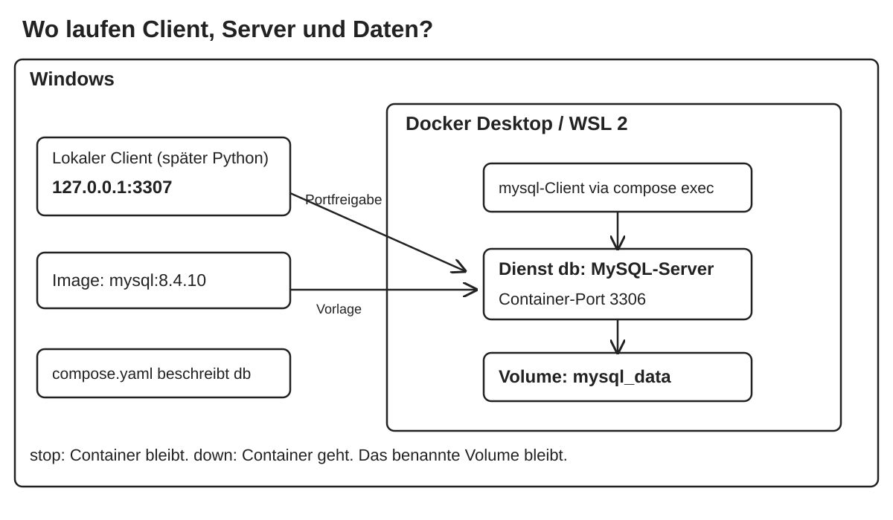

# MySQL mit Python und Hogwarts – Teilnehmerskript

Tag 2 des Kurses „Programmierung mit Python für komplexe Datenbanken“.

- Die Abschnitte folgen der Reihenfolge des Unterrichts.
- Vormittag: 8:30–12:00 Uhr, Theorie und gemeinsames Programmieren.
- Nachmittag: 13:00–16:15 Uhr, eigene Übungen und Besprechung.
- Jeder Codeblock nennt seine Datei und den passenden Aufruf.
- Ausgangspunkt ist der fertige Live-Bestand aus [Tag 1][tag1].

## Ziel des Tages

- Python mit der vorhandenen MySQL-Datenbank verbinden.
- Verbindung und Cursor unterscheiden.
- Ergebniszeilen als Python-Werte lesen.
- Eingaben als Parameter übergeben, ohne SQL damit zusammenzubauen.
- Schreibvorgänge mit COMMIT bestätigen.
- Zusammengehörige Änderungen mit ROLLBACK vollständig zurücknehmen.
- Cursor und Verbindung auch bei einem Fehler schließen.

Heute erhält die Hogwarts-Verwaltung kleine Python-Programme.
Du liest Kurse und Buchungen und speicherst eine vollständige Anmeldung.
Die vorhandenen Tabellen bleiben die Grundlage.
Ab Tag 3 verwenden wir dafür zusätzlich SQLAlchemy.

## Python und MySQL auf einen Blick

| Du möchtest … | Aufruf oder Einstellung | Abschnitt |
|---|---|---|
| eine Verbindung öffnen | get_connection() | 1–2 |
| einen Cursor erzeugen | connection.cursor() | 2 |
| eine SQL-Anweisung ausführen | cursor.execute(sql, params) | 2–5 |
| die nächste Zeile lesen | cursor.fetchone() | 2 |
| alle übrigen Zeilen lesen | cursor.fetchall() | 3 |
| einen Eingabewert binden | execute(sql, (wert,)) | 4 |
| zwei Werte binden | execute(sql, (start, ende)) | 5 |
| sofortiges Bestätigen ausschalten | autocommit=False | 1, 6 |
| eine Transaktion beginnen | connection.start_transaction() | 6, 8 |
| Änderungen bestätigen | connection.commit() | 7–8 |
| offene Änderungen verwerfen | connection.rollback() | 6–8 |
| eine erzeugte ID übernehmen | cursor.lastrowid | 7–8 |
| betroffene Zeilen prüfen | cursor.rowcount | 7, 11 |
| Ressourcen schließen | with-Verbindungs- und Cursorblock | 2 |
| Spalten über Namen lesen | cursor(dictionary=True) | 11 |
| mehrere Parametersätze ausführen | cursor.executemany(sql, rows) | 11 |
| einen Teilvorgang zurücknehmen | ROLLBACK TO SAVEPOINT | 11 |

## 0. Von SQL im Client zu SQL in Python

Die Verwaltung braucht eine Kursliste und eine Namenssuche.
Eine neue Schülerin soll zusammen mit ihrer Kursbuchung gespeichert werden.
Eine fehlgeschlagene Anmeldung darf keine halben Daten hinterlassen.

- Der MySQL-Server läuft weiter im Docker-Container.
- Python läuft lokal unter Windows in einer virtuellen Umgebung.
- Der Connector vermittelt zwischen Python und MySQL.
- Python sendet SQL an denselben Server wie der MySQL-Client.
- Jede Verbindung ist eine eigene Datenbanksitzung.
- MySQL koordiniert auch den Zugriff mehrerer Programme.



| Bestand am Anfang | Erwartete Daten |
|---|---|
| students | Acht Schüler mit IDs 1–8 |
| courses | Vier Kurse mit IDs 1–4 |
| bookings | Sieben Buchungen mit IDs 1–7 |
| Datenbankregeln | Schuljahrprüfung und beide Fremdschlüssel |
| Speicher-Engine | InnoDB für alle drei Tabellen |

### Projekt und MySQL-Client öffnen

In PowerShell:

```powershell
$courseDir = Join-Path $env:USERPROFILE 'hogwarts-sql'
Set-Location -LiteralPath $courseDir
git status --short
New-Item -ItemType Directory -Path .\tag2 -Force
New-Item -ItemType Directory -Path .\sql\tag2 -Force
docker compose up -d --wait --wait-timeout 180
docker compose ps
docker compose exec db mysql `
  --default-character-set=utf8mb4 -u dumbledore -p hogwarts
```

Das Passwort aus deiner vorhandenen .env eingeben.
Lass dieses Terminal für den MySQL-Client geöffnet.
Öffne eine zweite PowerShell für Python und Git im selben Projektordner.

| Eingabestelle | Erkennbar an | Hier gibst du ein |
|---|---|---|
| PowerShell | PS C:\…> | Python, pip, Docker und Git |
| MySQL-Client | mysql> | SQL und SOURCE |

### Ausgangsbestand kontrollieren

Datei `sql\tag2\01_start_check.sql`:

<!-- file: sql/tag2/01_start_check.sql -->
```sql
USE hogwarts;

SELECT DATABASE(), CURRENT_USER(), @@autocommit;

SELECT id, first_name, last_name, house, school_year
FROM students ORDER BY id;

SELECT id, title FROM courses ORDER BY id;

SELECT id, student_id, course_id, booking_date
FROM bookings ORDER BY id;

SHOW CREATE TABLE students;
SHOW CREATE TABLE bookings;

SHOW TABLE STATUS LIKE 'students';
SHOW TABLE STATUS LIKE 'courses';
SHOW TABLE STATUS LIKE 'bookings';
```

Laden: `SOURCE /work/sql/tag2/01_start_check.sql;`

<details>
<summary>Erwartung</summary>

Die drei Listen zeigen Schüler 1–8, Kurse 1–4 und Buchungen 1–7.
Harry ist im dritten Schuljahr. Alex hat noch kein bekanntes Haus.
Die Kurse heißen Arithmantik, Wahrsagen, Alte Runen und
Pflege magischer Geschöpfe.
SHOW TABLE STATUS zeigt in Engine jeweils InnoDB.
SHOW CREATE TABLE zeigt die Schuljahrprüfung und die Fremdschlüssel.
Der MySQL-Client verwendet normalerweise @@autocommit = 1.

</details>

> **⚠️ Pitfall: Den Bestand erneut importieren**
> Führe die Tag-1-INSERTs nicht erneut aus. Fehlende Schritte gezielt
> nachholen. Eine vorhandene Datenbank nicht pauschal neu anlegen.

## 1. Den Python-Arbeitsplatz einrichten

### 1.1 Lokaler Zugriff und Containerzugriff

| Wo läuft das Programm? | Host | Port |
|---|---|---|
| Python lokal unter Windows | 127.0.0.1 | 3307 |
| Später im Compose-Netz | db | 3306 |

- 3307 ist der veröffentlichte lokale Port aus unserem Tag-1-Aufbau.
- Wenn du dort einen anderen Port gewählt hast, behältst du ihn bei.
- Python verwendet den Kursbenutzer dumbledore.
- Das Administratorpasswort wird für diese Programme nicht benötigt.

> **⚠️ Pitfall: db als Host im lokalen Python-Programm**
> Der Service-Name db gilt im Compose-Netz. Unser lokales Python
> verbindet sich über 127.0.0.1 und den veröffentlichten Port.

### 1.2 Virtuelle Umgebung und Pakete

In der zweiten PowerShell im Projektordner:


Wähle in diesem neuen Terminal ebenfalls den vorhandenen Projektordner:

```powershell
Set-Location "$env:USERPROFILE\hogwarts-sql"
python --version
```

Unser Unterrichtsstand verwendet Python 3.14.2 und MySQL 8.4.10.
Falls noch keine .venv vorhanden ist, lege sie einmal an:

```powershell
python -m venv .venv
```

Aktiviere die vorhandene Umgebung:

```powershell
.\.venv\Scripts\Activate.ps1
python -c "import sys; print(sys.executable)"
```

Der ausgegebene Pfad muss auf .venv\Scripts\python.exe zeigen.

Datei `requirements-tag2.txt`:

<!-- file: requirements-tag2.txt -->
```text
mysql-connector-python==9.7.0
python-dotenv==1.2.1
```

```powershell
python -m pip install -r requirements-tag2.txt
python -m pip check
python -m pip show mysql-connector-python python-dotenv
```

> **💡 Merke: Ein Python-Projekt, eine Umgebung**
> Die virtuelle Umgebung enthält die Pakete dieses Projekts.
> python -m pip installiert sie für genau den gestarteten Interpreter.

> **⚠️ Pitfall: Aktivierung blockiert oder falsches Paket**
> Nutze bei blockierter Aktivierung den Interpreter direkt:
> .\.venv\Scripts\python.exe. Du musst dafür die Ausführungsrichtlinie
> nicht ändern. Installiere mysql-connector-python, nicht ein Paket mysql.
> Nenne auch deine eigenen Dateien nicht mysql.py.

Ohne Aktivierung funktioniert zum Beispiel:

```powershell
.\.venv\Scripts\python.exe -m pip install -r requirements-tag2.txt
```

### 1.3 Die vorhandene Konfiguration ergänzen

Compose liest seine .env für den Containerstart.
Python lädt die Datei zusätzlich mit python-dotenv.

Ergänze fehlende Einstellungen in der vorhandenen .env.example:

Datei `.env.example`:

<!-- file: .env.example -->
```dotenv
MYSQL_ROOT_PASSWORD=replace_with_local_root_password
MYSQL_PASSWORD=replace_with_local_course_password
MYSQL_HOST=127.0.0.1
MYSQL_PORT=3307
MYSQL_USER=dumbledore
MYSQL_DATABASE=hogwarts
```

- Die Beispieldatei enthält Platzhalter und darf in Git gespeichert werden.
- Deine lokale .env enthält die tatsächlichen Passwörter.
- Ergänze dort Host, Benutzer und Datenbank bei Bedarf.
- Behalte vorhandene Passwörter und den tatsächlich verwendeten Port.
- Überschreibe .env nicht mit .env.example.

Ergänze die vorhandene .gitignore, statt sie vollständig zu ersetzen:

Datei `.gitignore`:

<!-- file: .gitignore -->
```gitignore
.env
.env.*
!.env.example
.venv/
__pycache__/
*.pyc
backups/
```

> **⚠️ Pitfall: Das Passwort nachträglich ändern**
> Der vorhandene MySQL-Benutzer behält sein beim ersten Start gesetztes
> Passwort. Eine Änderung in .env ändert dieses Benutzerkonto nicht.
> Bei Access denied zuerst die Angaben prüfen. Das Volume behalten.

### 1.4 Eine Verbindungshilfe schreiben

Die folgende Datei enthält die vollständig zusammengeführten Schritte.
Sie lädt die Konfiguration und stellt get_connection bereit.

Datei `tag2\db.py`:

<!-- file: tag2/db.py -->
```python
import os
from pathlib import Path

import mysql.connector
from dotenv import load_dotenv


PROJECT_DIR = Path(__file__).resolve().parent.parent
load_dotenv(PROJECT_DIR / ".env")

def get_connection():
    password = os.environ.get("MYSQL_PASSWORD")
    if not password:
        raise ValueError("MYSQL_PASSWORD fehlt in der lokalen .env.")

    return mysql.connector.connect(
        host=os.environ.get("MYSQL_HOST", "127.0.0.1"),
        port=int(os.environ.get("MYSQL_PORT", "3307")),
        user=os.environ.get("MYSQL_USER", "dumbledore"),
        password=password,
        database=os.environ.get("MYSQL_DATABASE", "hogwarts"),
        charset="utf8mb4",
        autocommit=False,
        connection_timeout=5,
    )
```

- __file__ bezeichnet die Datei db.py.
- parent.parent führt von tag2 zum Projektordner mit der .env.
- load_dotenv lädt die Werte in die Python-Umgebung.
- Bereits gesetzte Umgebungsvariablen haben Vorrang.
- get_connection öffnet bei jedem Aufruf eine neue Verbindung.
- connection_timeout begrenzt das Warten auf einen unerreichbaren Server.
- autocommit=False lässt uns Schreibvorgänge ausdrücklich bestätigen.

> **💡 Merke**
> Das Importieren dieser Datei definiert die Verbindungshilfe.
> Erst get_connection() öffnet eine Verbindung zum Server.

## 2. Verbindung und Cursor unterscheiden

Die Verwaltung möchte den Datenbanknamen und den angemeldeten Benutzer sehen.

| Bestandteil | Aufgabe |
|---|---|
| connection | Datenbanksitzung und Transaktion verwalten |
| cursor | SQL ausführen und Ergebniszeilen lesen |
| execute | Die SQL-Anweisung ausführen |
| fetchone | Die nächste Zeile als Tupel oder None liefern |

Datei `tag2\connection_check.py`:

<!-- file: tag2/connection_check.py -->
```python
from mysql.connector import Error

from db import get_connection


def main():
    try:
        with get_connection() as connection:
            with connection.cursor() as cursor:
                cursor.execute("SELECT DATABASE(), CURRENT_USER()")

                row = cursor.fetchone()
                if row is None:
                    raise ValueError("Abfrage lieferte keine Zeile.")
                database, user = row
                print("Datenbank:", database)
                print("Benutzer:", user)
                print("Autocommit:", connection.autocommit)
    except (Error, ValueError) as error:
        print("Verbindung fehlgeschlagen:", error)
        raise SystemExit(1)


if __name__ == "__main__":
    main()
```

```powershell
.\.venv\Scripts\python.exe .\tag2\connection_check.py
```

<details>
<summary>Erwartung</summary>

Datenbank: hogwarts.
Benutzer: dumbledore@…; der Hostteil kann abweichen.
Autocommit: False.
Bei einem Verbindungsfehler endet das Programm mit Rückgabecode 1.

</details>

- Das Tupel enthält Datenbankname und Benutzer in der SELECT-Reihenfolge.
- database, user = row verteilt diese beiden Werte auf zwei Variablen.
- Die None-Prüfung behandelt den Fall ohne Ergebniszeile.
- with schließt zuerst den Cursor und danach die Verbindung.
- Das passiert auch, wenn innerhalb des Blocks ein Fehler auftritt.

> **💡 Merke: Schließen und Bestätigen sind verschiedene Aufgaben**
> with kümmert sich um Ressourcen. Es ersetzt keinen ausdrücklich
> benötigten COMMIT. Eine Python-Liste kann nach dem Schließen bleiben;
> unbestätigte Datenbankänderungen sind dadurch noch nicht gespeichert.

> **⚠️ Pitfall: Verbindungsfehler**
> ModuleNotFoundError: Interpreter und Paket prüfen.
> Access denied: Benutzer und Passwort prüfen.
> Can't connect: Container, Host und veröffentlichten Port prüfen.
> Unknown database: Datenbankname mit Tag 1 vergleichen.

## 3. Den Kurskatalog ausgeben

Die Verwaltung braucht eine alphabetisch sortierte Liste aller vier Kurse.
Das SQL ist aus Tag 1 bekannt. Neu ist die Ergebnisverarbeitung in Python.

Datei `tag2\course_list.py`:

<!-- file: tag2/course_list.py -->
```python
from db import get_connection


with get_connection() as connection:
    with connection.cursor() as cursor:
        cursor.execute("SELECT id, title FROM courses ORDER BY title")
        courses = cursor.fetchall()

for course_id, title in courses:
    print(f"{course_id}: {title}")

print("Kurse:", len(courses))
```

```powershell
.\.venv\Scripts\python.exe .\tag2\course_list.py
```

<details>
<summary>Erwartung</summary>

```text
3: Alte Runen
1: Arithmantik
4: Pflege magischer Geschöpfe
2: Wahrsagen
Kurse: 4
```

</details>

- fetchall liest alle noch offenen Zeilen als Liste von Tupeln.
- Bei keinem Treffer liefert es eine leere Liste.
- Die Schleife verarbeitet die schon gelesenen Daten.
- Die Verbindung darf davor geschlossen werden.
- Die Datenbank übernimmt ORDER BY; Python gibt das Ergebnis aus.

> **⚠️ Pitfall: Unread result found**
> Vor einer nächsten Abfrage müssen offene Ergebniszeilen gelesen sein.
> fetchone liest nur eine Zeile. fetchall liest alle übrigen Zeilen.
> Bei großen Ergebnissen behandeln wir später andere Leseverfahren.

## 4. Eine sichere Namenssuche entwickeln

Die Verwaltung gibt einen Nachnamen ein und erhält die passenden Schüler.

Datei `tag2\student_search.py`:

<!-- file: tag2/student_search.py -->
```python
from db import get_connection


def find_students(last_name):
    query = (
        "SELECT id, first_name, last_name "
        "FROM students WHERE last_name = %s ORDER BY id"
    )
    with get_connection() as connection:
        with connection.cursor() as cursor:
            cursor.execute(query, (last_name,))
            return cursor.fetchall()


def main():
    last_name = input("Nachname: ").strip()
    students = find_students(last_name)
    for student_id, first_name, family_name in students:
        print(f"{student_id}: {first_name} {family_name}")
    print("Treffer:", len(students))


if __name__ == "__main__":
    main()
```

```powershell
.\.venv\Scripts\python.exe .\tag2\student_search.py
```

<details>
<summary>Erwartung</summary>

Weasley: Ron mit ID 3 und Ginny mit ID 7, zwei Treffer.
Granger: Hermione mit ID 2, ein Treffer.
O'Neil: keine Treffer, aber kein SQL-Syntaxfehler.

</details>

### SQL und Eingaben getrennt übergeben

- %s ist ein Platzhalter des Connectors.
- Die SQL-Struktur bleibt fest; der Suchwert kommt separat hinzu.
- execute bekommt SQL und Parameter als zwei Argumente.
- (last_name,) ist ein Tupel mit einem Element.
- Das Komma bildet das Tupel; die Klammern allein tun das nicht.
- Der Platzhalter bleibt ohne zusätzliche SQL-Anführungszeichen.
- %s wird auch für Zahlen und Datumswerte verwendet.

> **💡 Merke: Parameterbindung**
> cursor.execute(query, (last_name,)) übergibt den Nachnamen als Daten.
> Verwende dafür weder einen f-String noch Zeichenkettenverkettung.
> Der Connector übernimmt die passende Behandlung des Werts.

Teste zusätzlich diese Eingabe am Prompt Nachname:

```text
' OR 1=1 --
```

<details>
<summary>Erwartung</summary>

Kein Schüler hat diesen Nachnamen. Das Ergebnis enthält keine Treffer.
Die Eingabe wird als ganzer Suchwert behandelt und ändert die SQL-Bedingung
nicht. Die ursprünglichen Schüler bleiben gespeichert.

</details>

> **⚠️ Pitfall: Platzhalter und Prüfung**
> Schreibe WHERE last_name = %s, nicht WHERE last_name = '%s'.
> (last_name) ist kein Tupel. Parameter können Werte ersetzen,
> aber keine Tabellen- oder Spaltennamen. Parameterbindung prüft nicht,
> ob ein eingegebener Name fachlich sinnvoll ist.

## 5. Buchungen eines Zeitraums anzeigen

Die Verwaltung möchte Buchungen vom 1. bis 2. September 1993 sehen.

Datei `tag2\booking_dates.py`:

<!-- file: tag2/booking_dates.py -->
```python
from datetime import date

from db import get_connection


def find_bookings(start_date, end_date):
    query = (
        "SELECT id, student_id, course_id, booking_date "
        "FROM bookings WHERE booking_date BETWEEN %s AND %s "
        "ORDER BY id"
    )
    with get_connection() as connection:
        with connection.cursor() as cursor:
            cursor.execute(query, (start_date, end_date))
            return cursor.fetchall()


if __name__ == "__main__":
    bookings = find_bookings(date(1993, 9, 1), date(1993, 9, 2))
    for booking_id, student_id, course_id, booking_date in bookings:
        print(booking_id, student_id, course_id, booking_date.isoformat())
    print("Buchungen:", len(bookings))
```

```powershell
.\.venv\Scripts\python.exe .\tag2\booking_dates.py
```

<details>
<summary>Erwartung</summary>

Sechs Buchungen mit IDs 1, 2, 3, 4, 5 und 6.
Buchung 7 vom 3. September liegt außerhalb des Zeitraums.
Die Datumswerte erscheinen im Format YYYY-MM-DD.

</details>

| MySQL | Python |
|---|---|
| DATE | datetime.date |
| NULL | None |
| Ergebniszeile | Tupel mit Werten in SELECT-Reihenfolge |
| Ergebnismenge | Liste solcher Tupel |

- date(1993, 9, 1) ist ein Python-Datumsobjekt, kein SQL-Text.
- Der Connector wandelt die Parameter in passende SQL-Werte um.
- Gelesene DATE-Werte werden wieder zu Python-date-Objekten.
- isoformat gibt eine verständliche Datumszeichenkette aus.
- BETWEEN schließt beide Grenzen ein.

> **⚠️ Pitfall: Reihenfolge der Parameter**
> start_date gehört zum ersten %s, end_date zum zweiten.
> Zwei Werte benötigen zwei Platzhalter. Vertauschte Grenzen liefern
> hier keine Treffer, auch wenn die Verbindung korrekt funktioniert.

## 6. Eine Änderung zur Probe ausführen

Harrys Schuljahr soll probeweise von 3 auf 4 gesetzt werden.
Danach nehmen wir die Änderung zurück.

- Eine Transaktion fasst zusammengehörige Datenänderungen zusammen.
- COMMIT bestätigt die offenen Änderungen dieser Verbindung.
- ROLLBACK nimmt ihre noch unbestätigten Änderungen zurück.
- Eigene Änderungen sind innerhalb derselben Transaktion sichtbar.
- Unsere InnoDB-Tabellen unterstützen dieses Verhalten.

Datei `sql\tag2\02_rollback.sql`:

<!-- file: sql/tag2/02_rollback.sql -->
```sql
USE hogwarts;

START TRANSACTION;

UPDATE students SET school_year = 4 WHERE id = 1;

SELECT id, first_name, school_year FROM students WHERE id = 1;

ROLLBACK;

SELECT id, first_name, school_year FROM students WHERE id = 1;
```

Laden: `SOURCE /work/sql/tag2/02_rollback.sql;`

<details>
<summary>Erwartung</summary>

Vor ROLLBACK zeigt Harry Schuljahr 4.
Nach ROLLBACK zeigt dieselbe Abfrage wieder Schuljahr 3.
Die Datei darf wiederholt geladen werden; der Endstand bleibt gleich.

</details>

| MySQL-Client | Connector/Python |
|---|---|
| START TRANSACTION | connection.start_transaction() |
| COMMIT | connection.commit() |
| ROLLBACK | connection.rollback() |

> **💡 Merke: Atomarität**
> Ein fachlicher Vorgang wird gemeinsam bestätigt oder vollständig
> zurückgenommen. Das braucht eine gemeinsame Transaktion.
> Das Laden einer Datei mit SOURCE erzeugt selbst keine solche Grenze.

> **⚠️ Pitfall: Was ROLLBACK nicht kann**
> Nach COMMIT kann ROLLBACK die bestätigten Änderungen nicht verwerfen.
> CREATE, ALTER und DROP können in MySQL implizit bestätigen.
> Sie gehören deshalb nicht in unsere Rücknahme-Demo.
> Ein COMMIT ersetzt außerdem kein Backup.

> **⚠️ Pitfall: Eine Transaktion zweimal starten**
> Bei autocommit=False kann bereits ein SELECT eine Transaktion eröffnen.
> start_transaction deshalb direkt auf der frischen Verbindung aufrufen.
> Der Connector meldet bei einer schon offenen Transaktion einen Fehler.

## 7. Ein Kursangebot dauerhaft speichern

Die Verwaltung möchte ein Probeangebot anlegen, prüfen und wieder entfernen.
Wir entwickeln dafür dieselbe Datei in drei kleinen Schritten.

### 7.1 Das Angebot anlegen und seine ID notieren

Datei `tag2\course_offer.py`:

<!-- file: tag2/course_offer.py -->
```python
from mysql.connector import Error

from db import get_connection


def add_course(title):
    with get_connection() as connection:
        try:
            with connection.cursor() as cursor:
                cursor.execute(
                    "INSERT INTO courses (title) VALUES (%s)", (title,)
                )
                course_id = cursor.lastrowid
            connection.commit()
            return course_id
        except Error:
            connection.rollback()
            raise


def main():
    course_id = add_course("Duellieren - Probeangebot")
    print("Neue ID:", course_id)
    print("Diese ID fuer die naechsten Schritte notieren.")


if __name__ == "__main__":
    main()
```

```powershell
.\.venv\Scripts\python.exe .\tag2\course_offer.py
```

<details>
<summary>Erwartung</summary>

Das Probeangebot Duellieren - Probeangebot erhält eine neue Kurs-ID.
Notiere genau diese ausgegebene ID. Das Angebot bleibt nach Programmende
in der Datenbank gespeichert.

</details>

- Der INSERT bekommt den Titel als separat übergebenen Parameter.
- lastrowid liefert die ID dieses INSERTs.
- commit bestätigt ihn, bevor die Verbindung geschlossen wird.
- Im Fehlerzweig nimmt rollback offene Änderungen zurück.
- raise gibt den Fehler danach an den Aufrufer weiter.

> **⚠️ Pitfall: Den ersten Stand erneut starten**
> Diese Version nur einmal ausführen. Jeder Start legt einen weiteren
> Kurs an. Die automatisch erzeugte ID nicht erraten: Auch gelöschte
> Probezeilen und fehlgeschlagene INSERTs können Lücken hinterlassen.

### 7.2 Dasselbe Angebot mit einer neuen Verbindung lesen

Die Imports und add_course bleiben in course_offer.py erhalten.
Ergänze get_course vor main und ersetze die bisherige main-Funktion.
Der Aufruf unter if __name__ am Dateiende bleibt erhalten.

Datei `tag2\course_offer.py`:

<!-- file: tag2/course_offer.py -->
```python
def get_course(course_id):
    with get_connection() as connection:
        with connection.cursor() as cursor:
            cursor.execute(
                "SELECT id, title FROM courses WHERE id = %s",
                (course_id,),
            )
            return cursor.fetchone()


def main():
    course_id = int(input("ID des Probeangebots: "))
    print("In neuer Verbindung:", get_course(course_id))
```

```powershell
.\.venv\Scripts\python.exe .\tag2\course_offer.py
```

Gib die notierte ID aus Schritt 7.1 ein.

<details>
<summary>Erwartung</summary>

Ein Tupel mit dieser ID und dem Titel Duellieren - Probeangebot.
Dieser Schritt legt keinen weiteren Kurs an und darf wiederholt werden.

</details>

> **💡 Merke: Mit einer neuen Verbindung prüfen**
> Innerhalb der eigenen Transaktion siehst du auch unbestätigte Daten.
> Der neue Zugriff zeigt, dass unser COMMIT die Änderung für andere
> Verbindungen gespeichert hat.

### 7.3 Genau dieses Angebot wieder entfernen

add_course, get_course und die Imports bleiben erhalten.
Ergänze remove_course und ersetze wieder nur main.
Der Aufruf am Dateiende bleibt erhalten.

Datei `tag2\course_offer.py`:

<!-- file: tag2/course_offer.py -->
```python
def remove_course(course_id):
    with get_connection() as connection:
        try:
            with connection.cursor() as cursor:
                cursor.execute(
                    "DELETE FROM courses WHERE id = %s", (course_id,)
                )
                changed = cursor.rowcount # Anzahl betroffener Zeilen
            connection.commit()
            return changed
        except Error:
            connection.rollback()
            raise


def main():
    course_id = int(input("ID des Probeangebots: "))
    print("Vorher:", get_course(course_id))
    print("Entfernte Probezeilen:", remove_course(course_id))
    print("Nach dem Entfernen:", get_course(course_id))
```

```powershell
.\.venv\Scripts\python.exe .\tag2\course_offer.py
```

Gib erneut dieselbe ID aus Schritt 7.1 ein.

<details>
<summary>Erwartung</summary>

Vorher: das gespeicherte Probeangebot.
Entfernte Probezeilen: 1.
Nach dem Entfernen: None.
Die vier ursprünglichen Kurse bleiben erhalten.

</details>

- rowcount zeigt beim DELETE die Anzahl der entfernten Zeilen.
- Eine nicht vorhandene ID ergibt hier 0, keinen SQL-Fehler.
- Bei UPDATE zählt rowcount normalerweise tatsächlich geänderte Zeilen.
- Auch DELETE benötigt commit, wenn die Entfernung dauerhaft sein soll.

> **⚠️ Pitfall: DELETE ohne passende Einschränkung**
> Der WHERE-Parameter muss die notierte Probe-ID enthalten.
> Entferne nur das eigene Probeangebot. Ein fehlendes WHERE würde
> alle passenden Tabellenzeilen betreffen.

### 7.4 Vollständiger Kontrollstand der Datei

Nachdem das Probeangebot aus 7.1 entfernt wurde, stelle main um.
Diese vollständige Fassung legt selbst ein neues Probeangebot an und
entfernt es nach der Kontrolle wieder.

Datei `tag2\course_offer.py`:

<!-- file: tag2/course_offer.py -->
```python
from mysql.connector import Error

from db import get_connection


def add_course(title):
    with get_connection() as connection:
        try:
            with connection.cursor() as cursor:
                cursor.execute(
                    "INSERT INTO courses (title) VALUES (%s)", (title,)
                )
                course_id = cursor.lastrowid
            connection.commit()
            return course_id
        except Error:
            connection.rollback()
            raise


def get_course(course_id):
    with get_connection() as connection:
        with connection.cursor() as cursor:
            cursor.execute(
                "SELECT id, title FROM courses WHERE id = %s",
                (course_id,),
            )
            return cursor.fetchone()


def remove_course(course_id):
    with get_connection() as connection:
        try:
            with connection.cursor() as cursor:
                cursor.execute(
                    "DELETE FROM courses WHERE id = %s", (course_id,)
                )
                changed = cursor.rowcount
            connection.commit()
            return changed
        except Error:
            connection.rollback()
            raise


def main():
    course_id = add_course("Duellieren - Probeangebot")
    print("Neue ID:", course_id)
    print("In neuer Verbindung:", get_course(course_id))
    print("Entfernte Probezeilen:", remove_course(course_id))
    print("Nach dem Entfernen:", get_course(course_id))


if __name__ == "__main__":
    main()
```

```powershell
.\.venv\Scripts\python.exe .\tag2\course_offer.py
```

<details>
<summary>Erwartung</summary>

Neue ID: die gerade erzeugte Kurs-ID.
In neuer Verbindung: das Tupel dieses Probeangebots.
Entfernte Probezeilen: 1.
Nach dem Entfernen: None.
Am Ende gibt es wieder genau die vier ursprünglichen Kurse.

</details>

> **⚠️ Pitfall: Abbruch nach COMMIT**
> Ein späterer Fehler entfernt einen schon bestätigten Kurs nicht.
> Kontrolliere nach einem Abbruch die ausgegebene ID gezielt.
> Nutze remove_course für dieses Angebot, bevor du neue Probezeilen anlegst.

## 8. Schüler und Buchung gemeinsam anlegen

Nora Winter soll aufgenommen werden und Arithmantik buchen.
Diese Anmeldung ist nur als vollständiger Vorgang gültig.

- Zuerst entsteht eine neue Schülerzeile.
- Ihre lastrowid wird als student_id in der Buchung verwendet.
- Beide INSERTs laufen auf derselben Verbindung.
- Dazwischen darf kein COMMIT stehen.
- Scheitert die Buchung, wird auch der neue Schüler zurückgenommen.
- Andere vorhandene Schüler dürfen weiterhin ohne Buchung gespeichert sein.

Datei `tag2\register_student.py`:

<!-- file: tag2/register_student.py -->
```python
from datetime import date

from mysql.connector import Error

from db import get_connection


def register_student(first_name, last_name, house, school_year, course_id):
    with get_connection() as connection:
        try:
            connection.start_transaction()
            with connection.cursor() as cursor:
                cursor.execute(
                    "INSERT INTO students "
                    "(first_name, last_name, house, school_year) "
                    "VALUES (%s, %s, %s, %s)",
                    (first_name, last_name, house, school_year),
                )
                student_id = cursor.lastrowid
                cursor.execute(
                    "INSERT INTO bookings "
                    "(student_id, course_id, booking_date) "
                    "VALUES (%s, %s, %s)",
                    (student_id, course_id, date(1993, 9, 4)),
                )
                booking_id = cursor.lastrowid
            connection.commit()
            return student_id, booking_id
        except Error:
            connection.rollback()
            raise


def main():
    try:
        course_id = int(input("Kurs-ID: "))
        student_id, booking_id = register_student(
            "Nora", "Winter", None, 1, course_id
        )
    except ValueError:
        print("Kurs-ID und Konfiguration muessen gueltige Werte enthalten.")
        raise SystemExit(1)
    except Error as error:
        print("Anmeldung fehlgeschlagen. Aenderungen zurueckgenommen.")
        print("Datenbankfehler:", error.errno)
        raise SystemExit(1)
    else:
        print("Gespeichert:", student_id, booking_id)


if __name__ == "__main__":
    main()
```

```powershell
.\.venv\Scripts\python.exe .\tag2\register_student.py
```

### 8.1 Zuerst den Fehlerfall prüfen

Gib zunächst Kurs-ID 999 ein. Dieser Kurs existiert nicht.
Prüfe danach mit derselben Kontrolldatei den Schüler- und Buchungsbestand.

Datei `sql\tag2\03_registration_check.sql`:

<!-- file: sql/tag2/03_registration_check.sql -->
```sql
USE hogwarts;

SELECT id, first_name, last_name, house, school_year
FROM students
WHERE first_name = 'Nora' AND last_name = 'Winter'
ORDER BY id;

SELECT id, student_id, course_id, booking_date
FROM bookings
WHERE booking_date = '1993-09-04'
ORDER BY id;

SELECT COUNT(*) AS students_count FROM students;
SELECT COUNT(*) AS courses_count FROM courses;
SELECT COUNT(*) AS bookings_count FROM bookings;
```

Laden: `SOURCE /work/sql/tag2/03_registration_check.sql;`

<details>
<summary>Erwartung</summary>

Die Anmeldung meldet einen Datenbankfehler und beendet sich mit Code 1.
Im gegebenen Setup ist es Fremdschlüsselfehler 1452.
Die Kontrolldatei findet keine Nora und keine Buchung vom 4. September.
Die Zeilenzahlen bleiben bei acht Schülern, vier Kursen und sieben Buchungen.

</details>

> **💡 Merke: Ein SQL-Fehler ist noch kein vollständiger ROLLBACK**
> Der zweite INSERT scheitert. Der erste kann vorher bereits erfolgreich
> gewesen sein. Deshalb nimmt unser Fehlerzweig die ganze noch offene
> Transaktion ausdrücklich zurück.

### 8.2 Danach den erfolgreichen Vorgang prüfen

Starte dasselbe Python-Programm nochmals:

```powershell
.\.venv\Scripts\python.exe .\tag2\register_student.py
```

Gib jetzt Kurs-ID 1 ein. Führe genau einen erfolgreichen Vorgang aus.
Lade die Kontrolldatei erneut im MySQL-Client:

```text
SOURCE /work/sql/tag2/03_registration_check.sql;
```

<details>
<summary>Erwartung</summary>

Das Programm gibt Noras erzeugte Schüler-ID und die neue Buchungs-ID aus.
Nora hat Haus NULL und Schuljahr 1.
Ihre Buchung verweist auf Arithmantik mit Kurs-ID 1 und Datum 1993-09-04.
Der Bestand enthält neun Schüler, vier Kurse und acht Buchungen.

</details>

> **⚠️ Pitfall: Die erfolgreiche Anmeldung wiederholen**
> Jeder weitere Erfolg legt noch eine Nora samt Buchung an.
> Es gibt noch keine fachliche Prüfung auf doppelte Namen.
> Wiederhole nicht blind einen Vorgang, dessen bestätigter Stand unklar ist.

> **⚠️ Pitfall: IDs nach ROLLBACK**
> Die Nummernvergabe kann trotz Rücknahme eine Nummer verbrauchen.
> Eine fehlende ID bedeutet nicht, dass eine Schülerzeile gespeichert blieb.
> Prüfe Daten und Verweise statt lückenlose ID-Folgen zu erwarten.

### 8.3 Die Arbeitseinheit erkennen

```text
Neue Verbindung
  → Transaktion starten
  → Schüler einfügen und Schüler-ID übernehmen
  → Buchung mit dieser Schüler-ID einfügen
  → Beide Schritte bestätigen
Fehler in einem Schreibschritt
  → Noch offene Änderungen gemeinsam zurücknehmen
```

- Nur ein gemeinsamer COMMIT bestätigt die vollständige Anmeldung.
- start_transaction wird direkt nach dem Verbinden aufgerufen.
- Der verwendete Cursor führt beide INSERTs aus.
- Ein ROLLBACK in einem anderen Terminal wäre eine andere Sitzung.

## 9. Stand am Ende des Vormittags

- [ ] connection_check zeigt hogwarts, dumbledore und Autocommit False.
- [ ] course_list zeigt die vier ursprünglichen Kurse.
- [ ] student_search findet Ron und Ginny bei Weasley.
- [ ] booking_dates findet bis 2. September sechs Buchungen.
- [ ] Harry bleibt nach der Rücknahme im dritten Schuljahr.
- [ ] Das Probeangebot wurde anhand seiner ID wieder entfernt.
- [ ] Die fehlgeschlagene Anmeldung hinterlässt keinen neuen Schüler.
- [ ] Nora und ihre Buchung wurden genau einmal gespeichert.
- [ ] Endstand: neun Schüler, vier Kurse und acht Buchungen.

Dieser Stand ist die Grundlage für Tag 3.
Die Programme von heute bleiben verfügbar, wenn wir SQLAlchemy ergänzen.

### Fragen zum Selbstprüfen

1. Welche Aufgabe hat die Verbindung? Welche Aufgabe hat der Cursor?
2. Was liefern fetchone und fetchall bei keinem Treffer?
3. Warum steht nach einem einzelnen Parameter ein Komma?
4. Woher kommt die ID für die neue Buchung?
5. Warum steht zwischen den beiden INSERTs kein COMMIT?
6. Kann ROLLBACK eine schon bestätigte Anmeldung entfernen?

<details>
<summary>Antworten zum Vergleichen</summary>

1. Die Verbindung verwaltet die Sitzung. Der Cursor führt SQL aus und liest.
2. fetchone liefert None. fetchall liefert eine leere Liste.
3. Das Komma bildet ein Tupel mit einem Element.
4. Aus lastrowid direkt nach dem Schüler-INSERT.
5. Beide Änderungen bilden zusammen einen fachlichen Vorgang.
6. Nein. Eine spätere Korrektur wäre ein neuer Schreibvorgang.

</details>

## 10. Der Nachmittag

Du arbeitest mit einem eigenen Übungsbestand in derselben Datenbank.
Die Verbindungshilfe tag2/db.py wird weiterverwendet.

| Bestand | Tabellen | Erwartete Zeilenzahlen |
|---|---|---|
| Live-Projekt | students, courses, bookings | 9 / 4 / 8 |
| Tag-1-Übungen | practice_… | Eigener früherer Bestand |
| Tag-2-Übungen | practice2_… | 8 / 4 / 7 |

- Das vollständige Setup steht in [Aufgabe 1 des Aufgabenblatts][aufgaben].
- Lege die dort angegebenen SQL-Dateien im Unterrichtsprojekt an.
- Lade das Setup nur bei noch nicht vorhandenen practice2-Tabellen.

Einmal laden:

```text
SOURCE /work/sql/tag2/90_practice_setup.sql;
```

Erneut kontrollieren:

```text
SOURCE /work/sql/tag2/91_practice_check.sql;
```

<details>
<summary>Erwartung</summary>

Acht Übungsschüler, vier Übungskurse und sieben Übungsbuchungen.
Nora aus dem Vormittag ist nicht Teil dieses Übungsbestands.

</details>

| Aufgaben | Schwerpunkt |
|---|---|
| 1 | Unabhängigen Übungsbestand vorbereiten |
| 2–4 | Einzelzeile, Hausliste und Datumswerte lesen |
| 5 | Namensmuster als Parameter übergeben |
| 6 | Eine Probeänderung zurücknehmen |
| 7 | Ein Angebot bestätigen und gezielt entfernen |
| 8 | Eine vollständige Anmeldung gemeinsam speichern |
| 9–13 | Freiwillige Vertiefungen |

- Speichere deine Programme direkt in tag2 als exercise_02.py usw.
- Sie können wie die Live-Dateien from db import get_connection verwenden.
- Starte sie als Dateien aus dem Projektordner, zum Beispiel:

```powershell
.\.venv\Scripts\python.exe .\tag2\exercise_02.py
```

> **⚠️ Pitfall: In den falschen Tabellen üben**
> Verwende nachmittags nur practice2_… für diese Aufgaben.
> Die Live-Tabellen sind die Grundlage für Tag 3.
> Ein vorhandenes Setup nicht erneut laden. Nutze zum Prüfen SELECT.

Bearbeite zuerst die Aufgaben selbst.
Danach kannst du die [separaten Referenzlösungen][loesungen] vergleichen.

## 11. Optional: Cursor und Transaktionen vertiefen

Die folgenden Bausteine sind freiwillig und voneinander unabhängig.
Die ersten vier verändern den abschließenden Live-Bestand nicht.
Der Kurswechsel verwendet eigene Demo-Tabellen und benötigt zusätzliche Zeit.

### 11.1 Ergebniszeilen als Dictionary lesen

Die Verwaltung möchte Luna über benannte Felder ausgeben.

Datei `tag2\bonus_dictionary.py`:

<!-- file: tag2/bonus_dictionary.py -->
```python
from db import get_connection


with get_connection() as connection:
    with connection.cursor(dictionary=True) as cursor:
        cursor.execute(
            "SELECT id, first_name, last_name, house "
            "FROM students WHERE id = %s", (5,)
        )
        student = cursor.fetchone()

if student is not None:
    print(student["first_name"], student["last_name"], student["house"])
```

```powershell
.\.venv\Scripts\python.exe .\tag2\bonus_dictionary.py
```

<details>
<summary>Erwartung</summary>

Luna Lovegood Ravenclaw.

</details>

- dictionary=True liefert Zeilen mit Spaltennamen als Schlüssel.
- Die SQL-Anweisung und ihre Parameter bleiben gleich.
- Bei keinem Treffer liefert auch dieser Cursor None.
- Für mehrere Tabellen brauchen die Spalten später eindeutige Namen.
- Übertragung: Aufgabe 9 im [Aufgabenblatt][aufgaben].

### 11.2 Mehrere Angebote gemeinsam ausprobieren

Die Verwaltung bekommt zwei neue Angebote als Liste.
Wir führen einen Probelauf aus und nehmen ihn anschließend zurück.

Datei `tag2\bonus_batch.py`:

<!-- file: tag2/bonus_batch.py -->
```python
from mysql.connector import Error

from db import get_connection


with get_connection() as connection:
    try:
        with connection.cursor() as cursor:
            cursor.executemany(
                "INSERT INTO courses (title) VALUES (%s)",
                [("Astronomie - Probe A",), ("Astronomie - Probe B",)],
            )
            print("Eingefuegte Zeilen:", cursor.rowcount)
        connection.rollback()
        print("Probelauf: Es wurde kein Angebot dauerhaft gespeichert.")
    except Error:
        connection.rollback()
        raise
```

```powershell
.\.venv\Scripts\python.exe .\tag2\bonus_batch.py
```

<details>
<summary>Erwartung</summary>

Eingefuegte Zeilen: 2.
Nach ROLLBACK bleibt keines der beiden Probeangebote gespeichert.
Der Kurskatalog enthält weiterhin seine vier regulären Kurse.

</details>

- executemany erhält eine SQL-Anweisung und mehrere Parametersätze.
- Jeder Parametersatz passt zu denselben Platzhaltern.
- Die Methode bestätigt die Änderungen nicht selbst.
- Der Probelauf verwendet für die gesamte Liste dieselbe Transaktion.
- Übertragung: Aufgabe 10 im [Aufgabenblatt][aufgaben].

### 11.3 Einen COMMIT mit einer zweiten Verbindung beobachten

Die Verwaltung möchte sehen, wann andere ein neues Angebot lesen können.

Datei `tag2\bonus_visibility.py`:

<!-- file: tag2/bonus_visibility.py -->
```python
from db import get_connection


def count_course(connection, course_id):
    with connection.cursor() as cursor:
        cursor.execute(
            "SELECT COUNT(*) FROM courses WHERE id = %s", (course_id,)
        )
        return cursor.fetchone()[0]


with get_connection() as writer, get_connection() as observer:
    observer.autocommit = True
    course_id = None
    try:
        with writer.cursor() as cursor:
            cursor.execute(
                "INSERT INTO courses (title) VALUES (%s)",
                ("Sichtbarkeit - Probeangebot",),
            )
            course_id = cursor.lastrowid
        print("Eigene Verbindung:", count_course(writer, course_id))
        print("Andere vor COMMIT:", count_course(observer, course_id))
        writer.commit()
        print("Andere nach COMMIT:", count_course(observer, course_id))
    finally:
        writer.rollback()
        if course_id is not None:
            with writer.cursor() as cursor:
                cursor.execute(
                    "DELETE FROM courses WHERE id = %s", (course_id,)
                )
            writer.commit()

    print("Nach Bereinigung:", count_course(observer, course_id))
```

```powershell
.\.venv\Scripts\python.exe .\tag2\bonus_visibility.py
```

<details>
<summary>Erwartung</summary>

```text
Eigene Verbindung: 1
Andere vor COMMIT: 0
Andere nach COMMIT: 1
Nach Bereinigung: 0
```


</details>

- writer und observer sind getrennte Datenbanksitzungen.
- Der Beobachter verwendet Autocommit für seine einzelnen Abfragen.
- Dadurch liest er jeweils einen neuen bestätigten Stand.
- Er sieht die unbestätigte Änderung der anderen Verbindung nicht.
- Nach dem COMMIT findet auch er den Kurs.
- Die Bereinigung löscht nur das selbst erzeugte Probeangebot.
- Übertragung: Aufgabe 11 im [Aufgabenblatt][aufgaben].

> **⚠️ Pitfall: Zwei Cursor sind keine zwei Verbindungen**
> Zwei Cursor auf derselben Verbindung teilen deren Transaktion.
> Eine lange Lesetransaktion kann einen älteren Snapshot sehen.
> Beende sie gezielt, ohne fremde offene Schreibarbeiten zu bestätigen.

### 11.4 Nur einen optionalen Kurswunsch zurücknehmen

Eine Person darf in diesem Bonus auch ohne gültigen Kurswunsch bestehen.
Das ist eine andere fachliche Regel als die vollständige Anmeldung aus 8.

Datei `tag2\bonus_savepoint.py`:

<!-- file: tag2/bonus_savepoint.py -->
```python
from datetime import date

from mysql.connector import Error, IntegrityError

from db import get_connection


with get_connection() as connection:
    try:
        connection.start_transaction()
        with connection.cursor() as cursor:
            cursor.execute(
                "INSERT INTO students "
                "(first_name, last_name, house, school_year) "
                "VALUES (%s, %s, %s, %s)",
                ("Mika", "Winter", None, 1),
            )
            student_id = cursor.lastrowid
            cursor.execute("SAVEPOINT before_optional_booking")
            try:
                cursor.execute(
                    "INSERT INTO bookings "
                    "(student_id, course_id, booking_date) "
                    "VALUES (%s, %s, %s)",
                    (student_id, 999, date(1993, 9, 4)),
                )
            except IntegrityError as error:
                if error.errno != 1452:
                    raise
                cursor.execute("ROLLBACK TO SAVEPOINT before_optional_booking")
                print("Optionale Buchung ungueltig.")
            cursor.execute("RELEASE SAVEPOINT before_optional_booking")
            cursor.execute(
                "SELECT first_name FROM students WHERE id = %s",
                (student_id,),
            )
            print("Innerhalb der Transaktion:", cursor.fetchone()[0])
        connection.rollback()
        print("Probelauf: Auch Mika wurde nicht dauerhaft gespeichert.")
    except Error:
        connection.rollback()
        raise
```

```powershell
.\.venv\Scripts\python.exe .\tag2\bonus_savepoint.py
```

<details>
<summary>Erwartung</summary>

Die optionale Buchung für Kurs 999 scheitert an der Fremdschlüsselprüfung.
Mika ist innerhalb der Transaktion weiterhin sichtbar.
Das abschließende vollständige ROLLBACK entfernt auch die neue Schülerzeile.
Der Hauptbestand bleibt bei neun Schülern, vier Kursen und acht Buchungen.

</details>

| Anweisung | Wirkung innerhalb der Transaktion |
|---|---|
| SAVEPOINT name | Eine Markierung setzen |
| ROLLBACK TO SAVEPOINT name | Änderungen seit der Markierung verwerfen |
| RELEASE SAVEPOINT name | Die Markierung entfernen |
| COMMIT | Verbleibende Änderungen bestätigen |
| ROLLBACK | Alle noch offenen Änderungen verwerfen |

> **💡 Merke: Ein Savepoint ist kein Speichern**
> Die Transaktion bleibt nach ROLLBACK TO offen.
> Frühere Änderungen sind dadurch noch nicht dauerhaft bestätigt.
> Ob du den ganzen Vorgang oder nur einen Teil zurücknehmen darfst,
> entscheidet der fachliche Auftrag.

- Das Beispiel behandelt gezielt Fremdschlüsselfehler 1452.
- Andere Fehler werden weitergegeben und vollständig zurückgenommen.
- Übertragung: Aufgabe 12 im [Aufgabenblatt][aufgaben].

### 11.5 Einen Kurswechsel als gemeinsame Arbeitseinheit speichern

Harry wechselt in dieser Demo von Wahrsagen zu Arithmantik.
Der Vorgang umfasst Platzänderungen, Verlaufseinträge und die Buchung.

- Der bisherige Kurs erhält einen freien Platz zurück.
- Der Zielkurs verliert einen freien Platz.
- Zwei Verlaufseinträge dokumentieren Freigabe und Reservierung.
- Harrys Demo-Buchung muss danach auf den Zielkurs verweisen.
- Alle fünf Schreibschritte gehören zu derselben Transaktion.
- Die Beispielzahlen sind eigene Demowerte, keine berechnete Auslastung.
- Die regulären Kurse und Buchungen werden dafür nicht verändert.

#### Eigene Demo-Tabellen einmal anlegen

Nur laden, wenn diese Demo-Tabellen noch nicht vorhanden sind:

Datei `sql\tag2\04_transfer_demo_setup.sql`:

<!-- file: sql/tag2/04_transfer_demo_setup.sql -->
```sql
USE hogwarts;

CREATE TABLE demo_transfer_courses (
    id INT PRIMARY KEY,
    title VARCHAR(100) NOT NULL,
    free_places INT NOT NULL,
    CONSTRAINT ck_demo_transfer_free_places CHECK (free_places >= 0)
) ENGINE=InnoDB;

CREATE TABLE demo_transfer_bookings (
    id INT PRIMARY KEY,
    student_id INT NOT NULL,
    course_id INT NOT NULL,
    CONSTRAINT fk_demo_transfer_student
        FOREIGN KEY (student_id) REFERENCES students(id),
    CONSTRAINT fk_demo_transfer_course
        FOREIGN KEY (course_id) REFERENCES demo_transfer_courses(id)
) ENGINE=InnoDB;

CREATE TABLE demo_transfer_changes (
    id INT AUTO_INCREMENT PRIMARY KEY,
    booking_id INT NOT NULL,
    course_id INT NOT NULL,
    action VARCHAR(10) NOT NULL,
    changed_at DATETIME NOT NULL,
    CONSTRAINT ck_demo_transfer_action
        CHECK (action IN ('RELEASE', 'RESERVE')),
    CONSTRAINT fk_demo_transfer_change_booking
        FOREIGN KEY (booking_id) REFERENCES demo_transfer_bookings(id),
    CONSTRAINT fk_demo_transfer_change_course
        FOREIGN KEY (course_id) REFERENCES demo_transfer_courses(id)
) ENGINE=InnoDB;

INSERT INTO demo_transfer_courses (id, title, free_places)
VALUES (1, 'Arithmantik', 2), (2, 'Wahrsagen', 5);

INSERT INTO demo_transfer_bookings (id, student_id, course_id)
VALUES (1, 1, 2);

SELECT * FROM demo_transfer_courses ORDER BY id;
SELECT * FROM demo_transfer_bookings ORDER BY id;
SELECT * FROM demo_transfer_changes ORDER BY id;
```

Laden: `SOURCE /work/sql/tag2/04_transfer_demo_setup.sql;`

<details>
<summary>Erwartung</summary>

Demo-Kurs 1: Arithmantik mit zwei freien Plätzen.
Demo-Kurs 2: Wahrsagen mit fünf freien Plätzen.
Demo-Buchung 1: Harry mit student_id 1 besucht Demo-Kurs 2.
Die Verlaufstabelle enthält keine Zeile.

</details>

#### Den Ablauf im vollständigen Beispiel nachverfolgen

Die folgende Vertiefung enthält zusätzliche Prüfungen und Sperrabfragen.
Markiere beim Lesen zuerst die fünf Schreibschritte und den COMMIT.
Suche danach die Stelle, die den geplanten Fehler auslöst.

<details>
<summary>Vollständiger Code für den optionalen Kurswechsel</summary>

Datei `tag2\bonus_transfer.py`:

<!-- file: tag2/bonus_transfer.py -->
```python
from mysql.connector import Error

from db import get_connection


def move_booking(booking_id, target_course_id, fail_after_release=False):
    with get_connection() as connection:
        try:
            connection.start_transaction()
            with connection.cursor() as cursor:
                cursor.execute(
                    "SELECT course_id FROM demo_transfer_bookings "
                    "WHERE id = %s FOR UPDATE",
                    (booking_id,),
                )
                booking = cursor.fetchone()
                if booking is None:
                    raise ValueError("Buchung nicht gefunden.")
                source_course_id = booking[0]
                if source_course_id == target_course_id:
                    raise ValueError("Die Buchung liegt schon im Zielkurs.")

                cursor.execute(
                    "SELECT id, free_places FROM demo_transfer_courses "
                    "WHERE id IN (%s, %s) ORDER BY id FOR UPDATE",
                    (source_course_id, target_course_id),
                )
                places = dict(cursor.fetchall())
                if target_course_id not in places:
                    raise ValueError("Zielkurs nicht gefunden.")
                if places[target_course_id] < 1:
                    raise ValueError("Im Zielkurs ist kein Platz frei.")

                cursor.execute(
                    "INSERT INTO demo_transfer_changes "
                    "(booking_id, course_id, action, changed_at) "
                    "VALUES (%s, %s, %s, NOW())",
                    (booking_id, source_course_id, "RELEASE"),
                )
                cursor.execute(
                    "INSERT INTO demo_transfer_changes "
                    "(booking_id, course_id, action, changed_at) "
                    "VALUES (%s, %s, %s, NOW())",
                    (booking_id, target_course_id, "RESERVE"),
                )
                cursor.execute(
                    "UPDATE demo_transfer_courses "
                    "SET free_places = free_places + 1 WHERE id = %s",
                    (source_course_id,),
                )
                if cursor.rowcount != 1:
                    raise ValueError("Ausgangskurs wurde nicht geaendert.")
                if fail_after_release:
                    raise ValueError("Absichtlicher Abbruch nach Freigabe.")

                cursor.execute(
                    "UPDATE demo_transfer_courses "
                    "SET free_places = free_places - 1 "
                    "WHERE id = %s AND free_places > 0",
                    (target_course_id,),
                )
                if cursor.rowcount != 1:
                    raise ValueError("Zielkurs wurde nicht geaendert.")
                cursor.execute(
                    "UPDATE demo_transfer_bookings SET course_id = %s "
                    "WHERE id = %s AND course_id = %s",
                    (target_course_id, booking_id, source_course_id),
                )
                if cursor.rowcount != 1:
                    raise ValueError("Buchung wurde nicht umgestellt.")
            connection.commit()
        except (Error, ValueError):
            connection.rollback()
            raise


def read_state():
    with get_connection() as connection:
        with connection.cursor() as cursor:
            cursor.execute(
                "SELECT id, free_places FROM demo_transfer_courses "
                "ORDER BY id"
            )
            courses = cursor.fetchall()
            cursor.execute(
                "SELECT id, student_id, course_id "
                "FROM demo_transfer_bookings ORDER BY id"
            )
            bookings = cursor.fetchall()
            cursor.execute(
                "SELECT course_id, action FROM demo_transfer_changes "
                "ORDER BY id"
            )
            changes = cursor.fetchall()
            return courses, bookings, changes


def main():
    initial_state = read_state()
    print("Vorher:", initial_state)
    try:
        move_booking(1, 1, fail_after_release=True)
    except ValueError as error:
        print("Fehlerfall:", error)
    else:
        raise AssertionError("Der geplante Abbruch fehlt.")
    assert read_state() == initial_state
    print("Nach Rollback:", read_state())

    move_booking(1, 1)
    print("Nach Commit:", read_state())
    move_booking(1, 2)
    print("Nach Rueckbuchung:", read_state())


if __name__ == "__main__":
    main()
```

</details>

```powershell
.\.venv\Scripts\python.exe .\tag2\bonus_transfer.py
```

<details>
<summary>Erwartung</summary>

Vorher: freie Plätze 2 / 5, Harrys Demo-Kurs 2, kein Verlauf.
Nach geplantem Fehler: derselbe Stand, weiterhin kein Verlauf.
Nach erstem COMMIT: freie Plätze 1 / 6, Harrys Demo-Kurs 1, zwei Einträge.
Nach Rückbuchung: freie Plätze 2 / 5, Harrys Demo-Kurs 2, vier Einträge.

</details>

- FOR UPDATE liest und sperrt die benötigten Zeilen für diesen Schreibvorgang.
- Die Sperren enden mit COMMIT oder vollständigem ROLLBACK.
- Alle Ergebniszeilen werden vor der nächsten Abfrage gelesen.
- rowcount muss für jede der drei Änderungen genau 1 sein.
- Ein UPDATE ohne betroffene Zeile ist nicht automatisch ein SQL-Fehler.
- ValueError lehnt hier einen fachlich ungültigen Vorgang ab.
- Auch diese Ablehnung führt zum vollständigen ROLLBACK.
- fail_after_release dient nur dem kontrollierten Fehlerfall.

#### Den bestätigten Zustand kontrollieren

Datei `sql\tag2\05_transfer_demo_check.sql`:

<!-- file: sql/tag2/05_transfer_demo_check.sql -->
```sql
USE hogwarts;

SELECT id, title, free_places FROM demo_transfer_courses ORDER BY id;
SELECT id, student_id, course_id FROM demo_transfer_bookings ORDER BY id;
SELECT id, booking_id, course_id, action, changed_at
FROM demo_transfer_changes ORDER BY id;
```

Laden: `SOURCE /work/sql/tag2/05_transfer_demo_check.sql;`

> **⚠️ Pitfall: Rückbuchung mit ROLLBACK verwechseln**
> Die Rückbuchung ist ein neuer bestätigter Vorgang mit neuem Verlauf.
> Sie löscht die frühere Geschichte nicht. Ein späteres ROLLBACK kann
> den schon bestätigten Hinweg nicht rückgängig machen.

- Das Demo-Programm einmal für die angegebene Ergebnisfolge ausführen.
- Weitere vollständige Läufe erzeugen jeweils vier weitere Verlaufseinträge.
- Die Summe der freien Demo-Plätze bleibt bei sieben.
- Aufgabe 13 überträgt den Ablauf auf eigene practice2_transfer-Tabellen.

## Anhang A – Dateien und Wiederaufnahme

### Dateien im Unterrichtsprojekt

```text
hogwarts-sql/
├── compose.yaml                    # Vorhandener Aufbau von Tag 1
├── .env                            # Lokale Zugangsdaten
├── .env.example                    # Nur Platzhalter
├── .gitignore
├── requirements-tag2.txt
├── tag2/
│   ├── db.py
│   ├── connection_check.py
│   ├── course_list.py
│   ├── student_search.py
│   ├── booking_dates.py
│   ├── course_offer.py
│   └── register_student.py
└── sql/
    ├── live/                       # Vorhandene Dateien von Tag 1
    └── tag2/
        ├── 01_start_check.sql
        ├── 02_rollback.sql
        └── 03_registration_check.sql
```

Optionale bonus-Dateien und eigene exercise-Dateien kommen unter tag2 hinzu.
Die Einrichtung von MySQL bleibt die aus Tag 1.

| Dateiart | Wo ausführen? | Aufruf |
|---|---|---|
| Python unter tag2 | PowerShell im Projektordner | venv-Python und Dateipfad |
| SQL unter sql/tag2 | Geöffneter MySQL-Client | SOURCE /work/sql/tag2/…; |
| Git | PowerShell im Projektordner | git-Befehle |

> **⚠️ Pitfall: Python-Dateien und SOURCE**
> SOURCE lädt SQL, keine Python-Programme.
> from db import get_connection funktioniert bei unseren Datei-Aufrufen,
> weil db.py neben den Programmen in tag2 liegt.
> Starte diese Beispiele wie gezeigt als Dateien, nicht mit python -m tag2.….

### Nach einer Pause wieder starten

In PowerShell:

```powershell
Set-Location "$env:USERPROFILE\hogwarts-sql"
docker compose up -d --wait --wait-timeout 180
.\.venv\Scripts\python.exe .\tag2\connection_check.py
```

Für SQL-Kontrollen den Client erneut öffnen:

```powershell
docker compose exec db mysql `
  --default-character-set=utf8mb4 -u dumbledore -p hogwarts
```

- Führe zunächst die passende reine Kontrolldatei aus.
- Starte die erfolgreiche Anmeldung nicht als Verbindungstest.
- Gezieltes Nachsehen ersetzt einen erneuten Gesamtimport.

### Häufige Fehler

| Beobachtung | Prüfen |
|---|---|
| mysql-Modul fehlt | venv-Interpreter und Paketinstallation |
| Access denied | Tatsächliches Passwort und Benutzerkonto |
| Verbindung nicht erreichbar | Docker-Status, Host und lokaler Port |
| Suche bleibt leer | Suchwert und WHERE-Bedingung |
| Unread result found | Offene Ergebniszeilen vollständig lesen |
| Transaction already in progress | Bereits offene Transaktion prüfen |
| INSERT verschwindet | COMMIT, ROLLBACK und Verbindungsschließen |
| Anmeldung bleibt halb gespeichert | Gemeinsame Verbindung und COMMIT prüfen |
| Nora erscheint mehrfach | Erfolgreiches Programm mehrfach gestartet |
